# Learn System Design 🏗️

<div align="center">

[](https://opensource.org/licenses/MIT)
[](https://go.dev/)
[](https://github.com/TheLearningHubOrg/learn-system-design/actions/workflows/ci.yml)
[](https://github.com/TheLearningHubOrg/learn-system-design/releases)
[](https://raft.github.io/)
[](#7-stage-7-staff-system-design-architect-interview-handbook--cheatsheet)

**From first capacity estimate to staff-level distributed systems design, with every core algorithm implemented and tested in Go.**  
Capacity planning, availability math, L4/L7 load balancing, consistent hashing, rate limiting, caching and CDNs, sharding, replication, sagas, CAP and PACELC, Raft, and end-to-end blueprints for a URL shortener, chat, video streaming and ride dispatch.

[Getting Started](#1-stage-1-foundations-requirements-estimation--core-metrics) • [Networking](#2-stage-2-networking-load-balancing--api-gateways) • [Caching](#3-stage-3-caching-cdns--edge-architectures) • [Databases](#4-stage-4-databases-replication-sharding--distributed-transactions) • [Theory & Consensus](#5-stage-5-distributed-systems-theory--consensus) • [Reliability](#6-stage-6-reliability-resilience--failure-engineering) • [Interview Prep](#7-stage-7-staff-system-design-architect-interview-handbook--cheatsheet)

<br/>

<a href="https://www.buymeacoffee.com/manthanank">
  
</a>

</div>

---

## 🗺️ 7-Stage Pedagogical Roadmap

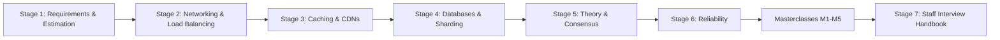

| Stage | Focus Domain | Core Concepts & Engineering Outcomes |
| :--- | :--- | :--- |
| **Stage 1** | **Foundations: Requirements, Estimation & Core Metrics** | Functional vs non-functional requirements, scale-up vs scale-out, p50/p99 latency and fan-out tail math, Little's Law (`L = λW`), M/M/1 queueing `1/(1-ρ)`, serial and parallel availability, error budgets, back-of-the-envelope QPS, storage and bandwidth. Outcome: a defensible one-page estimate for any product, checked by `internal/capacity`. |
| **Stage 2** | **Networking, Load Balancing & API Gateways** | DNS TTLs and Anycast, TCP and TLS 1.3 round trips, HTTP/1.1 vs HTTP/2 vs HTTP/3, L4 vs L7 balancing, round robin, nginx-style smooth weighted round robin, least connections, health checks and draining, consistent hashing with virtual nodes, token bucket and sliding-window limiters, `429` + `Retry-After`. Outcome: a rate-limited Go service that routes keys over a hash ring. |
| **Stage 3** | **Caching, CDNs & Edge Architectures** | Cache tiers and hit-ratio math, cache-aside, read/write-through, write-behind, LRU/LFU and Redis `maxmemory-policy`, invalidation races, stampede, penetration and avalanche defences, single-flight coalescing, XFetch early refresh, `Cache-Control`, `ETag`, `stale-while-revalidate`, Redis Cluster hash slots. Outcome: a cache-aside endpoint that survives a hot-key stampede. |
| **Stage 4** | **Databases, Replication, Sharding & Distributed Transactions** | SQL vs NoSQL families, range/hash/directory sharding and hotspots, two-phase commit vs sagas (orchestration and choreography), compensating actions, transactional outbox with CDC (Debezium reading the PostgreSQL WAL). |
| **Stage 5** | **Distributed Systems Theory & Consensus** | CAP and why "CA" is not a real option, PACELC classification of real stores, Raft leader election, log replication and majority commit, Raft vs Paxos. |
| **Stage 6** | **Reliability, Resilience & Failure Engineering** | Failure Mode and Effects Analysis, bulkheads, circuit breakers, graceful degradation. |
| **Masterclasses** | **IDs, URL shortener, chat, video, geospatial** | M1 Snowflake IDs, M2 URL shortener with a key generation service, M3 real-time chat over WebSockets and Cassandra, M4 HLS/DASH transcoding and adaptive bitrate, M5 ride dispatch with H3/S2/geohash cells. |
| **Stage 7** | **Staff Interview Handbook** | The 4-step interview framework, staff-level Q&As grouped by concept, internals, architecture and scenarios, and a dense cheatsheet of latency numbers and capacity constants. |

---

## 🆕 System Design Versions, What's New & Migration

System design has no single version number, but its defaults move: protocols get new RFCs, popular stores change licences or drop dependencies, and ID formats get standardised. This section tracks the changes that alter a design decision in late 2026, plus the toolchain the starter project needs.

### V.1 Release Timeline

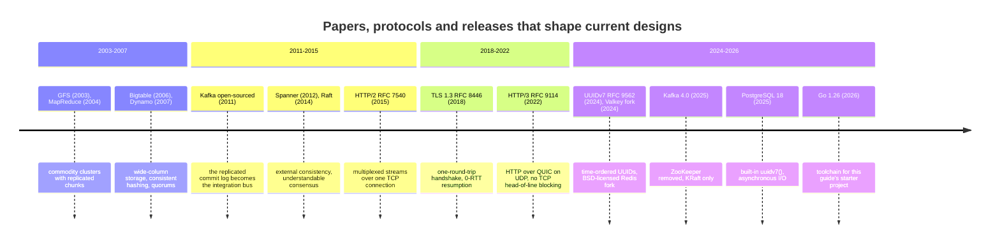

### V.2 Compatibility Matrix

| Technology | Version | Released | Status in late 2026 | Where this guide uses it |
| --- | --- | --- | --- | --- |
| HTTP | HTTP/1.1 (RFC 9112), HTTP/2 (RFC 9113), HTTP/3 (RFC 9114) | 2022 (current RFCs) | All three in production use; HTTP/3 enabled by default at major CDNs and in all current browsers | Stage 2.1 protocol comparison |
| TLS | 1.2 (RFC 5246), 1.3 (RFC 8446) | 2008, 2018 | 1.3 preferred, 1.2 still accepted; 1.0/1.1 deprecated by RFC 8996 | Stage 2.1 handshake cost |
| Apache Kafka | 3.9.x | Nov 2024 | Last line that supports ZooKeeper; the bridge release for migration | V.4 migration |
| Apache Kafka | 4.x | 2025 onward | Current stable; KRaft only | Stage 4 outbox, Stage 5 consensus |
| PostgreSQL | 13 | 2020 | End of life (Nov 2025) | Upgrade before using V.3 features |
| PostgreSQL | 18 | Sep 2025 | Current stable major | `uuidv7()`, M2 schema |
| Redis / Valkey | Redis 7.2 (BSD), Valkey 8.x (BSD), Redis 8 (AGPLv3 option) | 2023-2025 | All speak the same RESP protocol and commands used here | Stage 3.9 |
| Go | 1.26 | Feb 2026 | Current stable line used by the starter (`go.mod`) | All Go code |
| Docker images | `golang:1.26-alpine`, `gcr.io/distroless/static-debian12:nonroot` | 2026 | Maintained | `Dockerfile` |

### V.3 What's New in Current Practice

#### Time-ordered UUIDs for primary keys (UUIDv7, PostgreSQL 18)

Random UUIDv4 keys land on random B-tree pages, so every insert dirties a different page and the index stays cache-cold. UUIDv7 puts a 48-bit Unix millisecond timestamp first, so new keys append near the right edge of the index like a sequence would, while still being generated without coordination.

```sql
-- Before: random v4 keys, uniformly scattered inserts
CREATE TABLE orders_v4 (
    id         uuid PRIMARY KEY DEFAULT gen_random_uuid(),
    created_at timestamptz NOT NULL DEFAULT now()
);

-- After (PostgreSQL 18+): time-ordered v7 keys, append-mostly inserts
CREATE TABLE orders_v7 (
    id         uuid PRIMARY KEY DEFAULT uuidv7(),
    created_at timestamptz NOT NULL DEFAULT now()
);

-- The creation time is recoverable from the key itself.
SELECT id, uuid_extract_timestamp(id) FROM orders_v7 LIMIT 1;
```

#### Kafka without ZooKeeper (Kafka 4.0)

Kafka 4.0 removed ZooKeeper mode. Cluster metadata now lives in an internal Raft-replicated log managed by controller nodes (KRaft), which removes a second distributed system from the operating burden and speeds up controller failover.

```properties
# Before (Kafka 3.x, ZooKeeper mode): broker points at an external ensemble
broker.id=1
zookeeper.connect=zk1:2181,zk2:2181,zk3:2181/kafka
listeners=PLAINTEXT://:9092

# After (Kafka 4.x, KRaft): the node is broker and controller, no ZooKeeper
process.roles=broker,controller
node.id=1
controller.quorum.bootstrap.servers=kafka1:9093,kafka2:9093,kafka3:9093
listeners=PLAINTEXT://:9092,CONTROLLER://:9093
controller.listener.names=CONTROLLER
```

#### HTTP/3 at the edge

HTTP/2 multiplexes requests, but they still share one TCP stream, so one lost packet stalls all of them. HTTP/3 runs over QUIC on UDP, where each stream recovers independently and connection setup folds the transport and TLS handshakes together.

```nginx
# Before: HTTP/2 over TCP only (the "http2" listen parameter is deprecated since nginx 1.25.1)
server {
    listen 443 ssl http2;
    server_name example.com;
}

# After: HTTP/2 over TCP plus HTTP/3 over QUIC, advertised with Alt-Svc
server {
    listen 443 ssl;
    listen 443 quic reuseport;
    http2 on;
    server_name example.com;
    add_header Alt-Svc 'h3=":443"; ma=86400' always;
}
```

#### Method and wildcard routing in Go's standard library

Since Go 1.22, `net/http.ServeMux` matches the HTTP method and named path segments, so a small service no longer needs a third-party router. The starter's `internal/httpapi/server.go` relies on this.

```go
// Before: method checks and path parsing by hand
mux.HandleFunc("/v1/products/", func(w http.ResponseWriter, r *http.Request) {
	if r.Method != http.MethodGet {
		http.Error(w, "method not allowed", http.StatusMethodNotAllowed)
		return
	}
	id := strings.TrimPrefix(r.URL.Path, "/v1/products/")
	_ = id
})

// After: the pattern carries the method and a named wildcard
mux.HandleFunc("GET /v1/products/{id}", func(w http.ResponseWriter, r *http.Request) {
	id := r.PathValue("id") // 405 for other methods is automatic
	_ = id
})
```

#### Redis licensing and the Valkey fork

Redis moved from BSD to dual RSALv2/SSPL licensing with 7.4 (2024). The Linux Foundation forked the last BSD release as Valkey, and Redis 8 (2025) added AGPLv3 as a third option. For a design, the commands and data structures are the same; the choice is a licensing and vendor decision.

```yaml
# Before: compose service on the last BSD-licensed Redis line
services:
  cache:
    image: redis:7.2-alpine
    command: ["redis-server", "--maxmemory", "512mb", "--maxmemory-policy", "allkeys-lru"]

# After: Valkey, same flags and protocol
services:
  cache:
    image: valkey/valkey:8-alpine
    command: ["valkey-server", "--maxmemory", "512mb", "--maxmemory-policy", "allkeys-lru"]
```

### V.4 Migration Guide (Node starter v1.0.0 → Go starter, and infrastructure moves)

**This repo's starter.** Version 1.0.0 shipped a Node.js demo script. It is replaced by a Go service with real tests; the algorithms map one to one.

| Old file (removed) | New package | What changed |
| --- | --- | --- |
| `src/distributed/consistent-hash.mjs` | `internal/hashring` | 64-bit ring, mixed FNV hash, `GetN` replica lists, tests for 1/N key movement |
| `src/distributed/snowflake.mjs` | `internal/idgen` | Injectable clock, sequence-overflow and clock-rollback tests, `Decode` |
| `src/index.mjs` (console demo) | `cmd/server` + `internal/httpapi` | An HTTP service with `/health`, rate limiting and cache-aside |
| `tests/system-design.test.mjs` | `*_test.go` in every package | Tests exercise the shipped code instead of re-implementing it inline |

```bash
# Before
node --test tests/system-design.test.mjs
node src/index.mjs

# After
go test -race ./...
go run ./cmd/server          # then: curl localhost:8080/health
docker build -t learn-system-design . && docker run --rm -p 8080:8080 learn-system-design
```

**UUIDv4 to UUIDv7 keys (PostgreSQL 18).** Old rows keep their v4 values; both versions are valid `uuid` values, so the change is a default swap with no rewrite.

```sql
ALTER TABLE orders ALTER COLUMN id SET DEFAULT uuidv7();
```

**ZooKeeper to KRaft (Kafka).** You cannot jump from a ZooKeeper cluster straight to 4.x. Upgrade to 3.9.x, migrate the metadata, then upgrade.

```bash
# 1. On 3.9.x, read the existing cluster ID from ZooKeeper
bin/zookeeper-shell.sh zk1:2181 get /cluster/id

# 2. Format the new KRaft controllers with that same ID, then start them with
#    zookeeper.metadata.migration.enable=true and zookeeper.connect set
bin/kafka-storage.sh format --cluster-id <existing-id> --config config/controller.properties

# 3. Restart brokers with the migration flag and controller.quorum settings,
#    wait for the "migration completed" log, then restart them in KRaft mode,
#    remove the ZooKeeper settings, and only then upgrade to 4.x.
```

**Redis to Valkey without downtime.** Valkey can replicate from a Redis 7.2 primary, so you can move with a replica promotion.

```bash
valkey-cli -h new-node REPLICAOF old-redis 6379   # copy the dataset and follow changes
valkey-cli -h new-node INFO replication           # wait for master_link_status:up and offsets to match
valkey-cli -h new-node REPLICAOF NO ONE           # promote, then point clients at new-node
```

### V.5 Deprecations & Breaking Changes

| Version | Deprecated / removed | Replacement | What breaks and how to fix it |
| --- | --- | --- | --- |
| Kafka 4.0 | ZooKeeper mode | KRaft controllers | Brokers with `zookeeper.connect` will not start. Migrate on 3.9.x first (V.4). |
| RFC 8996 (2021) | TLS 1.0 and 1.1 | TLS 1.2 minimum, 1.3 preferred | Old clients fail the handshake. Set `ssl_protocols TLSv1.2 TLSv1.3;` and track client versions before removing 1.2. |
| Chrome 106 (2022) | HTTP/2 server push | `103 Early Hints`, `<link rel=preload>` | Pushed resources are ignored. Send `Link: </app.css>; rel=preload` in a 103 response instead. |
| RFC 9113 (2022) | RFC 7540 priority tree | RFC 9218 extensible priorities (`Priority: u=1`) | Servers may ignore old priority frames; rely on `Priority` headers. |
| nginx 1.25.1 | `listen ... http2` parameter | `http2 on;` directive | Deprecation warning at startup; move the setting as in V.3. |
| Redis 7.4 (2024) | BSD licence | Valkey (BSD), Redis 8 (AGPLv3 option) | No API break; a licence review may block upgrades past 7.2. |
| RFC 9562 (2024) | UUIDv1 recommended for new systems | UUIDv7 | v1 embeds a MAC address and a non-sortable time layout; switch defaults as in V.4. |
| PostgreSQL 13 | End of life Nov 2025 | PostgreSQL 17 or 18 | No more security fixes; plan a `pg_upgrade` or logical replication cut-over. |
| This repo 1.0.0 | Node.js demo starter | Go starter (`cmd/server`, `internal/...`) | `npm test` no longer exists; use `go test ./...`. |

---

## 📋 Table of Contents

- [1. Stage 1: Foundations: Requirements, Estimation & Core Metrics](#1-stage-1-foundations-requirements-estimation--core-metrics)
  - [1.1 What System Design Is and How a Design Is Built](#11-what-system-design-is-and-how-a-design-is-built)
  - [1.2 Running the Starter Project](#12-running-the-starter-project)
  - [1.3 Line-by-Line Breakdown of the Starter Server](#13-line-by-line-breakdown-of-the-starter-server)
  - [1.4 Functional and Non-Functional Requirements](#14-functional-and-non-functional-requirements)
  - [1.5 Vertical vs Horizontal Scaling](#15-vertical-vs-horizontal-scaling)
  - [1.6 Latency, Throughput and Percentiles](#16-latency-throughput-and-percentiles)
  - [1.7 Little's Law, Utilisation and Queueing](#17-littles-law-utilisation-and-queueing)
  - [1.8 Availability, the Nines, SLIs, SLOs and Error Budgets](#18-availability-the-nines-slis-slos-and-error-budgets)
  - [1.9 Back-of-the-Envelope Estimation](#19-back-of-the-envelope-estimation)
  - [1.10 Worked Estimate: A Photo-Sharing Platform](#110-worked-estimate-a-photo-sharing-platform)
  - [1.11 Pitfalls](#111-pitfalls)
  - [1.12 Best Practices](#112-best-practices)
  - [1.13 Hands-on Exercise](#113-hands-on-exercise)
- [2. Stage 2: Networking, Load Balancing & API Gateways](#2-stage-2-networking-load-balancing--api-gateways)
  - [2.1 The Request Path: DNS, TCP, TLS and HTTP Versions](#21-the-request-path-dns-tcp-tls-and-http-versions)
  - [2.2 DNS-Based Routing: TTLs, GeoDNS and Anycast](#22-dns-based-routing-ttls-geodns-and-anycast)
  - [2.3 Layer 4 vs Layer 7 Load Balancing](#23-layer-4-vs-layer-7-load-balancing)
  - [2.4 Load-Balancing Algorithms](#24-load-balancing-algorithms)
  - [2.5 Health Checks, Connection Draining and Failover](#25-health-checks-connection-draining-and-failover)
  - [2.6 Consistent Hashing and Virtual Nodes](#26-consistent-hashing-and-virtual-nodes)
  - [2.7 Reverse Proxies and API Gateways](#27-reverse-proxies-and-api-gateways)
  - [2.8 Rate Limiting Algorithms](#28-rate-limiting-algorithms)
  - [2.9 API Styles: REST, gRPC, GraphQL, WebSockets and Idempotency](#29-api-styles-rest-grpc-graphql-websockets-and-idempotency)
  - [2.10 Pitfalls](#210-pitfalls)
  - [2.11 Best Practices](#211-best-practices)
  - [2.12 Hands-on Exercise](#212-hands-on-exercise)
- [3. Stage 3: Caching, CDNs & Edge Architectures](#3-stage-3-caching-cdns--edge-architectures)
  - [3.1 The Caching Hierarchy and Hit-Ratio Math](#31-the-caching-hierarchy-and-hit-ratio-math)
  - [3.2 Read and Write Patterns: Cache-Aside, Read-Through, Write-Through, Write-Behind and Write-Around](#32-read-and-write-patterns-cache-aside-read-through-write-through-write-behind-and-write-around)
  - [3.3 Eviction Policies: LRU, LFU, TTL and Redis maxmemory](#33-eviction-policies-lru-lfu-ttl-and-redis-maxmemory)
  - [3.4 Invalidation and Consistency](#34-invalidation-and-consistency)
  - [3.5 Cache Failure Modes: Stampede, Penetration, Breakdown and Avalanche](#35-cache-failure-modes-stampede-penetration-breakdown-and-avalanche)
  - [3.6 Request Coalescing with Single-Flight](#36-request-coalescing-with-single-flight)
  - [3.7 Probabilistic Early Expiration (XFetch)](#37-probabilistic-early-expiration-xfetch)
  - [3.8 HTTP Caching and CDNs](#38-http-caching-and-cdns)
  - [3.9 Distributed Caches: Redis Cluster, Sentinel and Memcached](#39-distributed-caches-redis-cluster-sentinel-and-memcached)
  - [3.10 Pitfalls](#310-pitfalls)
  - [3.11 Best Practices](#311-best-practices)
  - [3.12 Hands-on Exercise](#312-hands-on-exercise)
- [4. Stage 4: Databases, Replication, Sharding & Distributed Transactions](#4-stage-4-databases-replication-sharding--distributed-transactions)
  - [4.1 Relational vs Non-Relational Data Models](#41-relational-vs-non-relational-data-models)
  - [4.2 Sharding Strategies](#42-sharding-strategies)
  - [4.3 Distributed Transactions: Two-Phase Commit vs Sagas](#43-distributed-transactions-two-phase-commit-vs-sagas)
  - [4.4 The Transactional Outbox Pattern with Change Data Capture](#44-the-transactional-outbox-pattern-with-change-data-capture)
  - [4.5 Orchestrated Saga Implementation](#45-orchestrated-saga-implementation)
- [5. Stage 5: Distributed Systems Theory & Consensus](#5-stage-5-distributed-systems-theory--consensus)
  - [5.1 The CAP Theorem and Why "CA" Is Not an Option](#51-the-cap-theorem-and-why-ca-is-not-an-option)
  - [5.2 The PACELC Theorem](#52-the-pacelc-theorem)
  - [5.3 Distributed Consensus: Raft vs Paxos](#53-distributed-consensus-raft-vs-paxos)
- [6. Stage 6: Reliability, Resilience & Failure Engineering](#6-stage-6-reliability-resilience--failure-engineering)
  - [6.1 Failure Mode and Effects Analysis (FMEA) in Architecture](#61-failure-mode-and-effects-analysis-fmea-in-architecture)
- [M1. Masterclass: Distributed Unique ID Generation](#m1-masterclass-distributed-unique-id-generation)
  - [M1.1 How It Works Internally](#m11-how-it-works-internally)
  - [M1.2 Complete Worked Example](#m12-complete-worked-example)
  - [M1.3 Trade-offs vs Alternatives](#m13-trade-offs-vs-alternatives)
  - [M1.4 Production Checklist](#m14-production-checklist)
- [M2. Masterclass: Designing a URL Shortener](#m2-masterclass-designing-a-url-shortener)
  - [M2.1 Requirements and Architecture](#m21-requirements-and-architecture)
  - [M2.2 The Key Generation Service](#m22-the-key-generation-service)
  - [M2.3 Data Model](#m23-data-model)
- [M3. Masterclass: Designing Real-Time Chat](#m3-masterclass-designing-real-time-chat)
  - [M3.1 Architecture](#m31-architecture)
  - [M3.2 Data Model (Cassandra CQL)](#m32-data-model-cassandra-cql)
- [M4. Masterclass: Designing a Video Streaming Pipeline](#m4-masterclass-designing-a-video-streaming-pipeline)
  - [M4.1 Upload and Transcoding Pipeline](#m41-upload-and-transcoding-pipeline)
  - [M4.2 Chunking and Adaptive Bitrate](#m42-chunking-and-adaptive-bitrate)
- [M5. Masterclass: Designing Geospatial Ride Dispatch](#m5-masterclass-designing-geospatial-ride-dispatch)
  - [M5.1 Architecture](#m51-architecture)
  - [M5.2 Spatial Cells: Geohash, S2 and H3](#m52-spatial-cells-geohash-s2-and-h3)
- [7. Stage 7: Staff System Design Architect Interview Handbook & Cheatsheet](#7-stage-7-staff-system-design-architect-interview-handbook--cheatsheet)
  - [7.1 Core Concepts (Q1-Q10)](#71-core-concepts-q1-q10)
  - [7.2 Internals & Performance (Q11-Q20)](#72-internals--performance-q11-q20)
  - [7.3 Architecture & Design (Q21-Q25)](#73-architecture--design-q21-q25)
  - [7.5 Staff Cheatsheet](#75-staff-cheatsheet)
- [🧪 Example Projects](#-example-projects)
- [📝 Cheat Sheets](#-cheat-sheets)
- [📚 Resources](#-resources)
- [🤝 Contributing](#-contributing)
- [📄 License](#-license)
- [🙏 Acknowledgments](#-acknowledgments)
- [🌐 Connect with me](#-connect-with-me)
- [☕ Support](#-support)

---

## 1. Stage 1: Foundations: Requirements, Estimation & Core Metrics

This stage covers what you decide before drawing a single box: what the system must do, how much load it carries, how fast and how available it must be, and what that costs in machines. It assumes you can read a little code and know what a server and a database are. By the end you can turn a vague prompt ("design Instagram") into numbers (QPS, storage, bandwidth, cache size, replica count) and defend each one, and you can run the starter service that computes them.

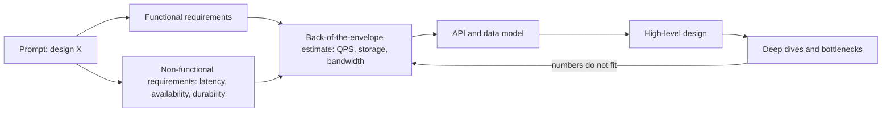

### 1.1 What System Design Is and How a Design Is Built

System design is choosing components, data layouts and communication patterns so that a product meets its requirements under real load and real failures, at a cost someone will pay. Code-level design asks "how do I structure this class?"; system design asks "how many copies of this service, where does the data live, and what happens when a machine or a network link dies?"

Every design, in an interview or a real design review, moves through the same loop shown above. The loop matters more than any single component: you estimate, sketch, find the part that does not fit the numbers, and go back. A design that skips estimation usually ends up over-built (a sharded cluster for 50 requests per second) or under-built (a single database for 200,000 writes per second).

| Question | Code-level design | System design |
| --- | --- | --- |
| Unit of design | Function, class, module | Service, datastore, queue, network hop |
| Main failure model | Exceptions, bugs | Machine crashes, partitions, overload, slow dependencies |
| Main constraint | Readability, correctness | Latency, throughput, availability, cost |
| How it is checked | Unit tests | Load tests, failure injection, capacity math |
| Typical output | Pull request | Design doc with estimates, diagrams, trade-offs |

The guide's starter project is a small Go service that implements the algorithms each early stage discusses. It is not a toy console demo: it serves HTTP, rate-limits clients, routes keys over a consistent-hash ring, issues Snowflake IDs and serves products cache-aside, and every behaviour is covered by tests.

### 1.2 Running the Starter Project

> **Which language do the examples use, and why?** System design is language-neutral, so infrastructure examples use each tool's own format: nginx config, SQL, CQL, Kafka properties, `redis-cli` and `curl`. Algorithms (consistent hashing, rate limiters, caches, Snowflake IDs) are written in **Go**, because most of the distributed infrastructure this guide discusses is built in Go (etcd and its Raft library, Kubernetes, Consul, CockroachDB, NATS), its standard library covers HTTP, concurrency and testing with no dependencies, and the race detector checks the concurrent code. Every Go snippet in Stages 1-3 is taken from the starter project in this repo and runs under `go test ./...`.

You need Go 1.26 or newer, or only Docker.

```bash
git clone https://github.com/TheLearningHubOrg/learn-system-design.git
cd learn-system-design

# Option A: Go toolchain
go test -race ./...              # every package's tests, with the race detector
go run ./cmd/server              # listens on 0.0.0.0:8080 (override with PORT)

# Option B: Docker only
docker build -t learn-system-design .
docker run --rm -p 8080:8080 learn-system-design

# Option C: run the tests without installing Go
docker run --rm -v "$PWD":/src -w /src golang:1.26-alpine go test ./...
```

With the server running, each endpoint maps to a section of this guide:

```bash
curl -s localhost:8080/health
# {"status":"ok"}

curl -s 'localhost:8080/v1/estimate?dau=500000000&reads=20&writes=0.1&object_bytes=200000&retention_days=1825'
# {"estimate":{"avg_read_qps":115740.74,"peak_read_qps":231481.48,"avg_write_qps":578.70, ...}}   (Stage 1.10)

curl -s localhost:8080/v1/route/user:42
# {"key":"user:42","owner":"cache-b","replicas":["cache-b","cache-c"]}                            (Stage 2.6)

curl -s 'localhost:8080/v1/ids?n=2'
# {"ids":[{"id":"375864552870383616","parts":{"time":"2026-11-03T04:31:32.63Z","node":1,"sequence":0}}, ...]}  (M1)

curl -si localhost:8080/v1/products/1 | grep X-Cache    # X-Cache: MISS  (Stage 3.2)
curl -si localhost:8080/v1/products/1 | grep X-Cache    # X-Cache: HIT
```

The repository layout follows the standard Go convention of one binary under `cmd/` and private packages under `internal/`:

```text
learn-system-design/
├── cmd/server/main.go          process entry point: config, HTTP server, graceful shutdown
├── internal/
│   ├── capacity/               Stage 1: estimates, availability, Little's Law, fan-out
│   ├── balancer/               Stage 2: round robin, smooth weighted, least connections
│   ├── hashring/               Stage 2: consistent hashing with virtual nodes
│   ├── ratelimit/              Stage 2: token bucket, sliding-window counter, per-client map
│   ├── cache/                  Stage 3: LRU with TTL, single-flight, XFetch, TTL jitter
│   ├── saga/                   Stage 4: orchestrated saga with compensations
│   ├── idgen/                  M1: Snowflake IDs
│   ├── geo/                    M5: geohash encoding
│   └── httpapi/                wires the packages into HTTP handlers
├── Dockerfile                  multi-stage build to a distroless, non-root image
└── .github/workflows/ci.yml    vet, gofmt, race tests, build, container smoke test
```

### 1.3 Line-by-Line Breakdown of the Starter Server

`cmd/server/main.go` is short, but almost every line encodes a production lesson that later stages rely on: bind to all interfaces, time out slow clients, and drain connections when the orchestrator says stop.

```go
func run(logger *slog.Logger) error {
	port := envOr("PORT", "8080")
	nodeID, err := strconv.ParseInt(envOr("NODE_ID", "1"), 10, 64)
	if err != nil {
		return err
	}
	var nodes []string
	if raw := os.Getenv("CACHE_NODES"); raw != "" {
		nodes = strings.Split(raw, ",")
	}

	handler, err := httpapi.New(httpapi.Config{CacheNodes: nodes, NodeID: nodeID, Logger: logger})
	if err != nil {
		return err
	}

	srv := &http.Server{
		Addr:              "0.0.0.0:" + port, // all interfaces, so the container port is reachable
		Handler:           handler,
		ReadHeaderTimeout: 5 * time.Second, // slow-loris protection
		ReadTimeout:       10 * time.Second,
		WriteTimeout:      10 * time.Second,
		IdleTimeout:       60 * time.Second,
	}

	// SIGTERM is what Docker and Kubernetes send before killing the process.
	ctx, stop := signal.NotifyContext(context.Background(), os.Interrupt, syscall.SIGTERM)
	defer stop()

	errc := make(chan error, 1)
	go func() {
		logger.Info("listening", "addr", srv.Addr, "node_id", nodeID)
		errc <- srv.ListenAndServe()
	}()

	select {
	case err := <-errc:
		return err
	case <-ctx.Done():
	}

	// Stop accepting connections and let in-flight requests finish.
	shutdownCtx, cancel := context.WithTimeout(context.Background(), 10*time.Second)
	defer cancel()
	if err := srv.Shutdown(shutdownCtx); err != nil {
		return err
	}
	if err := <-errc; !errors.Is(err, http.ErrServerClosed) {
		return err
	}
	logger.Info("shut down cleanly")
	return nil
}
```

| Line / API | Role | What happens at runtime |
| :--- | :--- | :--- |
| `envOr("PORT", "8080")` | Twelve-factor config | The same image runs on any port; the platform injects `PORT`. |
| `NODE_ID` | Identity for ID generation | Each replica must get a distinct value or Snowflake IDs collide (M1). |
| `"0.0.0.0:" + port` | Bind address | Listening on `localhost` inside a container makes the service unreachable from outside it. |
| `ReadHeaderTimeout` | Slow-client defence | A client that sends headers one byte a minute is cut off after 5 s instead of holding a connection forever. |
| `ReadTimeout` / `WriteTimeout` | Upper bound per request | Bounds how long a goroutine and its memory can be tied up by one request. |
| `IdleTimeout` | Keep-alive cap | Idle keep-alive connections are closed after 60 s so load balancers can rebalance. |
| `signal.NotifyContext(..., SIGTERM)` | Graceful stop trigger | The context is cancelled when the orchestrator asks the process to stop. |
| `srv.Shutdown(shutdownCtx)` | Connection draining | Closes listeners, waits for active requests up to 10 s, then returns. This is what makes rolling deploys lossless (Stage 2.5). |
| `errc` channel | Startup failure path | A port already in use returns immediately instead of hanging on `ctx.Done()`. |
| `slog.NewJSONHandler` (in `main`) | Structured logs | One JSON object per line, ready for a log pipeline. |

### 1.4 Functional and Non-Functional Requirements

Requirements come in two kinds, and the second kind drives the architecture.

- **Functional requirements** say what the system does: "a user can shorten a URL", "a rider can request a car".
- **Non-functional requirements** say how well: latency targets, availability, durability, consistency, throughput, cost, compliance.

Two products with identical functional requirements can need completely different designs. A URL shortener for an internal wiki and one for a global marketing platform both "shorten URLs"; one fits on a single Postgres instance, the other needs a CDN, a cache tier and a key generation service (M2).

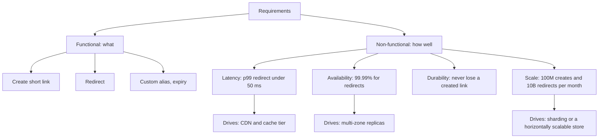

Write requirements so they can be tested. "Fast" cannot be checked; "p99 redirect latency under 50 ms measured at the load balancer" can.

| Vague | Testable | Design consequence |
| --- | --- | --- |
| "Fast" | p99 < 50 ms for reads at the edge | Reads must be served from memory or a CDN, not a cross-region database call |
| "Always up" | 99.99% monthly success rate on `GET /{code}` | The equivalent of about 4.3 minutes of total outage a month; needs redundancy in every tier |
| "Doesn't lose data" | RPO = 0 for created links | Synchronous replication or a quorum write before acknowledging |
| "Scales" | 10B redirects and 100M creates a month: about 3,800 average / 8,000 peak redirects/s, 40 average / 80 peak creates/s | Read-heavy (100:1): cache aggressively; writes fit on one primary |
| "Consistent" | A created link resolves everywhere within 1 s | Asynchronous replicas are acceptable if lag stays under 1 s |

Also write down what is **out of scope** (analytics dashboards, link previews). Scope cuts are the cheapest optimisation there is.

### 1.5 Vertical vs Horizontal Scaling

There are two ways to add capacity. **Vertical scaling** (scale up) moves the workload to a bigger machine. **Horizontal scaling** (scale out) adds more machines and spreads the work across them.

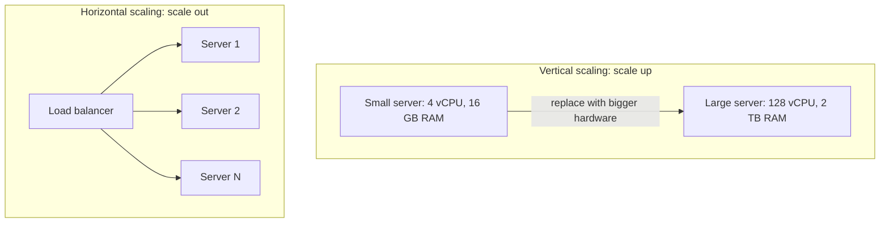

| Dimension | Vertical scaling (scale up) | Horizontal scaling (scale out) |
| :--- | :--- | :--- |
| **Mechanism** | More CPU, RAM and faster disks on one machine | More machines behind a load balancer or a partitioning scheme |
| **Downtime to scale** | Usually a restart or failover to the bigger machine | None if the service is stateless; rolling additions |
| **Ceiling** | Hard limit: the largest instance type you can buy | Practically far higher; limited by coordination and shared state |
| **Failure impact** | The machine is a single point of failure | Losing one of N machines removes 1/N of capacity |
| **Cost curve** | Linear at first, then steep at the top instance sizes | Roughly linear, plus the cost of load balancers and operations |
| **Software complexity** | None: the code does not change | The service must be stateless, or its state must be partitioned and replicated |

Scale up first when you can: it costs no engineering time, and current cloud instances with hundreds of cores and terabytes of RAM run surprisingly large workloads on one box, especially databases. Scale out when you hit the ceiling, when one machine is an unacceptable failure domain, or when load swings enough that elastic capacity saves money.

The precondition for scaling out a service is **statelessness**: any replica can serve any request because session data, uploads and caches live in shared stores (Redis, object storage, a database), not in one process's memory. The starter keeps its LRU cache in process on purpose, as a per-replica first tier (Stage 3.1); nothing breaks if a request lands on a replica whose cache is cold.

The **scale cube** names the three axes along which a system is split:

| Axis | Split by | Example | Section |
| --- | --- | --- | --- |
| X: clone | Run N identical copies | 10 stateless API replicas behind a load balancer | Stage 2 |
| Y: function | Split by responsibility | Separate checkout, search and media services | Stage 2.7 |
| Z: data | Split by key | Users A-M on shard 1, N-Z on shard 2 | Stage 4.2 |

### 1.6 Latency, Throughput and Percentiles

**Latency** is how long one request takes, from the client sending it to the client receiving the response. **Throughput** is how many requests (or bytes) the system completes per unit of time. They are related but independent: a factory can take 8 hours to build one car (latency) and still finish a car every minute (throughput) because many cars are on the line at once.

Averages hide the experience of real users. Latency distributions have long right tails (garbage collection pauses, cache misses, a retransmitted packet, a noisy neighbour), so systems are specified by **percentiles**:

| Percentile | Meaning | Use |
| --- | --- | --- |
| p50 (median) | Half of requests are faster | The typical experience; poor for SLOs |
| p95 | 1 in 20 requests is slower | Common dashboard line |
| p99 | 1 in 100 requests is slower | Typical SLO target for user-facing APIs |
| p99.9 | 1 in 1,000 requests is slower | Matters for high-volume or fan-out paths |
| max | The single worst request | Noisy; useful only for debugging |

The tail matters more than it looks because of **fan-out**. A page that calls 100 backends in parallel is as slow as the slowest of them. If each backend is slow (beyond its p99) 1% of the time, the chance that at least one of the 100 is slow is `1 - 0.99^100 ≈ 63%`. The backend's rare event becomes the user's common case. `internal/capacity` makes this concrete:

```go
// FanOutSlowProbability is the chance that a request which waits for n
// parallel backend calls sees at least one slow call, when each call is
// slow with probability p (p = 0.01 for "slower than p99").
func FanOutSlowProbability(p float64, n int) float64 {
	return 1 - math.Pow(1-p, float64(n))
}
```

```go
func TestFanOutSlowProbability(t *testing.T) {
	// One slow call in a hundred, fanned out to 100 backends: 63% of user
	// requests now see at least one p99-slow dependency.
	if got := FanOutSlowProbability(0.01, 100); !near(got, 0.634, 0.001) {
		t.Errorf("FanOutSlowProbability = %.3f, want 0.634", got)
	}
}
```

| Backends per request | p(at least one beyond its p99) | p(at least one beyond its p99.9) |
| --- | --- | --- |
| 1 | 1.0% | 0.1% |
| 10 | 9.6% | 1.0% |
| 50 | 39.5% | 4.9% |
| 100 | 63.4% | 9.5% |
| 1,000 | 99.996% | 63.2% |

Ways to fight tail latency, each covered later: cut fan-out (aggregate data ahead of time), **hedged requests** (send a second copy after the p95 deadline and take whichever answers first), timeouts with fallbacks, and caching the slow dependency.

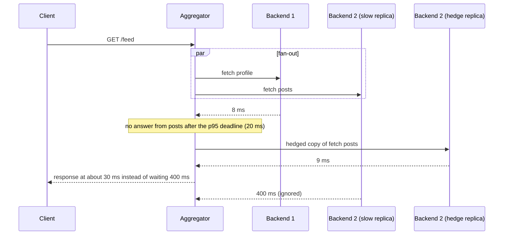

Hedging doubles load on the slowest requests only, typically adding a few percent of total traffic. It must only be used for idempotent reads.

### 1.7 Little's Law, Utilisation and Queueing

**Little's Law** links three numbers for any stable system: the average number of requests inside it (`L`), the arrival rate (`λ`) and the average time each request spends inside (`W`):

```text
L = λ × W
in-flight requests = arrivals per second × seconds per request
```

It needs no assumptions about distributions, which makes it the most useful formula in capacity planning. A service receiving 2,000 requests per second with a 150 ms average latency has `2,000 × 0.15 = 300` requests in flight on average. If each request holds a database connection for its whole life, you need about 300 connections plus headroom, which is how connection pool sizes should be chosen.

```go
// Concurrency applies Little's Law, L = lambda x W: the average number of
// requests in flight for a given arrival rate and time in the system.
func Concurrency(arrivalsPerSec float64, latency time.Duration) float64 {
	return arrivalsPerSec * latency.Seconds()
}
```

The second lesson is that latency is not flat as load grows. In the simplest queue model (M/M/1: random arrivals, one server), time in the system is the service time multiplied by `1 / (1 - ρ)`, where `ρ` is utilisation:

```go
// QueueingFactor is how many times longer than the bare service time a
// request spends in an M/M/1 queue at the given utilisation: 1/(1-rho).
// At 50% busy the wait doubles, at 90% it is ten times. It returns +Inf at
// or above 100%, where the queue grows without bound.
func QueueingFactor(utilisation float64) float64 {
	if utilisation >= 1 {
		return math.Inf(1)
	}
	return 1 / (1 - utilisation)
}
```

| Utilisation ρ | Latency multiplier `1/(1-ρ)` | A 10 ms service time becomes |
| --- | --- | --- |
| 50% | 2× | 20 ms |
| 70% | 3.3× | 33 ms |
| 80% | 5× | 50 ms |
| 90% | 10× | 100 ms |
| 95% | 20× | 200 ms |
| 99% | 100× | 1 s |

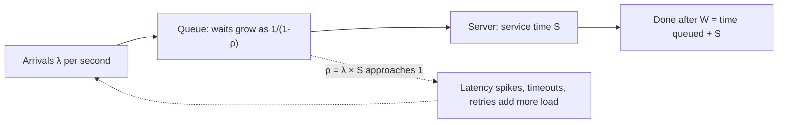

Real systems are not exactly M/M/1, but the shape holds: latency is flat until roughly 60-70% utilisation, then climbs steeply. This is why capacity plans target 50-70% peak utilisation, and why the dotted loop above (timeouts causing client retries, which add load) turns a busy system into an outage. Stage 2.8 (rate limiting) and Stage 6 (load shedding) break that loop.

### 1.8 Availability, the Nines, SLIs, SLOs and Error Budgets

Availability is the fraction of time, or of requests, for which the service works:

```text
availability = successful requests / valid requests       (request-based, preferred)
availability = uptime / (uptime + downtime)               (time-based)
```

| Availability | Downtime per year | Downtime per 30-day month | What it usually takes |
| :--- | :--- | :--- | :--- |
| **99% (two nines)** | 3.65 days | 7.2 hours | One server, manual recovery |
| **99.9% (three nines)** | 8.77 hours | 43.2 minutes | Redundant instances across zones, automated health checks |
| **99.99% (four nines)** | 52.6 minutes | 4.3 minutes | Automated failover in every tier, careful deploys, multi-zone data |
| **99.999% (five nines)** | 5.26 minutes | 26 seconds | Multi-region active-active, automated rollback; rarely justified end to end |

```go
// DowntimePerYear converts an availability fraction (0.999) into the outage
// budget it allows over an average year.
func DowntimePerYear(availability float64) time.Duration {
	return time.Duration((1 - availability) * float64(year))
}
```

**Composition is where designs go wrong.** Components a request passes through in sequence multiply their availabilities; redundant replicas, where any one suffices, multiply their *unavailabilities*:

```go
// Serial is the availability of components that must all work, such as a
// load balancer in front of an app in front of a database: the product.
func Serial(availabilities ...float64) float64 {
	p := 1.0
	for _, a := range availabilities {
		p *= a
	}
	return p
}

// Parallel is the availability of redundant replicas where any one is
// enough: one minus the chance that every replica is down at once. It
// assumes failures are independent, which shared racks, regions and
// deploys often break.
func Parallel(availabilities ...float64) float64 {
	allDown := 1.0
	for _, a := range availabilities {
		allDown *= 1 - a
	}
	return 1 - allDown
}
```

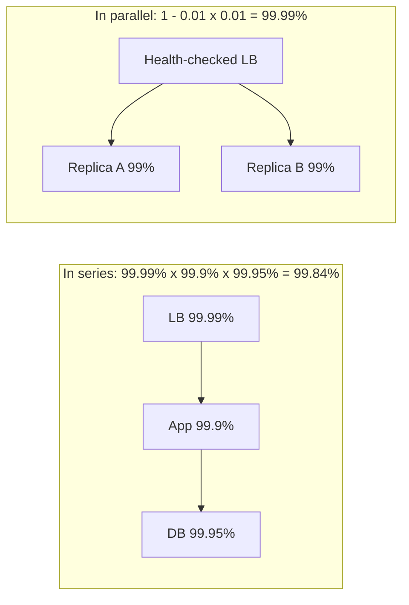

Three 99.9%-class components in series already give less than 99.9%. Two mediocre 99% replicas in parallel give 99.99%, *if their failures are independent*. Correlated failures (same rack, same bad deploy, same expired certificate) break that assumption, which is why redundancy must cross failure domains: zones, regions, deploy waves.

The vocabulary that turns these numbers into operations:

- **SLI (Service Level Indicator):** the measurement, for example "fraction of `GET /{code}` requests answered with a non-5xx status in under 50 ms".
- **SLO (Service Level Objective):** the internal target for an SLI over a window, for example "99.9% over 28 days".
- **SLA (Service Level Agreement):** a contract with customers, with credits or penalties if breached. SLAs are set looser than SLOs so you breach the SLO first and have time to react.
- **Error budget:** `1 - SLO`. A 99.9% SLO on 1 billion monthly requests allows 1 million failures. While budget remains, teams ship features; when it is spent, they freeze risky changes and fix reliability. The budget turns "how reliable?" from an argument into arithmetic.

| SLO (28 days) | Error budget | Allowed full-outage time | Budget burned by a 10-minute total outage |
| --- | --- | --- | --- |
| 99% | 1% | 6.7 hours | 2.5% of the budget |
| 99.9% | 0.1% | 40.3 minutes | 25% |
| 99.95% | 0.05% | 20.2 minutes | 50% |
| 99.99% | 0.01% | 4.0 minutes | 250%: the budget is gone |

### 1.9 Back-of-the-Envelope Estimation

Estimation is not about precision; it is about the order of magnitude, because that decides the architecture. 500 writes per second and 50,000 writes per second need different systems; 500 and 700 do not. Round aggressively and say so.

**Constants to memorise:**

| Quantity | Exact | Use in your head |
| --- | --- | --- |
| Seconds per day | 86,400 | 10^5 (about 15% high, which is a safe direction) |
| Seconds per month | 2.6 million | 2.5 × 10^6 |
| 1 million requests/day | 11.6 per second | about 12 QPS |
| 100 million requests/day | 1,157 per second | about 1,200 QPS |
| 1 billion requests/day | 11,574 per second | about 12,000 QPS |
| Peak-to-average ratio | product dependent | 2-5× (higher for event-driven traffic) |
| 2^10 / 2^20 / 2^30 / 2^40 | 1,024 / ~1.05M / ~1.07B / ~1.1T | 10^3 / 10^6 / 10^9 / 10^12 |

**Latency orders of magnitude** (current hardware, rounded; exact values vary by generation):

| Operation | Approximate time | Relative to a memory read |
| --- | --- | --- |
| L1 cache hit | 1 ns | 0.01× |
| Main memory read | 100 ns | 1× |
| Compress 1 KB with a fast codec (zstd/lz4) | 1-3 µs | 10-30× |
| Read 4 KB randomly from NVMe SSD | 20-100 µs | 200-1,000× |
| Round trip within one data centre | 100-500 µs | 1,000-5,000× |
| Read 1 MB sequentially from NVMe SSD | 100-300 µs | 1,000-3,000× |
| HDD seek | 5-10 ms | 50,000-100,000× |
| Round trip between continents | 70-200 ms | about a million× |

Three conclusions fall out of this table and recur in every stage: memory is about a thousand times faster than a network hop, a network hop inside a data centre is cheap compared with one across an ocean, and disks seek slowly, so sequential I/O (logs, LSM trees) beats random I/O.

**The estimation recipe:**

1. Users: DAU, and the fraction that writes.
2. Requests: actions per user per day ÷ 10^5 = average QPS; multiply by the peak factor.
3. Storage: writes per day × object size × retention × replication factor.
4. Bandwidth: peak read QPS × response size (× 8 for bits).
5. Memory for cache: the hot fraction (often 20% of daily reads cover 80% of traffic) × object size.
6. Machines: peak load ÷ per-machine capacity at 50-70% utilisation (Stage 1.7).

`internal/capacity` encodes steps 2-4 so the arithmetic is checked rather than recalled:

```go
// Estimate turns a workload into request rates, storage and bandwidth.
func (w Workload) Estimate() Estimate {
	peak := orDefault(w.PeakToAverage, 2)
	retention := orDefault(w.RetentionDays, 365)
	copies := orDefault(w.Replication, 3)

	reads := w.DailyActiveUsers * w.ReadsPerUserDay / SecondsPerDay
	writes := w.DailyActiveUsers * w.WritesPerUserDay / SecondsPerDay
	ingest := w.DailyActiveUsers * w.WritesPerUserDay * w.ObjectBytes

	return Estimate{
		AvgReadQPS:        reads,
		PeakReadQPS:       reads * peak,
		AvgWriteQPS:       writes,
		PeakWriteQPS:      writes * peak,
		IngestBytesPerDay: ingest,
		StorageBytes:      ingest * retention * copies,
		PeakEgressBitsSec: reads * peak * w.ObjectBytes * 8,
	}
}
```

| Field | Formula | Why it matters |
| --- | --- | --- |
| `AvgReadQPS` | DAU × reads/user ÷ 86,400 | Sizes the read path and the cache |
| `PeakReadQPS` | average × peak factor | Machines are sized for peak, not average |
| `IngestBytesPerDay` | DAU × writes/user × object size | Daily growth; drives storage tier choice |
| `StorageBytes` | ingest × retention × copies | Replication (usually 3) triples raw storage |
| `PeakEgressBitsSec` | peak reads × size × 8 | Network cards and CDN bills are priced in bits per second |

### 1.10 Worked Estimate: A Photo-Sharing Platform

**Prompt:** 500 million DAU. Each user views 20 photos a day. 10% of users upload one photo a day. Average photo 200 KB, metadata 500 bytes per photo. Keep everything for 5 years with 3 copies.

| Metric | Derivation | Result |
| :--- | :--- | :--- |
| **Average read QPS** | 500 × 10^6 × 20 ÷ 86,400 | **about 116,000 QPS** (the 10^5 shortcut gives 100,000) |
| **Peak read QPS (2×)** | 116,000 × 2 | **about 230,000 QPS** |
| **Average write QPS** | 50 × 10^6 × 1 ÷ 86,400 | **about 580 QPS**; reads outnumber writes 200:1 |
| **Photo ingest per day** | 50 × 10^6 × 200 KB | **10 TB/day** |
| **Metadata per day** | 50 × 10^6 × 500 B | **25 GB/day**: fits a relational database for years |
| **5-year photo storage, 3 copies** | 10 TB × 1,825 × 3 | **about 55 PB**: object storage, not a database |
| **Peak egress** | 230,000 × 200 KB × 8 | **about 370 Gbit/s**: only a CDN can serve this |
| **Cache for hot photos** | photos from the last 2 days = 100M; cache the hottest 20% = 20M × 200 KB | **4 TB of RAM** across a cache cluster, or let the CDN hold it |

Run the same numbers through the starter, which the tests pin (`internal/capacity/capacity_test.go`):

```bash
curl -s 'localhost:8080/v1/estimate?dau=500000000&reads=20&writes=0.1&object_bytes=200000&retention_days=1825&replication=3'
```

**What the numbers decide:**

- 200:1 read-to-write ratio: optimise reads. Photos go to object storage behind a CDN; the origin should see only CDN misses.
- 580 writes/s of metadata: one well-sized relational primary handles it. Sharding is not needed on day one; plan the shard key (user ID) anyway.
- 55 PB: tiered object storage with lifecycle rules (hot for 30 days, infrequent-access afterwards) cuts cost more than any compute optimisation.
- 370 Gbit/s egress: a CDN contract is a first-order architectural component, not an afterthought.

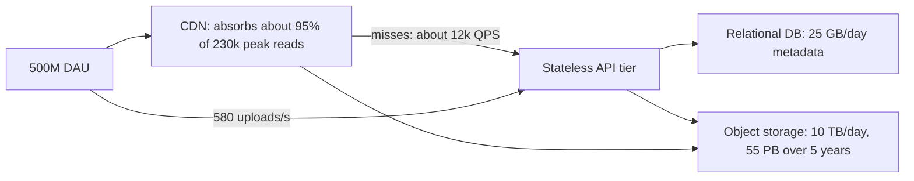

### 1.11 Pitfalls

| Pitfall | Symptom | Fix |
| --- | --- | --- |
| Designing before estimating | A sharded multi-region design for 30 QPS, or one database for 200k writes/s | Do the five-line estimate first; let numbers pick components |
| Sizing for average load | Fine at noon, `503 Service Unavailable` and timeouts during the evening peak | Multiply by a peak factor (2-5×) and size for 50-70% utilisation at peak |
| Reporting mean latency | Dashboard says 40 ms while users complain; p99 is 2 s | Track p50, p99 and p99.9 per endpoint; alert on p99 |
| Running hot (85-95% CPU) | Latency climbs non-linearly, retries amplify load, cascade | Keep headroom (Stage 1.7); autoscale on utilisation well below 100% |
| Assuming independent failures | "Two replicas, so 99.99%" yet both die together | Spread replicas across zones and deploy waves; model shared dependencies in series |
| Forgetting replication in storage math | Storage budget off by 3× | Multiply by the replication factor and by index and metadata overhead (10-30%) |
| SLO equal to SLA | Every SLO miss is a contractual breach | Keep the internal SLO stricter than the SLA |
| Binding to `localhost` in a container | `curl: (52) Empty reply from server` or connection refused from the host | Bind `0.0.0.0` (see `cmd/server/main.go`) |
| No server timeouts | Goroutine and memory growth under slow clients; `too many open files` | Set `ReadHeaderTimeout`, `ReadTimeout`, `WriteTimeout`, `IdleTimeout` |

### 1.12 Best Practices

- **Write requirements as measurable statements:** "p99 < 50 ms" can be tested and alerted on; "fast" cannot.
- **Round to one significant figure and state it:** the architecture depends on the order of magnitude, and rounding keeps attention there.
- **Size for peak at 50-70% utilisation:** queueing delay explodes past that point.
- **Use request-based SLIs:** they weigh an outage at peak more than one at 3 a.m., which matches user impact.
- **Spend error budgets deliberately:** they make the speed-versus-reliability trade-off explicit and shared between product and engineering.
- **Scale up before scaling out, but design for scale-out:** keep services stateless from the start so the switch is a deployment change, not a rewrite.
- **Put redundancy across failure domains:** two replicas in one rack protect against a disk failure, not a top-of-rack switch failure.
- **Drain on SIGTERM:** graceful shutdown is what makes rolling deploys invisible to users.

### 1.13 Hands-on Exercise

**Task.** Estimate a messaging app: 200 million DAU, each user sends 40 messages a day and receives 120, average message 300 bytes, retained 2 years, 3 copies, peak factor 3. Then compute the in-flight request count for the send path if a send takes 80 ms, and the end-to-end availability if a send passes through an LB (99.99%), the chat service (99.95%) and a database (99.95%).

1. Run the estimate through `GET /v1/estimate` (use `reads=120`, `writes=40`).
2. Add a test case to `internal/capacity/capacity_test.go` that pins your answers.
3. Use `Concurrency` and `Serial` for the last two numbers.

**Expected output (rounded):**

| Metric | Value |
| --- | --- |
| Average send QPS | about 93,000 |
| Peak send QPS | about 280,000 |
| Peak receive QPS | about 830,000 |
| Ingest per day | 2.4 TB |
| Storage for 2 years, 3 copies | about 5.3 PB |
| In-flight sends at peak (`Concurrency(280000, 80ms)`) | about 22,000 |
| Serial availability | about 99.89%: worse than any single component |

**Where the solution lives.** The formulas are in `internal/capacity/capacity.go`; `TestPhotoSharingEstimate` in `internal/capacity/capacity_test.go` shows the table-driven test pattern to copy.

[Back to top ⤴️](#-table-of-contents)

---

## 2. Stage 2: Networking, Load Balancing & API Gateways

This stage follows a request from the user's device to your service: name resolution, connection setup, the load balancer that picks a backend, and the gateway that authenticates and rate-limits it. It builds on the latency and availability math from Stage 1. Afterwards you can choose between L4 and L7 balancing, pick a balancing algorithm for a given workload, explain why consistent hashing moves only 1/N of keys, and implement a rate limiter that returns correct `429` responses; the starter implements all of these.

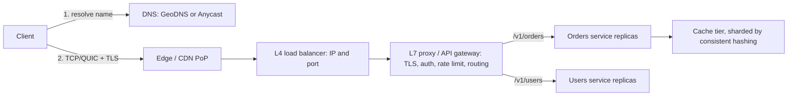

### 2.1 The Request Path: DNS, TCP, TLS and HTTP Versions

Network latency is dominated by round trips, not bandwidth. A user 100 ms away from your server pays 100 ms for every exchange that must complete before the next can start, so the number of round trips in connection setup is a design parameter.

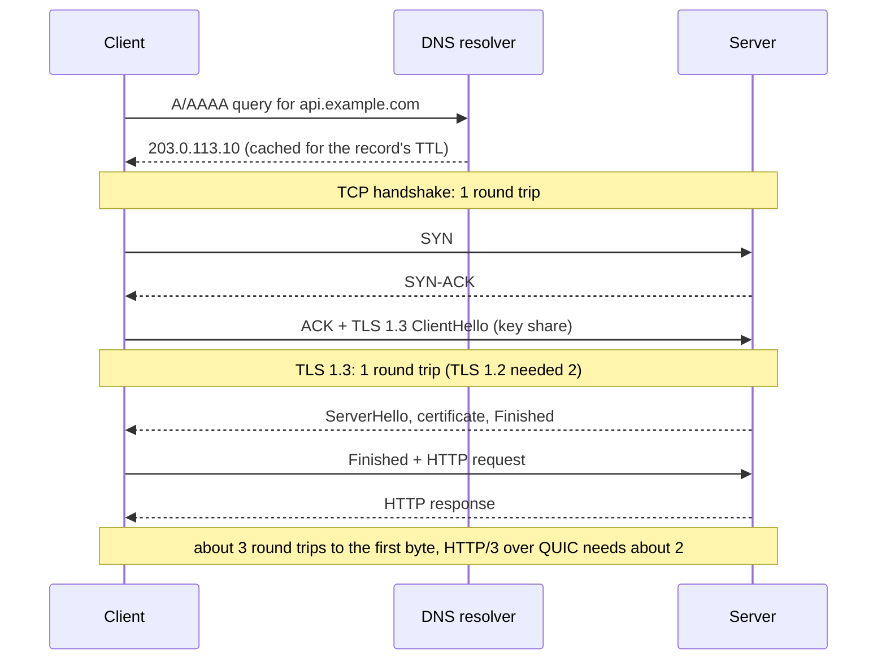

| Setup step | Round trips | How to avoid paying it |
| --- | --- | --- |
| DNS lookup | 0-1 (cached or not) | Long-enough TTLs, resolver caching, `dns-prefetch` hints |
| TCP handshake | 1 | Connection reuse (keep-alive), pooling between services |
| TLS 1.2 handshake | 2 | Upgrade to TLS 1.3 |
| TLS 1.3 handshake | 1 (0 on resumption with 0-RTT) | Session resumption; 0-RTT only for idempotent requests, because 0-RTT data can be replayed |
| QUIC (HTTP/3) | 1 for transport and TLS together, 0 on resumption | Enable HTTP/3 at the edge (V.3) |

The OSI model is a vocabulary for *where* a component looks at traffic, which is what separates the load balancer types in 2.3:

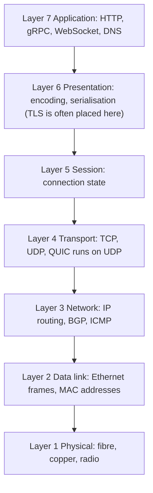

**HTTP versions compared:**

| | HTTP/1.1 | HTTP/2 | HTTP/3 |
| --- | --- | --- | --- |
| Transport | TCP | TCP | QUIC over UDP |
| Requests per connection | One at a time (pipelining is unused in practice) | Many concurrent streams | Many concurrent streams |
| Head-of-line blocking | At HTTP level | Removed at HTTP level, still present at TCP level | Removed: each stream recovers its own losses |
| Header compression | None | HPACK | QPACK |
| Connection migration (Wi-Fi to mobile) | No | No | Yes, via connection IDs |
| Typical use | Simple clients, internal tools | Browsers, gRPC between services | Browsers and mobile apps on lossy networks |

Browsers open about 6 connections per host under HTTP/1.1 to work around one-request-at-a-time; HTTP/2 and HTTP/3 use one connection, which is why domain sharding tricks from the HTTP/1.1 era now hurt performance.

### 2.2 DNS-Based Routing: TTLs, GeoDNS and Anycast

DNS is the first load balancer a request meets. Three techniques steer users at that level:

| Technique | How it works | Failover speed | Typical use |
| --- | --- | --- | --- |
| **Round-robin DNS** | The name returns several A/AAAA records; clients pick one | Slow: clients and resolvers cache records for the TTL, and some ignore it | Spreading load across a few entry points |
| **GeoDNS / latency-based DNS** | The authoritative server answers differently depending on the resolver's location or measured latency | TTL-bound (30-300 s typical) | Sending users to the nearest region |
| **Anycast** | The same IP prefix is announced over BGP from many locations; the internet routes each packet to the topologically nearest one | Seconds: BGP withdraws a failed site's route | CDNs, public DNS resolvers, DDoS absorption |

```bash
# See the records, TTL and which address you were given
dig +noall +answer api.example.com A
# api.example.com.  60  IN  A  203.0.113.10
# api.example.com.  60  IN  A  203.0.113.11

# Ask a specific resolver to compare GeoDNS answers from different vantage points
dig @1.1.1.1 +short api.example.com
dig @8.8.8.8 +short api.example.com

# Follow the delegation chain from the root to find a misconfigured hop
dig +trace api.example.com
```

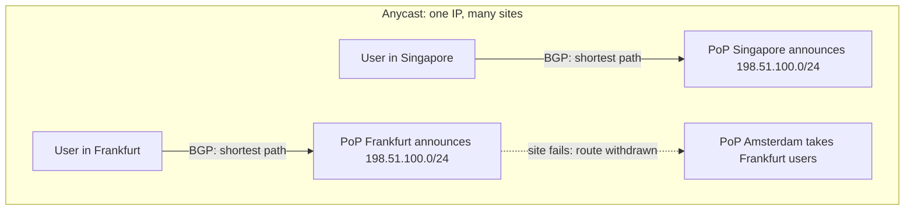

**TTL trade-off.** A low TTL (30-60 s) makes DNS failover and traffic shifts fast but multiplies query volume and adds lookups to cold clients. A high TTL (hours) is cheap but strands users on a dead address. Lower the TTL a day *before* a planned migration, because resolvers still hold the old long TTL until it expires.

### 2.3 Layer 4 vs Layer 7 Load Balancing

A **Layer 4** load balancer forwards connections based on IP addresses and ports without reading the payload. A **Layer 7** load balancer terminates the connection, parses HTTP (or gRPC), and routes each request based on its content. Large systems usually use both: L4 in front for raw connection distribution and DDoS resistance, L7 behind it for routing.

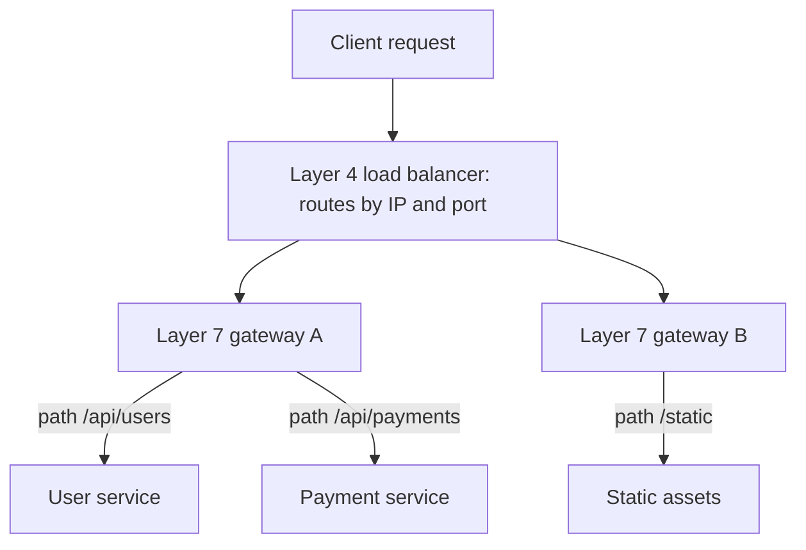

| Dimension | Layer 4 (transport) | Layer 7 (application) |
| :--- | :--- | :--- |
| **What it inspects** | Source/destination IP and port | Method, path, headers, cookies, gRPC service name |
| **TLS** | Passes encrypted bytes through (or terminates TLS without reading HTTP) | Terminates TLS and reads plaintext requests |
| **Routing** | Per connection | Per request: path, header, canary percentage |
| **Long-lived connections** | One busy connection stays on one backend | Can spread requests from one HTTP/2 connection over many backends |
| **Cost per request** | Very low; can run in the kernel (IPVS, eBPF/XDP) | Higher: TLS, parsing, buffering |
| **Features** | Connection limits, source-IP stickiness | Retries, rewriting, auth, rate limiting, compression, observability |
| **Examples** | AWS NLB, Google Cloud Network LB, Linux IPVS, HAProxy in TCP mode | AWS ALB, nginx, Envoy, HAProxy in HTTP mode, Traefik |

The long-lived connection row is the trap most often missed: gRPC multiplexes all calls over one HTTP/2 connection, so an L4 balancer pins all of a client's traffic to one backend. gRPC needs an L7 proxy (Envoy, a service mesh) or client-side balancing.

### 2.4 Load-Balancing Algorithms

The algorithm decides which healthy backend gets the next request. `internal/balancer` implements the three most used ones.

**Round robin** cycles through backends. It is right when backends are identical and requests cost about the same. The starter's version is lock-free: one atomic counter is the only shared state.

```go
// Pick returns the next backend in the rotation.
func (r *RoundRobin) Pick() string {
	n := r.next.Add(1) - 1
	return r.backends[n%uint64(len(r.backends))]
}
```

**Smooth weighted round robin** handles backends of different sizes. Naive weighting (send 5 in a row to the big server, then 1 to each small one) creates bursts. nginx's algorithm interleaves them:

```go
// Pick raises every peer's score by its weight, chooses the highest score
// and lowers the winner by the total weight.
func (s *SmoothWeighted) Pick() string {
	s.mu.Lock()
	defer s.mu.Unlock()
	var best *peer
	for _, p := range s.peers {
		p.current += p.weight
		if best == nil || p.current > best.current {
			best = p
		}
	}
	best.current -= s.total
	return best.name
}
```

| Pick | Scores before (a=5, b=1, c=1) | After adding weights | Winner | Winner minus total (7) |
| --- | --- | --- | --- | --- |
| 1 | 0, 0, 0 | 5, 1, 1 | a | -2, 1, 1 |
| 2 | -2, 1, 1 | 3, 2, 2 | a | -4, 2, 2 |
| 3 | -4, 2, 2 | 1, 3, 3 | b | 1, -4, 3 |
| 4 | 1, -4, 3 | 6, -3, 4 | a | -1, -3, 4 |
| 5 | -1, -3, 4 | 4, -2, 5 | c | 4, -2, -2 |
| 6 | 4, -2, -2 | 9, -1, -1 | a | 2, -1, -1 |
| 7 | 2, -1, -1 | 7, 0, 0 | a | 0, 0, 0 |

After 7 picks (the sum of weights) every score is back to zero and the sequence `a a b a c a a` repeats; `TestSmoothWeightedMatchesNginxSequence` pins it.

**Least connections** sends each request to the backend with the fewest requests in flight. It adapts when request costs vary (a report query next to a health check) or when one backend is slower, because slow backends accumulate in-flight requests and stop being picked.

```go
// Acquire picks the least-loaded backend (ties go to the earliest in the
// list) and returns a function that marks the request as finished.
func (l *LeastConnections) Acquire() (backend string, release func()) {
	l.mu.Lock()
	defer l.mu.Unlock()
	best := l.order[0]
	for _, b := range l.order[1:] {
		if l.active[b] < l.active[best] {
			best = b
		}
	}
	l.active[best]++
	var once sync.Once
	return best, func() {
		once.Do(func() {
			l.mu.Lock()
			l.active[best]--
			l.mu.Unlock()
		})
	}
}
```

| Line / API | Role | What happens at runtime |
| --- | --- | --- |
| `l.mu.Lock()` | One critical section for read and increment | Two concurrent requests cannot both see the same backend as least loaded and both pick it |
| `l.active[best]++` | Count the request before it starts | The next caller already sees the new load |
| `release` closure | Caller-owned completion | Must be called (usually `defer release()`), or the backend looks busy forever |
| `sync.Once` | Idempotent release | A double `release()` in an error path cannot drive the count negative |

| Algorithm | Best for | Weakness |
| --- | --- | --- |
| Round robin | Identical backends, uniform requests | Ignores current load and slow backends |
| Weighted round robin | Mixed instance sizes, canary at 5% | Static weights do not react to slowness |
| Least connections | Variable request cost, long requests | Needs shared state; a fast-failing backend (instant 500s) looks idle and attracts traffic |
| Power of two choices | Large fleets with many balancers | Picks two random backends and takes the less loaded; near least-connections quality without global state |
| Hash (source IP, header, key) | Stickiness, cache locality | Uneven if keys are skewed; use consistent hashing (2.6) so scaling moves few keys |
| Least response time / EWMA | Heterogeneous latency | Needs latency tracking; can oscillate |

The weakness of least connections in the table is a real outage pattern: a backend that fails every request in 1 ms has almost no requests in flight, so it receives most traffic. Health checks and outlier ejection (2.5) are the defence.

### 2.5 Health Checks, Connection Draining and Failover

A load balancer is only as good as its knowledge of which backends work.

- **Active health checks:** the balancer calls an endpoint (`GET /health`) every few seconds and removes a backend after N failures.
- **Passive health checks (outlier detection):** the balancer watches real traffic and ejects a backend that returns too many errors or timeouts.
- **Liveness vs readiness:** *liveness* answers "should this process be restarted?"; *readiness* answers "should it receive traffic right now?". A service that is warming its cache or has lost its database connection is alive but not ready.

The starter's `/health` is deliberately cheap and exempt from rate limiting, so a throttled client cannot get the instance marked unhealthy:

```go
func (s *server) rateLimit(next http.Handler) http.Handler {
	return http.HandlerFunc(func(w http.ResponseWriter, r *http.Request) {
		if r.URL.Path == "/health" {
			next.ServeHTTP(w, r)
			return
		}
		ok, wait := s.limiter.Allow(s.clientIP(r))
		if !ok {
			w.Header().Set("Retry-After", strconv.Itoa(int(math.Ceil(wait.Seconds()))))
			writeError(w, http.StatusTooManyRequests, "rate limit exceeded")
			return
		}
		next.ServeHTTP(w, r)
	})
}
```

An nginx upstream with passive health checks, bounded retries and connection reuse (open-source nginx has passive checks only; active `health_check` is an nginx Plus feature):

```nginx
upstream api {
    least_conn;
    server 10.0.1.10:8080 max_fails=3 fail_timeout=10s;   # 3 failures in 10 s: out for 10 s
    server 10.0.1.11:8080 max_fails=3 fail_timeout=10s;
    server 10.0.1.12:8080 backup;                         # only used when the others are down
    keepalive 64;                                         # idle upstream connections kept per worker
}

server {
    listen 80;
    location / {
        proxy_pass http://api;
        proxy_http_version 1.1;
        proxy_set_header Connection "";                   # required for upstream keep-alive
        proxy_connect_timeout 1s;
        proxy_read_timeout 5s;
        proxy_next_upstream error timeout http_502 http_503;
        proxy_next_upstream_tries 2;                      # at most one retry on another backend
        # POST and other non-idempotent requests are not retried unless you add non_idempotent.
    }
}
```

**Connection draining** removes a backend without dropping requests. The sequence during a rolling deploy:

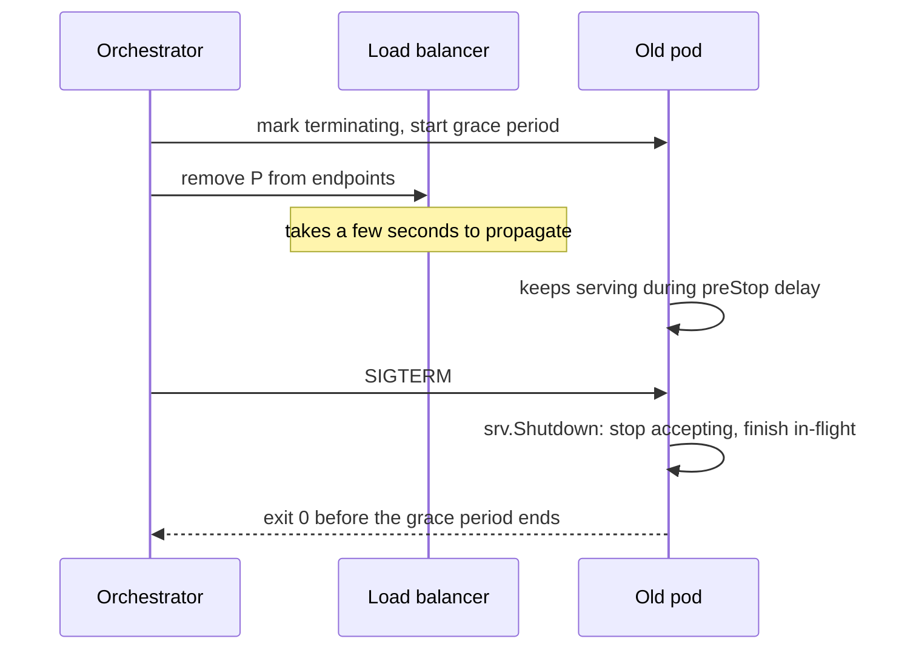

In Kubernetes the readiness probe, a short pre-stop pause and the grace period implement this. The pause covers the time it takes for endpoint removal to reach every proxy; without it, proxies keep sending to a process that is already shutting down.

```yaml
apiVersion: apps/v1
kind: Deployment
metadata:
  name: system-design-api
spec:
  replicas: 3
  selector:
    matchLabels: { app: system-design-api }
  template:
    metadata:
      labels: { app: system-design-api }
    spec:
      terminationGracePeriodSeconds: 30
      containers:
        - name: api
          image: learn-system-design:latest
          ports: [{ containerPort: 8080 }]
          readinessProbe:
            httpGet: { path: /health, port: 8080 }
            periodSeconds: 5
            failureThreshold: 2
          livenessProbe:
            httpGet: { path: /health, port: 8080 }
            periodSeconds: 10
            failureThreshold: 3
          lifecycle:
            preStop:
              sleep: { seconds: 5 }   # built-in sleep action (Kubernetes 1.30+); the distroless image has no shell
```

### 2.6 Consistent Hashing and Virtual Nodes

To spread keys over N cache or storage nodes, the obvious rule is `node = hash(key) mod N`. It distributes evenly, but changing N remaps almost everything: going from 3 to 4 nodes keeps a key in place only when `h mod 3 == h mod 4`, which holds for about a quarter of keys. Three quarters of the cache misses at once and the database takes the full load. `TestModuloHashingMovesMostKeys` measures this.

**Consistent hashing** places nodes and keys on the same circular hash space. A key belongs to the first node found walking clockwise from the key's position. Adding a node only takes over the arc between it and its predecessor; removing a node hands its arc to its successor. On average only `1/N` of keys move.

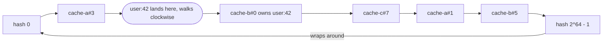

With one point per node, arcs are uneven and one node can own half the ring. **Virtual nodes** fix this: each physical node is hashed onto the ring many times (`cache-a#0` … `cache-a#159`), so each owns many small arcs whose total approaches `1/N`. Virtual nodes also let a bigger machine take more points, and when a node fails its load spreads over all the others rather than landing on one neighbour.

```go
// Add places a node on the ring. Adding a node twice is a no-op.
func (r *Ring) Add(node string) {
	r.mu.Lock()
	defer r.mu.Unlock()
	if _, ok := r.nodes[node]; ok {
		return
	}
	r.nodes[node] = struct{}{}
	for i := range r.replicas {
		r.points = append(r.points, point{hashKey(node + "#" + strconv.Itoa(i)), node})
	}
	slices.SortFunc(r.points, func(a, b point) int { return cmp.Compare(a.hash, b.hash) })
}

// Get returns the node that owns key, or false when the ring is empty.
func (r *Ring) Get(key string) (string, bool) {
	r.mu.RLock()
	defer r.mu.RUnlock()
	if len(r.points) == 0 {
		return "", false
	}
	i, _ := slices.BinarySearchFunc(r.points, hashKey(key), comparePoint)
	if i == len(r.points) {
		i = 0 // past the largest hash: wrap around to the start of the ring
	}
	return r.points[i].node, true
}
```

| Line / API | Role | What happens at runtime |
| --- | --- | --- |
| `node + "#" + strconv.Itoa(i)` | Virtual node label | 160 distinct positions per physical node |
| `hashKey` (FNV-1a + SplitMix64 finaliser) | Uniform 64-bit positions | FNV alone clusters labels that differ in the last character; the finaliser spreads them |
| `slices.SortFunc` | Keep points ordered | Sorting happens on membership changes, which are rare, so lookups stay cheap |
| `slices.BinarySearchFunc` | Find first point ≥ key hash | O(log V) for V virtual nodes: about 9 comparisons for 480 points |
| `i == len(r.points)` → `0` | Ring wrap-around | A key hashed past the last point belongs to the first one |
| `sync.RWMutex` | Many readers, rare writers | Lookups run in parallel; membership changes take the write lock |

`GetN` walks further clockwise and collects distinct physical nodes; this is the Dynamo-style *preference list* that decides where a key's replicas live. The starter's `/v1/route/{key}` returns both:

```bash
curl -s localhost:8080/v1/route/user:42
# {"key":"user:42","owner":"cache-b","replicas":["cache-b","cache-c"]}
```

The tests verify the properties that matter, not just that the code runs:

```go
func TestAddingANodeMovesAboutOneNth(t *testing.T) {
	r := New(160)
	for _, n := range []string{"cache-a", "cache-b", "cache-c"} {
		r.Add(n)
	}
	before := ownership(r)
	r.Add("cache-d")
	after := ownership(r)

	moved := 0
	for k, was := range before {
		if now := after[k]; now != was {
			moved++
			if now != "cache-d" {
				t.Fatalf("key %s moved %s -> %s; keys may only move to the new node", k, was, now)
			}
		}
	}
	frac := float64(moved) / keys
	if frac < 0.15 || frac > 0.35 {
		t.Errorf("%.1f%% of keys moved, want about 25%%", frac*100)
	}
}
```

Running it logs `adding a 4th node moved 26.3% of keys (modulo hashing would move 75%)`.

| Scheme | Keys moved when N → N+1 | Lookup cost | Notes |
| --- | --- | --- | --- |
| `hash mod N` | about N/(N+1) | O(1) | Fine only if N never changes |
| Consistent hashing + virtual nodes | about 1/(N+1) | O(log V) | Used by Dynamo-style stores, Cassandra token rings, many cache clients |
| Rendezvous (highest random weight) | about 1/(N+1) | O(N) per lookup | No ring to maintain; good for small N |
| Jump consistent hash | about 1/(N+1) | O(log N), no memory | Nodes must be numbered 0..N-1 and only added or removed at the end |
| Fixed hash slots (Redis Cluster: 16,384) | Only slots you migrate | O(1) | Explicit, operator-controlled rebalancing (Stage 3.9) |

### 2.7 Reverse Proxies and API Gateways

A **reverse proxy** sits in front of servers and handles traffic on their behalf: TLS termination, compression, caching, buffering slow clients, hiding origin addresses. A **load balancer** spreads traffic across replicas. Most real products (nginx, Envoy, HAProxy) are both. An **API gateway** is a reverse proxy with API-specific policy: authentication, per-client quotas, request validation, versioned routing, protocol translation.

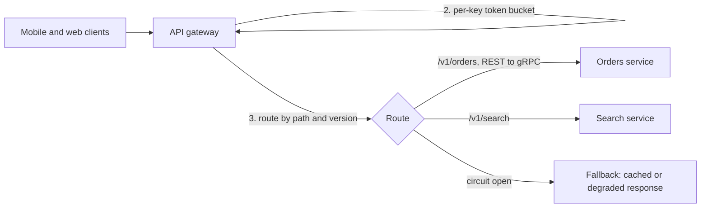

| Responsibility | Why at the gateway | Gotcha |
| --- | --- | --- |
| TLS termination | One place for certificates and cipher policy | Re-encrypt to backends (mTLS) if the internal network is not trusted |
| Authentication (JWT, API keys, OAuth 2.0 tokens) | Reject bad requests before they cost backend CPU | Backends must still enforce *authorisation*; the gateway does not know business rules |
| Rate limiting and quotas | Protect every service with one policy | Per-gateway-instance counters under-count; share state or divide the limit (2.8) |
| Routing and versioning | `/v1` and `/v2` can map to different deployments | Keep routing rules in version control; drift between environments causes "works in staging" |
| Protocol translation | Public REST/JSON, internal gRPC | Error mapping (gRPC status to HTTP status) must be explicit |
| Request/response transformation | Hide internal fields, add headers | Heavy transformation turns the gateway into an untested monolith |
| Observability | One place to record latency, status and caller | Propagate trace context (`traceparent`) downstream |

Keep business logic out of the gateway. A gateway that aggregates five services into one response is a *backend for frontend* (BFF) and should be owned and tested like a service.

**Client IP behind proxies.** Behind a proxy, `RemoteAddr` is the proxy's address. The starter only trusts `X-Forwarded-For` when configured to, because any client can send that header:

```go
func (s *server) clientIP(r *http.Request) string {
	if s.cfg.TrustProxyIP {
		if xff := r.Header.Get("X-Forwarded-For"); xff != "" {
			// The left-most entry is the original client as seen by the
			// first proxy. Only trust it when that proxy is yours.
			first, _, _ := strings.Cut(xff, ",")
			return strings.TrimSpace(first)
		}
	}
	host, _, err := net.SplitHostPort(r.RemoteAddr)
	if err != nil {
		return r.RemoteAddr
	}
	return host
}
```

If the proxy appends to an existing header rather than overwriting it, the left-most entry is whatever the client wrote. In that setup, configure the edge proxy to overwrite the header, or read the entry that your own outermost proxy added (counting from the right).

### 2.8 Rate Limiting Algorithms

Rate limiting caps how many requests a client may make in a period. It protects capacity from abuse and bugs (a retry loop in one client), enforces commercial quotas, and keeps one tenant from starving others.

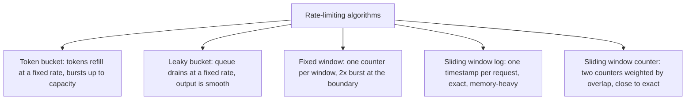

| Algorithm | Allows bursts | State per client | Boundary problem | Where it fits |
| :--- | :--- | :--- | :--- | :--- |
| **Token bucket** | Yes, up to the capacity | 2 numbers: tokens, last refill time | None | Public APIs; AWS API Gateway and Stripe document token-bucket limits |
| **Leaky bucket** | No: requests queue and leave at a constant rate | Queue (or a counter and timestamp) | None | Smoothing traffic to a fragile downstream; Shopify's REST Admin API documents one |
| **Fixed window** | At window edges | 1 counter per window | Up to 2× the limit across a boundary | Simple internal quotas |
| **Sliding window log** | Yes | One timestamp per request in the window | None | Low-volume, high-value limits (login attempts) |
| **Sliding window counter** | Limited | 2 counters | Small approximation error | High-volume limits; Cloudflare has described using it at scale |

**Token bucket** (from `internal/ratelimit`). The bucket refills lazily from elapsed time, so there is no timer goroutine per client:

```go
// Allow takes one token. When the bucket is empty it reports how long the
// caller should wait, which becomes the HTTP Retry-After header.
func (b *TokenBucket) Allow() (ok bool, retryAfter time.Duration) {
	b.mu.Lock()
	defer b.mu.Unlock()
	now := b.now()
	// Refill lazily: no background goroutine, just arithmetic on elapsed time.
	if elapsed := now.Sub(b.last).Seconds(); elapsed > 0 {
		b.tokens = min(b.capacity, b.tokens+elapsed*b.rate)
		b.last = now
	}
	if b.tokens >= 1 {
		b.tokens--
		return true, 0
	}
	missing := 1 - b.tokens
	return false, time.Duration(missing / b.rate * float64(time.Second))
}
```

| Line / API | Role | What happens at runtime |
| --- | --- | --- |
| `b.now()` | Injected clock | Tests advance a fake clock instead of sleeping, so they are exact and fast |
| `min(b.capacity, …)` | Cap the refill | A client idle for an hour gets one burst of `capacity`, not 36,000 banked tokens |
| `b.tokens >= 1` | Spend a token | Fractional tokens accumulate between requests |
| `missing / b.rate` | Time to the next token | Exact `Retry-After`; clients that honour it stop hammering |

**Sliding window counter.** A fixed window lets a client send the full limit at 00:59 and again at 01:00. The sliding counter weights the previous window by how much of it still overlaps a window ending now:

```go
// Allow counts the request if the weighted estimate is under the limit.
func (s *SlidingWindow) Allow() bool {
	s.mu.Lock()
	defer s.mu.Unlock()
	now := s.now()
	start := now.Truncate(s.window)
	switch {
	case start.Equal(s.currStart):
		// still inside the current window
	case start.Sub(s.currStart) == s.window:
		s.prev, s.curr = s.curr, 0 // moved into the next window
		s.currStart = start
	default:
		s.prev, s.curr = 0, 0 // idle for more than a whole window
		s.currStart = start
	}
	overlap := 1 - float64(now.Sub(start))/float64(s.window)
	estimate := float64(s.prev)*overlap + float64(s.curr)
	if estimate >= float64(s.limit) {
		return false
	}
	s.curr++
	return true
}
```

`TestSlidingWindowBlocksBoundaryBurst` sends 10 requests (the limit) in the last second of a window, then 10 more one second into the next: only 1 is allowed, because the previous window still weighs 59/60. A fixed window would have allowed all 10.

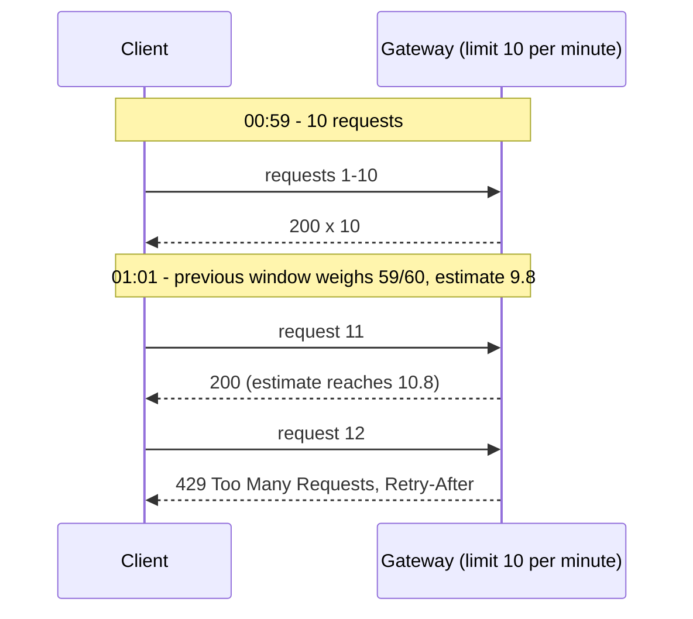

**HTTP contract.** Reject with `429 Too Many Requests` and a `Retry-After` header (seconds). The starter rounds the token-bucket wait up:

```bash
for i in $(seq 1 25); do curl -s -o /dev/null -w '%{http_code} ' localhost:8080/v1/ids; done
# 200 x 20, then 429s: the burst is 20 and refill is 10/s, so a slow loop sees fewer 429s
curl -si localhost:8080/v1/ids | grep -i retry-after
# Retry-After: 1
```

**Distributed limits.** With 10 gateway instances each holding local buckets, a client spread across all of them gets 10× the limit. Options:

| Approach | Accuracy | Cost | Notes |
| --- | --- | --- | --- |
| Local limit = global limit ÷ instances | Approximate | None | Breaks when the instance count changes or traffic is uneven |
| Sticky routing by client key (consistent hashing, 2.6) | Good | None | One instance owns each client's bucket |
| Central counter in Redis | Exact | One round trip per request | Use an atomic script; Redis becomes a dependency on the hot path |
| Local buckets with periodic sync | Good | Low | Allows short overshoot; used for multi-region limits |

A fixed-window counter in Redis must increment and set expiry atomically, or a crash between the two leaves a counter that never expires. A Lua script runs atomically on the server:

```lua
-- fixed_window.lua: KEYS[1] = counter key, ARGV[1] = limit, ARGV[2] = window in seconds
local n = redis.call('INCR', KEYS[1])
if n == 1 then
  redis.call('EXPIRE', KEYS[1], ARGV[2])
end
if n > tonumber(ARGV[1]) then
  return 0
end
return 1
```

```bash
# key includes the window number (unix time / 60) so each minute gets a fresh counter
redis-cli --eval fixed_window.lua rl:user:42:29445120 , 100 60
# (integer) 1   -> allowed
```

### 2.9 API Styles: REST, gRPC, GraphQL, WebSockets and Idempotency

The interface style affects caching, load balancing and failure handling, so it is a system design decision, not only an API taste.

| Style | Transport and encoding | Strengths | Weaknesses | Fits |
| --- | --- | --- | --- | --- |
| REST over HTTP | HTTP/1.1-3, JSON | Cacheable GETs, universal tooling, easy debugging | Over- and under-fetching, no schema by default | Public APIs, CRUD |
| gRPC | HTTP/2, Protocol Buffers | Typed contracts, streaming, compact payloads, generated clients | Needs L7 balancing (2.3), not browser-native without a proxy | Service-to-service calls |
| GraphQL | HTTP, JSON | Client picks fields; one round trip for nested data | POST queries defeat HTTP caching; a costly query is easy to write, so it needs depth and cost limits | Product APIs with many client shapes |
| WebSockets | Upgraded HTTP/1.1 connection (or HTTP/2 extended CONNECT) | Full duplex, low per-message overhead | Stateful connections complicate balancing and deploys | Chat, collaboration, games (M3) |
| Server-Sent Events | HTTP response stream | Simple server push, automatic reconnect | One direction only | Live feeds, notifications |
| Webhooks | HTTP callbacks to the customer | No polling | Delivery must be retried, signed and deduplicated | Event notifications to third parties |

A gRPC contract is language-neutral; any language generates client and server code from it:

```protobuf
syntax = "proto3";

package idgen.v1;

service IdService {
  // Unary: one request, one response.
  rpc NextIds(NextIdsRequest) returns (NextIdsResponse);
}

message NextIdsRequest {
  uint32 count = 1; // 1-100
}

message NextIdsResponse {
  repeated fixed64 ids = 1;
}
```

**Idempotency** decides what is safe to retry, and Stage 2's balancers and gateways retry. An operation is idempotent if doing it twice has the same effect as once.

| Method | Safe (no side effects) | Idempotent | Retry on timeout? |
| --- | --- | --- | --- |
| `GET`, `HEAD`, `OPTIONS` | Yes | Yes | Yes |
| `PUT` (full replace) | No | Yes | Yes |
| `DELETE` | No | Yes | Yes (a second call may return 404) |
| `POST` | No | No | Only with an idempotency key |
| `PATCH` | No | Not in general | Only if the patch is idempotent or keyed |

For `POST /payments`, the client sends a unique `Idempotency-Key` header; the server stores the key with the result, and a retry with the same key returns the stored result instead of charging twice. The pattern is covered in depth in Stage 7 (Q5) and Stage 4's outbox.

### 2.10 Pitfalls

| Pitfall | Symptom | Fix |
| --- | --- | --- |
| gRPC behind an L4 balancer | One backend at 100% CPU, others idle; per-pod QPS badly skewed | Use an L7 proxy (Envoy) or client-side balancing for HTTP/2 traffic |
| Health check that only proves the process is up | LB keeps sending traffic to an instance whose DB connection is dead; users get `500` | Separate liveness from readiness; readiness checks critical dependencies cheaply |
| Health check that checks too much | One slow shared dependency marks every instance unhealthy; total outage | Readiness should fail only on dependencies this instance cannot serve without |
| No connection draining | `502 Bad Gateway` spikes on every deploy | Graceful shutdown on SIGTERM plus a pre-stop pause (2.5) |
| Retries at every layer | 3 retries at client, gateway and service = 27× load during an incident | Retry at one layer, with a budget (for example at most 10% extra requests) and jittered backoff |
| Retrying non-idempotent requests | Duplicate orders and double charges | Retry only idempotent methods, or require idempotency keys |
| `hash mod N` sharding of a cache | Hit ratio drops to about 25% after adding one node; DB overload | Consistent hashing or hash slots (2.6) |
| Few virtual nodes | One cache node owns 50% of keys; hot node | Use 100-200 virtual nodes per physical node |
| Trusting `X-Forwarded-For` from the internet | Attackers spoof IPs to evade rate limits | Trust it only from your own proxies (2.7) |
| Per-instance rate limits with autoscaling | Effective limit grows with instance count | Central or sticky limiting (2.8) |
| Long DNS TTL during a migration | Users hit the old IP for hours | Lower the TTL a day before; keep the old endpoint serving until traffic drains |
| Missing `Retry-After` on 429 | Clients retry immediately in a tight loop | Always send `Retry-After`; document client backoff |

### 2.11 Best Practices

- **Count round trips, not milliseconds:** connection reuse, TLS 1.3 and HTTP/3 remove whole round trips, which beats any server-side tuning for distant users.
- **Put L4 in front of L7 at large scale:** L4 absorbs volume cheaply; L7 provides per-request routing and policy.
- **Default to least connections or power-of-two choices for variable workloads:** round robin assumes identical requests, which is rarely true.
- **Use consistent hashing whenever membership changes:** caches and partitioned stores keep most keys in place during scaling and failures.
- **Make `/health` cheap and unthrottled:** health checks run constantly and must not compete with user traffic.
- **Drain before stopping:** remove from rotation, wait, then shut down gracefully.
- **Rate-limit per client and globally:** per-client limits stop one abuser; a global limit protects total capacity.
- **Return `429` with `Retry-After`:** a precise wait time turns a retry storm into an orderly queue.
- **Keep the gateway thin:** policy at the edge, business logic in services.
- **Design every write to be idempotent or keyed:** retries are inevitable across networks.

### 2.12 Hands-on Exercise

**Task.** Add a power-of-two-choices balancer to `internal/balancer`:

1. `NewP2C(rnd func() int, backends ...string)` where `rnd` returns a random index (inject it for tests).
2. `Acquire()` picks two different random backends and returns the one with fewer in-flight requests, plus a release function (reuse the bookkeeping pattern from `LeastConnections`).
3. Write a test that holds 5 requests open on backend `a` and checks that, whenever `a` is one of the two candidates, the other backend is chosen.
4. Bonus: run 10,000 simulated requests with random durations against round robin, least connections and P2C, and print the maximum in-flight count per backend.

**Expected output.** The test passes under `go test -race ./internal/balancer`. In the bonus simulation, P2C's maximum in-flight count is close to least connections and noticeably lower than round robin's when request durations vary.

**Where the solution lives.** Start from `LeastConnections` in `internal/balancer/balancer.go`; the test structure matches `TestLeastConnectionsPrefersIdleBackend` in `internal/balancer/balancer_test.go`.

[Back to top ⤴️](#-table-of-contents)

---

## 3. Stage 3: Caching, CDNs & Edge Architectures

Caching is the cheapest capacity you can buy: a memory read is about a thousand times faster than a network round trip to a database (Stage 1.9), and every hit is a query the database never sees. This stage covers where caches sit, how reads and writes interact with them, how they evict and invalidate, how they fail under load, and how HTTP caching and CDNs extend them to the edge. It assumes the latency numbers from Stage 1 and the consistent hashing from Stage 2. Afterwards you can size a cache from a hit-ratio target, pick a write pattern, and defend a hot key against a stampede; the starter's `/v1/products/{id}` does exactly that.

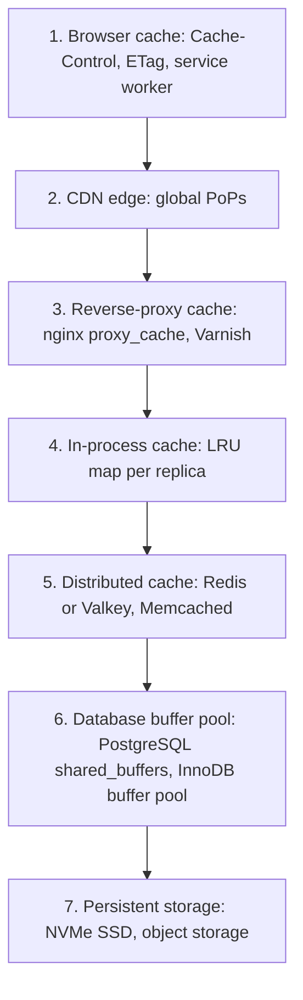

### 3.1 The Caching Hierarchy and Hit-Ratio Math

Each tier in the diagram is closer to the user, faster and smaller than the one below it. A request falls through tiers until one has the answer.

| Tier | Typical latency | Capacity | Shared by | Invalidation control |
| --- | --- | --- | --- | --- |
| Browser | 0 (no request) or a 304 round trip | MBs per user | One user | Weak: only via headers and URL versioning |
| CDN edge | 5-30 ms from the user | TBs per PoP | All users near a PoP | Purge APIs, TTLs |
| Reverse proxy | under 1 ms added | GBs | All users of a region | Purge, TTLs |
| In-process (per replica) | under 1 µs | MBs to a few GB | One replica | Full, but N copies drift independently |
| Distributed (Redis/Memcached) | 0.2-1 ms (one network hop) | Tens of GB to TBs | All replicas | Full: `DEL`, TTL |
| Database buffer pool | 0.1-1 ms including query overhead | GBs to TBs | All queries | Automatic |

The single most useful formula is the effective latency and backend load as a function of hit ratio `h`:

```text
effective latency = t_cache + (1 - h) × t_origin        (cache checked first, then origin on a miss)
origin load       = (1 - h) × total QPS
```

With a 0.5 ms cache and a 10 ms database at 50,000 QPS:

| Hit ratio | Effective latency | Database QPS |
| --- | --- | --- |
| 0% (no cache) | 10 ms | 50,000 |
| 80% | 2.5 ms | 10,000 |
| 90% | 1.5 ms | 5,000 |
| 99% | 0.6 ms | 500 |
| 99.9% | 0.51 ms | 50 |

Going from 90% to 99% looks like a small improvement in hit ratio but cuts database load by 10×. It also means the database is now sized for 500 QPS, so **losing the cache becomes an outage**: a cold or failed cache sends 100× the load the database is provisioned for. Section 3.5 deals with that.

```mermaid
flowchart LR
    R["50,000 QPS"] --> C{"Cache hit?"}
    C -->|"99% hit: 0.5 ms"| OK["Response"]
    C -->|"1% miss: 500 QPS"| DB["Database sized for about 500 QPS"]
    DB --> OK
    X["Cache node lost"] -.->|"all 50,000 QPS fall through"| DB
```

**Sizing the cache.** Access patterns are usually skewed (Zipf-like): a small fraction of keys gets most reads. Measure the key popularity curve and cache enough of the head to hit the target ratio. A rough start is "20% of daily distinct keys serves 80% of reads", then validate with the real hit ratio from `INFO stats` (3.9).

### 3.2 Read and Write Patterns: Cache-Aside, Read-Through, Write-Through, Write-Behind and Write-Around

**Cache-aside (lazy loading)** is the default. The application owns the logic: read the cache; on a miss, read the database and populate the cache. Writes go to the database and then delete the cached key.

```mermaid
sequenceDiagram
    participant A as App
    participant C as Cache
    participant D as Database
    A->>C: GET product:1
    C-->>A: miss
    A->>D: SELECT ... WHERE id = 1
    D-->>A: row
    A->>C: SET product:1 row EX 30
    Note over A,D: write path
    A->>D: UPDATE products SET ... WHERE id = 1
    A->>C: DEL product:1
```

The starter's product endpoint is cache-aside with two additions explained later: single-flight coalescing (3.6) and TTL jitter (3.5).

```go
// product is cache-aside: read the cache, on a miss load from the origin
// (coalesced so a hot key triggers one load) and populate the cache with a
// jittered TTL.
func (s *server) product(w http.ResponseWriter, r *http.Request) {
	id := r.PathValue("id")
	if p, ok := s.products.Get(id); ok {
		w.Header().Set("X-Cache", "HIT")
		writeJSON(w, http.StatusOK, p)
		return
	}
	p, err, shared := s.flight.Do(id, func() (Product, error) {
		// Detach from the first caller's cancellation: other callers share
		// this load, so one client hanging up must not fail all of them.
		ctx, cancel := context.WithTimeout(context.WithoutCancel(r.Context()), 2*time.Second)
		defer cancel()
		p, err := s.cfg.Origin(ctx, id)
		if err == nil {
			ttl := cache.JitteredTTL(s.cfg.CacheTTL, 0.1, rand.Float64)
			s.products.Set(id, p, ttl)
		}
		return p, err
	})
	switch {
	case errors.Is(err, ErrNotFound):
		writeError(w, http.StatusNotFound, "product not found")
		return
	case err != nil:
		s.cfg.Logger.Error("origin failed", "id", id, "err", err)
		writeError(w, http.StatusBadGateway, "origin unavailable")
		return
	}
	if shared {
		w.Header().Set("X-Cache", "MISS-COALESCED")
	} else {
		w.Header().Set("X-Cache", "MISS")
	}
	writeJSON(w, http.StatusOK, p)
}
```

| Line / API | Role | What happens at runtime |
| --- | --- | --- |
| `s.products.Get(id)` | Cache read | O(1) map lookup plus a move-to-front in the LRU list |
| `X-Cache` header | Observability | Lets you measure hit ratio from access logs and debug with `curl -i` |
| `s.flight.Do(id, …)` | Coalesce concurrent misses | Only the first caller for an ID runs the loader; the others wait for its result |
| `context.WithoutCancel` | Shared work must outlive one caller | If the first client disconnects, the load still finishes for everyone waiting on it |
| `context.WithTimeout(…, 2s)` | Bound the origin call | A hung database cannot hold goroutines forever |
| `if err == nil { … Set … }` | Cache only successes | Errors are not cached, so the next request retries (negative caching is the exercise in 3.12) |
| `JitteredTTL(…, 0.1, …)` | Spread expiries | Keys loaded together do not all expire in the same second |
| `502 Bad Gateway` on origin error | Honest failure | The caller knows the dependency failed, not the request |

**The other patterns:**

```mermaid
flowchart TD
    subgraph WriteThrough["Write-through"]
        WT_App["App"] -->|"1. write"| WT_Cache["Cache"]
        WT_Cache -->|"2. synchronous write"| WT_DB["Database"]
    end
    subgraph WriteBehind["Write-behind (write-back)"]
        WB_App["App"] -->|"1. fast write"| WB_Cache["Cache"]
        WB_Cache -.->|"2. asynchronous batched flush"| WB_DB["Database"]
    end
    subgraph WriteAround["Write-around"]
        WA_App["App"] -->|"1. write directly"| WA_DB["Database"]
        WA_App -.->|"2. invalidate key"| WA_Cache["Cache"]
    end
```

| Pattern | Read path | Write path | Write latency | Consistency | Risk |
| :--- | :--- | :--- | :--- | :--- | :--- |
| **Cache-aside** | App reads cache, loads DB on miss | App writes DB, deletes key | DB write | Eventual; bounded by TTL and invalidation | Stale reads after races (3.4) |
| **Read-through** | Cache library loads DB on miss | (paired with one of the below) | n/a | As cache-aside | Loader logic hidden in the cache layer |
| **Write-through** | Cache always populated | Write cache and DB synchronously | Cache + DB | Strong between cache and DB if both succeed | Caches data nobody reads; partial failure handling |
| **Write-behind** | Cache | Write cache, flush to DB later in batches | Memory speed | Eventual | **Data loss** if the cache node dies before flushing |
| **Write-around** | Cache-aside | Write DB only, invalidate cache | DB write | Eventual | First read after a write is always a miss |

Write-behind belongs only where losing the last few seconds of writes is acceptable (view counters, analytics) or where the cache itself is durable and replicated. For money, orders and anything with an audit trail, the database must commit first.

### 3.3 Eviction Policies: LRU, LFU, TTL and Redis maxmemory

A cache is full almost all the time, so the eviction policy decides what it is actually holding.

| Policy | Evicts | Good for | Weakness |
| --- | --- | --- | --- |
| **LRU** (least recently used) | The entry not touched for the longest | Recency-heavy workloads; the default choice | One large scan (a batch job reading every key once) flushes the hot set |
| **LFU** (least frequently used) | The entry with the fewest accesses | Stable popularity (top products, config) | Slow to forget yesterday's hot keys without decay |
| **FIFO** | The oldest insert | Simplicity | Ignores usage entirely |
| **TTL-based** | Entries past their expiry | Data with a natural freshness limit | Not a capacity policy by itself |
| **Random** | A random entry | Very cheap, surprisingly decent | Unpredictable |
| **W-TinyLFU** (Caffeine, Ristretto) | Admits new entries only if they are likely more popular than the victim | Mixed recency and frequency; scan resistance | More complex |

The starter's `internal/cache.LRU` is the classic O(1) design: a hash map from key to a node in a doubly linked list ordered by recency.

```go
// Set stores a value. A ttl of zero or less means the entry never expires.
func (c *LRU[K, V]) Set(key K, value V, ttl time.Duration) {
	c.mu.Lock()
	defer c.mu.Unlock()
	var expires time.Time
	if ttl > 0 {
		expires = c.now().Add(ttl)
	}
	if el, ok := c.items[key]; ok {
		e := el.Value.(*entry[K, V])
		e.value, e.expires = value, expires
		c.ll.MoveToFront(el)
		return
	}
	c.items[key] = c.ll.PushFront(&entry[K, V]{key: key, value: value, expires: expires})
	if c.ll.Len() > c.capacity {
		c.removeElement(c.ll.Back())
		c.evicted++
	}
}
```

```mermaid
flowchart LR
    subgraph list["Recency list: front = most recent"]
        F["front: c"] --> M["a"] --> B["back: b, evicted next"]
    end
    subgraph index["Map: key to list node"]
        KA["a"] -.-> M
        KB["b"] -.-> B
        KC["c"] -.-> F
    end
```

| Line / API | Role | What happens at runtime |
| --- | --- | --- |
| `LRU[K comparable, V any]` | Generic cache | One implementation for any key and value type, checked at compile time |
| `c.items[key]` | O(1) lookup | The map points straight at the list node |
| `MoveToFront` | Record recency | O(1) pointer swaps, no copying |
| `c.ll.Back()` | Find the victim | The least recently used entry is always at the tail |
| `c.evicted++` | Eviction metric | A rising eviction rate with a falling hit ratio means the cache is too small |
| Expiry checked in `GetWithExpiry` | Lazy expiry | Expired entries are removed when read; no background sweeper needed for correctness |

`TestLRUEvictsLeastRecentlyUsed` checks that reading `a` protects it, so inserting `c` into a full cache of `{a, b}` evicts `b`.

**Redis eviction** is configured, not coded. With the default `noeviction`, a full Redis rejects writes with `OOM command not allowed when used memory > 'maxmemory'`. A cache should evict:

```bash
redis-cli CONFIG SET maxmemory 2gb
redis-cli CONFIG SET maxmemory-policy allkeys-lfu   # or allkeys-lru
redis-cli CONFIG GET maxmemory-policy
redis-cli INFO stats | grep -E 'keyspace_(hits|misses)|evicted_keys'
```

| `maxmemory-policy` | Considers | Use when |
| --- | --- | --- |
| `noeviction` | Nothing; writes fail | Redis is a primary store, not a cache |
| `allkeys-lru` / `allkeys-lfu` | All keys | Pure cache: the usual choice |
| `volatile-lru` / `volatile-lfu` | Only keys with a TTL | Mixed use: persistent keys without TTL are protected |
| `volatile-ttl` | Keys with the shortest remaining TTL | TTLs already encode priority |
| `allkeys-random` / `volatile-random` | Random | Uniform access patterns |

Redis approximates LRU and LFU by sampling a few keys (`maxmemory-samples`, default 5) rather than keeping a global list, which costs almost no memory and is close to exact in practice.

### 3.4 Invalidation and Consistency

A cache holds a copy, and copies go stale. Invalidation is deciding when a copy stops being valid, and the hard part is concurrency.

**Delete, do not update, on write.** If two writers each update the database and then `SET` the cache, their cache writes can land in the opposite order to their database writes, leaving the cache permanently wrong. Deleting the key after the database write means the next reader loads the current value.

Even delete-on-write has a race. A reader that missed the cache can read the old row, stall, and write it into the cache *after* the writer's delete:

```mermaid
sequenceDiagram
    participant R as Reader
    participant C as Cache
    participant D as Database
    participant W as Writer
    R->>C: GET k
    C-->>R: miss
    R->>D: SELECT k
    D-->>R: v1 (old)
    Note over R: reader pauses (GC, slow network)
    W->>D: UPDATE k = v2
    W->>C: DEL k
    R->>C: SET k = v1
    Note over C: stale v1 cached until its TTL expires
```

| Mitigation | How it works | Cost |
| --- | --- | --- |
| **Short TTL** | Bounds how long any stale value can live | More misses; does not prevent the race, only limits it |
| **Delayed second delete** | Writer deletes again a few hundred ms later | Cheap; narrows the window but timing is a guess |
| **Versioned values** | Store `(version, value)`; only `SET` if the cached version is older, using an atomic compare-and-set (a small Lua script on the cache server) | Needs a version column (`updated_at`, row version) |
| **Leases** | On a miss the cache hands the reader a token; a `DEL` invalidates outstanding tokens, so the late `SET` is rejected | Needs cache support; described in Facebook's "Scaling Memcache at Facebook" (NSDI 2013) |
| **CDC-driven invalidation** | A change-data-capture stream from the database log deletes keys after commit (Stage 4.4) | One more pipeline, but invalidation can no longer be forgotten by application code |
| **Versioned keys** | Embed the version in the key: `product:1:v42`; readers look up the current version first | Old versions just age out; good for immutable content |

Choose by how much staleness the product tolerates. A product description can be 60 s stale; an account balance or an inventory count used to accept orders should not be read from a cache at all, or only as a hint that the database re-checks.

**Key design rules:** namespace keys (`svc:entity:id`), include anything that changes the response (locale, currency, API version), bound key length, and never build keys from unbounded user input without hashing it.

### 3.5 Cache Failure Modes: Stampede, Penetration, Breakdown and Avalanche

Caches fail in four classic ways, each with a different trigger and defence.

| Failure | Trigger | What the database sees | Defences |
| :--- | :--- | :--- | :--- |
| **Stampede** (thundering herd) | A popular key expires; every concurrent request misses at once | N identical queries for the same row | Single-flight per process (3.6), a distributed lock, early refresh (3.7) |
| **Penetration** | Requests for keys that do not exist (bugs, scrapers, attacks) | Every request, because nothing is ever cached | Cache "not found" with a short TTL; Bloom filter of valid IDs in front |
| **Breakdown** (hot-key expiry) | One extremely hot key expires under peak load | One very expensive key rebuilt by many callers | Never expire it; refresh in the background; replicate it to every node |
| **Avalanche** | Many keys expire together (bulk load with equal TTLs), or a cache node or cluster restarts | A large share of all traffic at once | TTL jitter, warm-up before taking traffic, replicas, circuit breaker in front of the DB |

**TTL jitter** is one line of code and removes a whole class of avalanche:

```go
// JitteredTTL spreads expiry times so keys written together do not expire
// together (a cache avalanche). fraction 0.1 gives base +/- 10%. rnd returns
// a value in [0, 1).
func JitteredTTL(base time.Duration, fraction float64, rnd func() float64) time.Duration {
	return time.Duration(float64(base) * (1 + fraction*(2*rnd()-1)))
}
```

With a 30 s base and 10% jitter, keys loaded in the same second expire spread across 27-33 s instead of all at 30 s.

**Bloom filters against penetration.** A Bloom filter is a bit array of `m` bits with `k` hash functions. Adding an ID sets `k` bits; a lookup that finds any of its bits clear proves the ID was never added, so the request is rejected without touching the cache or database. A lookup with all bits set means "probably present". False negatives are impossible; false positives occur at a rate of about `(1 - e^(-kn/m))^k` for `n` inserted items.

| Bits per item (m/n) | Optimal k ≈ (m/n)·ln 2 | False-positive rate |
| --- | --- | --- |
| 4.8 | 3 | about 10% |
| 9.6 | 7 | about 1% |
| 14.4 | 10 | about 0.1% |

100 million valid product IDs at 1% false positives need about 960 million bits, roughly 120 MB, which fits in memory on every gateway. The filter must be rebuilt or updated when IDs are created, and standard Bloom filters cannot delete (counting Bloom filters or cuckoo filters can).

```mermaid
flowchart LR
    Q["GET /products/999999999"] --> BF{"Bloom filter: maybe present?"}
    BF -->|"definitely absent"| R404["404 at the edge: no cache or DB work"]
    BF -->|"maybe present"| C{"Cache"}
    C -->|"hit, including a cached 'not found'"| OK["Response"]
    C -->|"miss"| DB["Database"]
    DB -->|"row or not-found, cached with short TTL"| C
```

### 3.6 Request Coalescing with Single-Flight

When a hot key misses, hundreds of goroutines in the same process discover it at once. Single-flight makes the first one do the work and the rest wait for its result. The starter's version is generic and fits on one screen; `golang.org/x/sync/singleflight` is the production library with the same idea.

```go
// Do runs fn once per key at a time. shared is true for callers that got
// another caller's result.
func (g *Group[K, V]) Do(key K, fn func() (V, error)) (v V, err error, shared bool) {
	g.mu.Lock()
	if g.calls == nil {
		g.calls = make(map[K]*call[V])
	}
	if c, ok := g.calls[key]; ok {
		g.mu.Unlock()
		c.wg.Wait()
		return c.val, c.err, true
	}
	c := &call[V]{}
	c.wg.Add(1)
	g.calls[key] = c
	g.mu.Unlock()

	// Forget the key even if fn panics, or every later caller would block.
	defer func() {
		g.mu.Lock()
		delete(g.calls, key)
		g.mu.Unlock()
		c.wg.Done()
	}()
	c.val, c.err = fn()
	return c.val, c.err, false
}
```

| Line / API | Role | What happens at runtime |
| --- | --- | --- |
| `g.calls[key]` lookup under `g.mu` | Detect an in-flight load | Checking and registering happen in one critical section, so two callers cannot both become the leader |
| `c.wg.Wait()` | Followers block | Waiting happens *outside* the group lock, so other keys are not blocked |
| `c.wg.Add(1)` before unlock | Leader registration | Followers that arrive immediately find a call they can wait on |
| `defer … delete … Done()` | Cleanup on success, error or panic | The key is forgotten so the next miss after completion starts a fresh load; errors are not cached |
| `shared` result | Metrics | Counting coalesced calls shows how much load single-flight removed |

```mermaid
sequenceDiagram
    participant G1 as Request 1
    participant G2 as Request 2..1000
    participant SF as Group
    participant DB as Database
    G1->>SF: Do("product:1")
    SF->>DB: one query
    G2->>SF: Do("product:1")
    Note over G2,SF: key in flight: wait on the same call
    DB-->>SF: row (200 ms)
    SF-->>G1: row, shared=false
    SF-->>G2: row, shared=true
```

`TestProductStampedeIsCoalesced` fires 20 concurrent requests at a cold key whose origin takes 200 ms and asserts the origin ran exactly once. Single-flight works per process; with 50 replicas you still get up to 50 loads per hot key, which is usually fine. If it is not, add a short-lived distributed lock (`SET lock:k token NX PX 2000` in Redis) so only one replica loads, while the others serve stale data or wait briefly.

### 3.7 Probabilistic Early Expiration (XFetch)

Single-flight limits the damage at expiry; early refresh avoids the expiry miss altogether. With XFetch (Vattani, Chierichetti and Lowenstein, VLDB 2015), every reader that gets a hit also rolls a die. The closer the entry is to expiry, and the longer it takes to recompute, the more likely the reader recomputes it early while everyone else keeps getting hits.

```text
recompute early if   now - Δ · β · ln(rand)  ≥  expiry        rand in (0, 1]
Δ = time a recompute takes      β = eagerness (1.0 is the paper's default; > 1 refreshes earlier)
```

`-ln(rand)` is an exponentially distributed random number with mean 1, so the "look-ahead" gap is on average `Δ·β` and occasionally much larger. Many readers make independent draws, so with high traffic one of them refreshes shortly before expiry, and the rest never see a miss. With low traffic almost nobody refreshes early, which is what you want.

```go
func ShouldRefreshEarly(now, expiry time.Time, delta time.Duration, beta float64, rnd func() float64) bool {
	if !now.Before(expiry) {
		return true
	}
	gap := -float64(delta) * beta * math.Log(rnd()) // >= 0 because ln(rnd) <= 0
	return gap >= float64(expiry.Sub(now))
}
```

| Parameter | Meaning | Effect of increasing it |
| --- | --- | --- |
| `now`, `expiry` | Current time and the entry's expiry (from `LRU.GetWithExpiry`) | Less time left raises the refresh probability |
| `delta` | Measured recompute time | Expensive values refresh earlier, so the refresh finishes before expiry |
| `beta` | Tuning knob | Higher means earlier and more frequent refreshes; 1.0 is a good start |
| `rnd` | Uniform in (0, 1] | Pass `1 - rand.Float64()` so `ln(0)` never happens |

`TestShouldRefreshEarlyGetsLikelierNearExpiry` sweeps 1,000 evenly spaced random values: with 10 s left and a 1 s recompute none refresh, while with 1 s left about 37% do (`e^-1`). In a handler, the reader that wins the draw recomputes in the background (or inline, through the same single-flight group) and the current value is still returned immediately.

| Technique | Prevents the miss? | Coordination | Best for |
| --- | --- | --- | --- |
| Single-flight | No, shrinks it to one load per process | In-process | Every cache-aside path (cheap default) |
| Distributed lock on miss | No, one load cluster-wide | Redis or similar | Very expensive recomputes |
| XFetch early refresh | Yes, probabilistically | None | Hot keys with known recompute cost |
| Background refresh job | Yes | Scheduler | A known, small set of critical keys |
| Serve stale while revalidating | Yes, at the cost of brief staleness | None | HTTP caching and CDNs (3.8) |

### 3.8 HTTP Caching and CDNs

HTTP caching moves the cache to the browser and the CDN, controlled entirely by response headers (RFC 9111). Getting the headers right is often the largest performance win in a web system because hits never reach your infrastructure.

| Header / directive | Meaning |
| --- | --- |
| `Cache-Control: max-age=60` | Any cache may reuse the response for 60 s |
| `s-maxage=600` | Shared caches (CDN, proxy) use 600 s; browsers still use `max-age` |
| `public` / `private` | `private` forbids shared caches; use it for per-user responses |
| `no-cache` | May store, but must revalidate with the origin before each reuse |
| `no-store` | Never store (sensitive data) |
| `immutable` | The resource never changes at this URL; skip revalidation |
| `stale-while-revalidate=30` (RFC 5861) | After expiry, serve stale for up to 30 s while fetching a fresh copy in the background |
| `stale-if-error=86400` (RFC 5861) | Serve stale for up to a day if the origin errors |
| `ETag: "v42"` + `If-None-Match` | Conditional request; the origin answers `304 Not Modified` with no body if unchanged |
| `Vary: Accept-Encoding` | Cache separate variants per listed request header; `Vary: Cookie` effectively disables shared caching |

```bash
# First request: full response with validators
curl -si https://cdn.example.com/api/products/1 | grep -iE 'cache-control|etag|age|x-cache'
# cache-control: public, max-age=60, s-maxage=300, stale-while-revalidate=30
# etag: "p1-v42"

# Revalidation: 304 and no body if the ETag still matches
curl -si -H 'If-None-Match: "p1-v42"' https://cdn.example.com/api/products/1 | head -1
# HTTP/2 304
```

**Static assets** should use content-hashed file names (`app.3f9a1c.js`) with `Cache-Control: public, max-age=31536000, immutable`; a deploy changes the name, so no purge is ever needed. **HTML and API responses** get short TTLs plus `stale-while-revalidate`.

**Push vs pull CDNs:**

| | Pull (origin pull) | Push |
| --- | --- | --- |
| How content gets to the edge | On the first miss, the PoP fetches from the origin and caches per headers | You upload content to CDN storage ahead of time |
| Origin load | Misses and revalidations only | None for pushed content |
| Freshness control | TTLs, purge API | Explicit uploads and deletes |
| Fits | Websites and APIs with changing or long-tail content | Large, known files: software releases, video segments (M4) |

A CDN in front of a large catalogue still sends every first request per PoP to the origin. **Origin shielding** (a designated mid-tier PoP that all edge PoPs fetch through) collapses those into one origin request, and **request collapsing** at the CDN does for HTTP what single-flight does in Go.

nginx can act as a shielding cache in front of the starter with the same defences: locking (coalescing), stale serving and background refresh.

```nginx
proxy_cache_path /var/cache/nginx keys_zone=api_cache:50m max_size=5g inactive=10m use_temp_path=off;

upstream app { server 127.0.0.1:8080; keepalive 32; }

server {
    listen 80;

    location /v1/products/ {
        proxy_pass http://app;
        proxy_http_version 1.1;
        proxy_set_header Connection "";

        proxy_cache api_cache;
        proxy_cache_valid 200 30s;               # used when the origin sends no Cache-Control
        proxy_cache_valid 404 5s;                # negative caching against penetration
        proxy_cache_lock on;                     # one origin request per key; others wait
        proxy_cache_lock_timeout 2s;
        proxy_cache_use_stale updating error timeout http_502 http_503;
        proxy_cache_background_update on;        # refresh expired entries without blocking clients
        add_header X-Proxy-Cache $upstream_cache_status always;   # HIT, MISS, STALE, UPDATING
    }
}
```

```mermaid
flowchart LR
    U1["Users in region A"] --> E1["Edge PoP A"]
    U2["Users in region B"] --> E2["Edge PoP B"]
    E1 -->|"miss"| SH["Shield PoP"]
    E2 -->|"miss"| SH
    SH -->|"one request per key"| O["Origin: nginx proxy_cache, then the app"]
```

### 3.9 Distributed Caches: Redis Cluster, Sentinel and Memcached

An in-process cache is fastest but each replica has its own copy, which multiplies memory use and makes invalidation per replica. A distributed cache gives every replica one shared copy at the cost of a network hop. Most systems use both: a small in-process tier for the hottest keys with a short TTL, and Redis or Memcached behind it.

**Redis Cluster** shards keys over 16,384 hash slots: `slot = CRC16(key) mod 16384`. Each primary owns a range of slots, replicas follow each primary, and rebalancing moves whole slots. Clients cache the slot map and follow `MOVED` redirects when it changes.

```bash
redis-cli -c -h cache-1 CLUSTER KEYSLOT user:42            # (integer) slot number for this key
redis-cli -c -h cache-1 CLUSTER SHARDS                      # which node owns which slots, and replicas

# Multi-key commands need every key in one slot; hash tags pick the part that is hashed
redis-cli -c MSET user:{42}:profile p user:{42}:prefs q     # OK: both hash "42"
redis-cli -c MSET user:42:profile p user:43:profile q
# (error) CROSSSLOT Keys in request don't hash to the same slot

# Cache-aside primitives
redis-cli SET product:1 '{"id":"1","name":"Mechanical keyboard"}' EX 30
redis-cli TTL product:1
redis-cli SET lock:product:1 "$(uuidgen)" NX PX 2000        # short distributed lock for a miss
redis-cli MEMORY USAGE product:1                            # bytes including overhead
```

| Topology | Sharding | Failover | Fits |
| --- | --- | --- | --- |
| Single Redis primary + replicas, **Sentinel** | None (one primary holds all data) | Sentinel processes agree by quorum, promote a replica and tell clients | Datasets that fit one machine; simplest HA |
| **Redis Cluster** (or Valkey cluster mode) | 16,384 hash slots across primaries | Built in: replicas of a failed primary are promoted by the other primaries | Datasets or throughput beyond one machine |
| **Memcached** | Client-side, usually consistent hashing (2.6) | None: a lost node is a cold shard | Simple, multi-threaded, pure cache of blobs |
| Managed services (ElastiCache, Memorystore, Azure Cache) | Either mode | Provider-managed | When you do not want to operate it |

| Concern | Redis / Valkey | Memcached |
| --- | --- | --- |
| Data types | Strings, hashes, lists, sets, sorted sets, streams, bitmaps, HyperLogLog | Strings (blobs) |
| Persistence | Optional RDB snapshots, AOF log | None |
| Threading | Commands execute on one main thread; I/O threads optional | Multi-threaded |
| Replication | Asynchronous replicas (acknowledged writes can be lost on failover) | None |
| Eviction | Configurable policies (3.3) | LRU per slab class |

**Hot keys in a cluster.** A single key always lives in one slot on one primary, so a celebrity profile read 500,000 times a second saturates one node no matter how many nodes exist. Defences: an in-process tier in front (even a 1 s TTL absorbs most reads), replicating the value under several keys (`profile:42#0` … `profile:42#7`) and reading a random copy, or reading from replicas for that key.

```mermaid
flowchart TD
    APP["App replicas: in-process LRU, 1-5 s TTL"] -->|"miss"| CL["Redis Cluster client with cached slot map"]
    CL -->|"slots 0-5460"| P1["Primary 1"]
    CL -->|"slots 5461-10922"| P2["Primary 2"]
    CL -->|"slots 10923-16383"| P3["Primary 3"]
    P1 --> R1["Replica 1"]
    P2 --> R2["Replica 2"]
    P3 --> R3["Replica 3"]
    CL -.->|"MOVED 3999 node: refresh slot map"| CL
```

### 3.10 Pitfalls

| Pitfall | Symptom | Fix |
| --- | --- | --- |
| Updating the cache on write instead of deleting | Cache permanently holds an older value after concurrent writes | Write the DB, then `DEL` the key (3.4) |
| Same TTL for everything loaded at once | Periodic latency spikes and DB CPU spikes exactly one TTL after a deploy or warm-up | TTL jitter (3.5) |
| Not caching "not found" | DB QPS stays high under scraping; cache hit ratio looks fine for real IDs | Cache negative results with a short TTL, or a Bloom filter |
| Caching errors | A transient DB error is served to users for the full TTL | Cache only successful (and deliberate negative) results |
| No coalescing on hot keys | DB connection pool exhausted when one key expires: `too many connections` / pool timeout errors | Single-flight (3.6), early refresh (3.7) |
| Database sized for the post-cache load only | A cache restart takes the database down (avalanche) | Warm caches before traffic, add replicas, protect the DB with a concurrency limit |
| Redis left on `noeviction` as a cache | `OOM command not allowed when used memory > 'maxmemory'` on writes | `allkeys-lru` or `allkeys-lfu` (3.3) |
| Multi-key commands across slots | `CROSSSLOT Keys in request don't hash to the same slot` | Hash tags `{id}` for keys used together |
| `Vary: Cookie` or `Set-Cookie` on cacheable responses | CDN hit ratio near zero | Strip cookies from static and public paths; mark per-user responses `private` |
| Caching per-user data in a shared cache under a shared key | One user sees another user's data | Include the user or tenant in the key, or mark responses `private, no-store` |
| Cache as the only copy of data (write-behind) | Lost writes after a cache node failure | Commit to the database first for anything that matters |
| In-process cache with long TTLs on many replicas | Different replicas return different values for minutes | Short TTLs in-process (seconds), or broadcast invalidations |

### 3.11 Best Practices

- **Measure hit ratio per key prefix:** a global hit ratio hides one endpoint that never hits.
- **Default to cache-aside with delete-on-write:** it is simple, fails safe (a cache outage is a performance problem, not a correctness problem) and works with any store.
- **Always set a TTL:** even with perfect invalidation, a TTL bounds the damage of a missed one.
- **Add jitter to every TTL:** it costs one line and prevents synchronised expiry.
- **Coalesce misses for hot keys:** single-flight in process, a short lock across processes.
- **Serve stale on origin failure:** `stale-if-error` and `proxy_cache_use_stale` turn an origin outage into stale-but-available content.
- **Version static assets by content hash:** immutable URLs never need purging.
- **Keep per-user data out of shared caches unless the key includes the user:** cross-user leaks are a security incident, not a performance bug.
- **Size the database for a cold cache, or protect it:** a cache is a performance layer; plan for it to be empty.
- **Choose Redis eviction deliberately:** `allkeys-lfu` for stable popularity, `allkeys-lru` for recency, `noeviction` only for data stores.

### 3.12 Hands-on Exercise

**Task.** Add negative caching to the starter's product endpoint so repeated requests for unknown IDs stop reaching the origin.

1. In `internal/httpapi/server.go`, when the origin returns `ErrNotFound`, store a marker in the cache with a short TTL (for example 5 s). One approach: change the cache value type to a small struct `{Product Product; Missing bool}`.
2. On a cache hit with `Missing == true`, return `404` with `X-Cache: HIT`.
3. Add a test next to `TestProductCacheAside` in `internal/httpapi/server_test.go` that requests `/v1/products/999` three times and asserts the origin was called once and every response was 404.
4. Bonus: use `cache.ShouldRefreshEarly` with `LRU.GetWithExpiry` to refresh hot products before expiry through the same `flight` group, and test it with an injected `rnd` that always returns a tiny value.

**Expected output.**

```bash
go test -race ./internal/httpapi -run 'Product' -v
# --- PASS: TestProductCacheAside
# --- PASS: TestProductNegativeCaching       (your new test)
# --- PASS: TestProductStampedeIsCoalesced
```

**Where the solution lives.** The cache-aside handler is `product` in `internal/httpapi/server.go`; the LRU, `JitteredTTL` and `ShouldRefreshEarly` are in `internal/cache/`.

[Back to top ⤴️](#-table-of-contents)

---

## 4. Stage 4: Databases, Replication, Sharding & Distributed Transactions

This stage covers how data is stored, split and kept consistent once one database is no longer enough: choosing a data model, partitioning rows across machines, and coordinating writes that span services.

```mermaid
flowchart TD
    DB["Database families"] --> SQL["Relational (PostgreSQL, MySQL): ACID, joins, strict schema"]
    DB --> NoSQL["Non-relational"]
    NoSQL --> Doc["Document (MongoDB): nested JSON-like records, flexible schema"]
    NoSQL --> KV["Key-value (Redis, DynamoDB): lookups by key, horizontal scale"]
    NoSQL --> Col["Wide-column (Cassandra, ScyllaDB): high write volume, time series"]
    NoSQL --> Graph["Graph (Neo4j): traversals over highly connected data"]
```

### 4.1 Relational vs Non-Relational Data Models

Choose a relational database when the domain needs transactions across several entities (ledgers, billing, inventory), ad-hoc queries and joins over normalised data, or strict constraints. Choose a document or key-value store when access is almost always by one partition key, the record shape varies, and write volume must scale out beyond what one primary can take. Many systems use both: a relational system of record plus a key-value or search store for specific read paths.

### 4.2 Sharding Strategies

When a table no longer fits one server, or its write rate exceeds one primary, **sharding** splits its rows across independent database instances.

```mermaid
flowchart TD
    Query["Incoming query"] --> Router["Shard router or proxy (Vitess, Citus)"]
    Router -->|"user_id 1 - 10,000,000"| Shard1["Shard 1: server A"]
    Router -->|"user_id 10,000,001 - 20,000,000"| Shard2["Shard 2: server B"]
    Router -->|"user_id 20,000,001 - 30,000,000"| Shard3["Shard 3: server C"]
```

- **Hash-based sharding:** `shard = hash(shard_key) mod N` spreads rows evenly, but changing N moves most rows unless you use consistent hashing or a fixed number of logical shards mapped onto physical servers (Stage 2.6).
- **Range-based sharding:** rows are split by key ranges (dates, IDs). Range scans are cheap, but monotonically increasing keys send all new writes to the last shard, creating a write hotspot.
- **Directory-based sharding:** a lookup table maps each key (or tenant) to a shard. Flexible and easy to rebalance, but the directory is a dependency on every query and must be highly available.
- **The cost of sharding:** joins across shards become scatter-gather queries in the application, transactions across shards need a distributed commit protocol or a saga (4.3), and the shard key is very hard to change later.

### 4.3 Distributed Transactions: Two-Phase Commit vs Sagas

In a microservice checkout, one user action touches several databases (orders, payments, inventory). There are two families of solutions.

#### Two-Phase Commit (2PC): synchronous and blocking

- **Phase 1 (prepare):** the coordinator asks every participant whether it can commit. Each participant writes the change durably, holds its locks and votes yes or no.
- **Phase 2 (commit):** if every vote was yes, the coordinator tells all participants to commit; otherwise it tells them to roll back.
- **Why it is avoided across services:** participants hold locks between the phases. If the coordinator crashes after collecting votes, prepared participants cannot decide on their own and stay blocked with locks held until it recovers. 2PC also couples the availability of every participant together. It remains common *inside* one distributed database, where the coordinator is itself replicated.

#### The Saga Pattern: asynchronous and compensating

A saga is a sequence of local transactions. Each step commits in its own database and triggers the next. If a step fails, the saga runs **compensating transactions** for the completed steps in reverse order (cancel the order, release the stock, refund the card). Compensation is a semantic undo, not a rollback: other transactions may have seen the intermediate state.

```mermaid
sequenceDiagram
    autonumber
    participant Order as Order service
    participant Payment as Payment service
    participant Inventory as Inventory service
    Order->>Order: create order (PENDING)
    Order->>Inventory: reserve stock
    Inventory-->>Order: reserved
    Order->>Payment: charge card
    Payment-->>Order: declined
    Order->>Inventory: compensate: release stock
    Order->>Order: compensate: cancel order
```

### 4.4 The Transactional Outbox Pattern with Change Data Capture

A frequent distributed systems bug: a service commits a database change and then publishes an event to Kafka. If the process crashes or the broker is unreachable between the two, the database and the event stream disagree permanently. Publishing first has the mirror-image problem.

```mermaid
flowchart LR
    App["Application service"] -->|"1. one local ACID transaction"| LocalDB
    subgraph LocalDB["Local database"]
        OrdersTable["orders table"]
        OutboxTable["outbox table"]
    end
    LocalDB -->|"2. read the write-ahead log"| Debezium["CDC connector (Debezium)"]
    Debezium -->|"3. publish, at least once"| Kafka["Kafka topic"]
```

1. The service writes the business row (`orders`) and the event row (`outbox`) in the **same local transaction**, so both commit or neither does.
2. A change data capture connector such as Debezium tails the database log (the PostgreSQL WAL through logical decoding, or the MySQL binlog) and publishes each outbox row to Kafka.
3. Delivery is at least once, so consumers must be idempotent (deduplicate by event ID).

### 4.5 Orchestrated Saga Implementation

The orchestrator owns the step order and the compensation logic. `internal/saga` is a minimal, tested version:

```go
// Run executes steps in order. If a step fails, the steps that already
// succeeded are compensated in reverse order. The returned error joins the
// original failure with any compensation failures; those need repair,
// because the system is now neither fully done nor fully undone.
func Run(ctx context.Context, steps []Step) error {
	done := make([]Step, 0, len(steps))
	for _, s := range steps {
		if err := s.Execute(ctx); err != nil {
			errs := []error{fmt.Errorf("step %s: %w", s.Name, err)}
			for i := len(done) - 1; i >= 0; i-- {
				if done[i].Compensate == nil {
					continue
				}
				if cerr := done[i].Compensate(ctx); cerr != nil {
					errs = append(errs, fmt.Errorf("compensate %s: %w", done[i].Name, cerr))
				}
			}
			return errors.Join(errs...)
		}
		done = append(done, s)
	}
	return nil
}
```

| Saga step | Local action | Compensating action |
| :--- | :--- | :--- |
| **1. Create order** | Insert order with status `PENDING_PAYMENT` | Set status to `CANCELLED` |
| **2. Reserve inventory** | Decrement available stock | Add the reserved items back |
| **3. Charge card** | Capture payment through the payment provider | Issue a refund |
| **4. Dispatch** | Create a shipment with the carrier | Cancel the shipment |

A production orchestrator also persists saga state after every step (so a crashed orchestrator resumes instead of forgetting), retries steps with idempotency keys, and alerts when a compensation fails. Workflow engines such as Temporal or AWS Step Functions provide that durability.

[Back to top ⤴️](#-table-of-contents)

---

## 5. Stage 5: Distributed Systems Theory & Consensus

This stage covers the theoretical limits that shape every replicated system and the consensus protocols that let a group of machines agree despite failures.

```mermaid
flowchart TD
    CAP["During a network partition"] --> CP["Choose consistency (CP): refuse or delay some requests. etcd, ZooKeeper, Spanner, CockroachDB"]
    CAP --> AP["Choose availability (AP): answer, possibly with stale data. Cassandra, DynamoDB default reads, Riak"]
    CAP -.-x|"not an option on a real network"| CA["CA: consistent and available while partitioned"]
```

### 5.1 The CAP Theorem and Why "CA" Is Not an Option

Conjectured by Eric Brewer in 2000 and proved by Gilbert and Lynch in 2002, the CAP theorem says that a replicated data store cannot guarantee all three of the following at once:

- **Consistency (C):** every read sees the most recent write or returns an error (linearizability).
- **Availability (A):** every request to a non-failed node gets a non-error response, without a guarantee that it reflects the latest write.
- **Partition tolerance (P):** the system keeps operating when the network drops or delays messages between nodes.

> [!IMPORTANT]
> Network partitions are not optional: switches fail, links get cut, and long pauses look like partitions. A distributed system therefore cannot "choose CA". The real question is what it does **while** a partition lasts: refuse some requests to stay consistent (CP), or keep answering and reconcile later (AP). Many stores let you choose per request.

### 5.2 The PACELC Theorem

Daniel Abadi pointed out that CAP only describes behaviour during a partition, which is rare. PACELC adds the normal case:

```text
if Partition: choose Availability or Consistency
Else:         choose Latency or Consistency
```

Even without failures, waiting for replicas to confirm a write (consistency) costs latency.

| System | PACELC (typical configuration) | Notes |
| --- | --- | --- |
| Cassandra, DynamoDB (default reads) | PA/EL | Tunable: quorum reads and writes move it toward consistency |
| MongoDB | Depends on read and write concerns | With `majority` write and read concerns it behaves PC/EC; with defaults and secondary reads it leans toward availability and latency |
| Spanner, CockroachDB | PC/EC | Pays latency for strong consistency in normal operation too |
| etcd, ZooKeeper | PC/EC | Consensus on every write |

### 5.3 Distributed Consensus: Raft vs Paxos

Consensus lets a group of nodes agree on one ordered log of commands even if a minority crashes. Replicated state machines (etcd, Consul, the KRaft controllers in Kafka 4, CockroachDB ranges) are built on it.

```mermaid
sequenceDiagram
    participant C as Client
    participant L as Leader
    participant F1 as Follower 1
    participant F2 as Follower 2
    C->>L: write x = 5
    L->>L: append to log (term 3, index 42)
    par replicate
        L->>F1: AppendEntries(term 3, index 42)
        L->>F2: AppendEntries(term 3, index 42)
    end
    F1-->>L: success
    Note over L: 2 of 3 nodes have the entry: majority, so it is committed
    L->>L: apply to state machine
    L-->>C: ok
    F2-->>L: success (late, still fine)
```

Raft was designed to be easier to understand and implement than Paxos, and splits consensus into three parts:

1. **Leader election:** followers that hear nothing from a leader within a randomised election timeout become candidates and request votes. Randomised timeouts make split votes rare. Each node votes at most once per term, and only for a candidate whose log is at least as up to date as its own.
2. **Log replication:** the leader appends client commands to its log and replicates them with `AppendEntries` RPCs; followers reject entries that do not match their log at the previous index, and the leader backs up until the logs agree.
3. **Safety:** an entry is committed once a majority (`⌊N/2⌋ + 1`) stores it. Because any two majorities overlap, a future leader is guaranteed to have every committed entry.

| | Raft | (Multi-)Paxos |
| --- | --- | --- |
| Design goal | Understandability, a complete specification | Minimal, provably correct core |
| Leader | Strong leader; all writes go through it | Leader is an optimisation of the basic protocol |
| Specification of the full system | Elections, replication, membership changes, snapshots all described | Many variants; practical systems fill the gaps themselves |
| Used by | etcd, Consul, CockroachDB, TiKV, Kafka KRaft | Chubby, Spanner (Paxos groups), many internal systems |

A cluster of `2f + 1` nodes tolerates `f` failures: 3 nodes survive 1, 5 survive 2. Even sizes add cost without adding fault tolerance.

[Back to top ⤴️](#-table-of-contents)

---

## 6. Stage 6: Reliability, Resilience & Failure Engineering

This stage covers designing for the failures Stage 1 measured: limiting the blast radius of a failing component and degrading instead of collapsing.

```mermaid
flowchart LR
    REQ["Incoming request"] --> BH{"Bulkhead: pool for this dependency has room?"}
    BH -->|"no"| SHED["Reject fast: 503 or fallback"]
    BH -->|"yes"| CB{"Circuit breaker state"}
    CB -->|"open"| FB["Fallback response"]
    CB -->|"closed or half-open"| DEP["Call dependency with timeout"]
    DEP -->|"failure or timeout"| CB
```

### 6.1 Failure Mode and Effects Analysis (FMEA) in Architecture

FMEA walks through each component, asks how it can fail, what the effect on users is, and how the design detects and contains it. Three containment patterns appear in almost every answer:

- **Bulkheads:** isolate resources per dependency or workload (separate connection pools and thread pools for payments and for search), so one exhausted pool cannot starve the others.
- **Circuit breakers:** stop calling a dependency that is failing, give it time to recover, and fail fast in the meantime instead of piling up waiting requests.
- **Graceful degradation:** under extreme load or partial failure, turn off non-essential features (recommendations, personalisation) to keep the essential path (checkout) working.

[Back to top ⤴️](#-table-of-contents)

---

## M1. Masterclass: Distributed Unique ID Generation

Auto-increment integers need one authority to hand out the next number, which does not scale across many writers. Random 128-bit UUIDv4 values need no coordination but scatter inserts across B-tree pages. Snowflake-style IDs are 64-bit, roughly time-ordered and generated locally by each node.

### M1.1 How It Works Internally

```mermaid
flowchart LR
    T["Clock: ms since custom epoch (41 bits)"] --> ID["64-bit ID"]
    N["Node ID from config (10 bits)"] --> ID
    S["Per-ms sequence (12 bits)"] --> ID
    S -->|"4,096 used this ms"| W["Wait for the next millisecond"]
    T -->|"clock went backwards"| E["Refuse: ErrClockMovedBackwards"]
```

```text
 1 bit   41 bits: milliseconds since epoch               10 bits: node   12 bits: sequence
┌──────┬──────────────────────────────────────────────────┬─────────────┬────────────────┐
│  0   │ 0110101100101101010011010110101001011010         │ 0101001101  │ 000000000001   │
└──────┴──────────────────────────────────────────────────┴─────────────┴────────────────┘
```

| Field | Size | Capacity | Purpose |
| :--- | :--- | :--- | :--- |
| **Sign bit** | 1 bit | Always `0` | Keeps the ID a positive signed 64-bit integer |
| **Timestamp** | 41 bits | 2^41 ms ≈ **69.7 years** | Milliseconds since a custom epoch; makes IDs sort by creation time |
| **Node ID** | 10 bits | **1,024 nodes** | Often split as 5 bits data centre + 5 bits worker |
| **Sequence** | 12 bits | **4,096 IDs per ms per node** | About 4 million IDs per second per node |

### M1.2 Complete Worked Example

`internal/idgen/snowflake.go` is the starter's generator; `GET /v1/ids` serves it.

```go
// Next returns a new ID. IDs from one generator strictly increase.
func (s *Snowflake) Next() (int64, error) {
	s.mu.Lock()
	defer s.mu.Unlock()

	ms := s.millis()
	switch {
	case ms < s.lastMs:
		return 0, fmt.Errorf("%w by %dms", ErrClockMovedBackwards, s.lastMs-ms)
	case ms > maxTime:
		return 0, errors.New("idgen: 41-bit timestamp exhausted; move the epoch")
	case ms == s.lastMs:
		s.seq = (s.seq + 1) & maxSeq
		if s.seq == 0 {
			// 4,096 IDs already issued this millisecond: wait for the next one.
			for ms <= s.lastMs {
				ms = s.millis()
			}
		}
	default:
		s.seq = 0
	}
	s.lastMs = ms
	return ms<<(nodeBits+seqBits) | s.node<<seqBits | s.seq, nil
}
```

The HTTP API returns IDs as strings because JavaScript numbers lose precision above 2^53, and a 64-bit ID would be silently rounded in a browser.

### M1.3 Trade-offs vs Alternatives

| Scheme | Size | Sortable by time | Coordination | Weakness |
| --- | --- | --- | --- | --- |
| Database auto-increment | 64 bits | Yes | One primary (or ranges handed out per node) | Single writer; IDs reveal volume |
| UUIDv4 | 128 bits | No | None | Random index inserts, larger keys |
| UUIDv7 (RFC 9562) | 128 bits | Yes (ms) | None | Twice the size of Snowflake; now built into PostgreSQL 18 |
| Snowflake | 64 bits | Yes (ms) | Unique node IDs only | Clock rollback handling; node ID assignment |
| Ticket server / range allocation | 64 bits | Roughly | Central service, but only once per range | Gaps after crashes |

### M1.4 Production Checklist

- Assign node IDs from a registry or orchestration metadata; two nodes with the same ID produce duplicates.
- Run NTP in slewing mode so the clock is adjusted gradually instead of stepping backwards; alert on `ErrClockMovedBackwards`.
- Pick a recent custom epoch to maximise the 69-year range.
- Return IDs as strings in JSON APIs.

[Back to top ⤴️](#-table-of-contents)

---

## M2. Masterclass: Designing a URL Shortener

### M2.1 Requirements and Architecture

- **Functional:** given a long URL, create a short alias (`https://sho.rt/aZ89xK`); visiting the alias redirects to the original URL; optional custom aliases and expiry.
- **Non-functional:** p99 redirect latency under 50 ms; redirects highly available; created links never lost.
- **Scale:** 100 million new URLs and 10 billion redirects a month, a 100:1 read-to-write ratio.

```mermaid
flowchart TD
    Client["Browser"] --> CDN["CDN: caches redirects at the edge"]
    CDN -->|"cache miss"| Gateway["L7 load balancer / API gateway"]
    Gateway --> WebApp["Shortener service replicas"]
    WebApp <--> KGS["Key generation service: pre-generated base62 keys"]
    WebApp <--> Redis["Redis cluster: hot mappings"]
    WebApp --> DB["Key-value store (DynamoDB or Cassandra)"]
```

### M2.2 The Key Generation Service

Hashing the long URL (MD5 or SHA-256, truncated) on every request needs collision checks against the database. A **key generation service (KGS)** instead pre-generates unique 7-character base62 keys (`[a-zA-Z0-9]`, so 62^7 ≈ 3.5 trillion keys):

- The KGS stores keys in two sets: unused and used.
- Each application server takes a batch (for example 10,000 keys) into memory and marks the batch used in one operation, then assigns keys from memory in O(1) with no collision check.
- If a server crashes, its unassigned keys are lost. With trillions of keys this is an acceptable cost for never coordinating per request.

### M2.3 Data Model

```sql
CREATE TABLE url_mappings (
    short_key    VARCHAR(7) PRIMARY KEY,   -- base62 key, for example 'aZ89xK'
    original_url TEXT        NOT NULL,
    user_id      UUID,
    created_at   TIMESTAMPTZ NOT NULL DEFAULT clock_timestamp(),
    expires_at   TIMESTAMPTZ,
    click_count  BIGINT      NOT NULL DEFAULT 0
);

-- Partial index: only rows that can expire are scanned by the cleanup job
CREATE INDEX idx_url_mappings_expires ON url_mappings (expires_at) WHERE expires_at IS NOT NULL;
```

[Back to top ⤴️](#-table-of-contents)

---

## M3. Masterclass: Designing Real-Time Chat

### M3.1 Architecture

**Scale:** 50 million concurrently connected users and billions of messages a day.

```mermaid
flowchart TD
    UserA["Alice"] -->|"persistent WebSocket"| WS_Server1["WebSocket gateway 1"]
    UserB["Bob"] -->|"persistent WebSocket"| WS_Server2["WebSocket gateway 2"]
    WS_Server1 --> RedisSession["Redis session registry: user to gateway"]
    WS_Server1 --> Kafka["Kafka: chat topics partitioned by conversation"]
    Kafka --> ChatWorker["Delivery service"]
    ChatWorker --> RedisSession
    ChatWorker -->|"push to the recipient's socket"| WS_Server2
    ChatWorker --> Cassandra["Cassandra: message history"]
```

1. **Connection tier:** stateful WebSocket gateways hold open connections with clients.
2. **Session registry:** Redis maps `user_id` to the gateway currently holding that user's connection.
3. **Storage tier:** messages are immutable, append-only and read by conversation, which suits Cassandra or ScyllaDB partitioned by `conversation_id` and clustered by a time-ordered message ID.

### M3.2 Data Model (Cassandra CQL)

```sql
CREATE TABLE messages_by_conversation (
    conversation_id UUID,
    message_id      TIMEUUID,  -- time-based UUID: orders messages and is unique per node
    sender_id       UUID,
    content         TEXT,
    media_url       TEXT,
    status          TEXT,      -- 'SENT', 'DELIVERED', 'READ'
    PRIMARY KEY ((conversation_id), message_id)
) WITH CLUSTERING ORDER BY (message_id ASC);
```

- **Partition key `conversation_id`:** all messages of one conversation live on the same replica set, so reading a conversation touches one partition.
- **Clustering key `message_id`:** rows are stored sorted by time on disk, so "the last 50 messages" is one sequential read (`LIMIT 50` with a reversed order or a time bound).
- Very large group conversations need bucketing (for example `(conversation_id, month)`) to keep partitions bounded.

[Back to top ⤴️](#-table-of-contents)

---

## M4. Masterclass: Designing a Video Streaming Pipeline

### M4.1 Upload and Transcoding Pipeline

```mermaid
flowchart TD
    Creator["Creator"] -->|"1. upload source file"| UploadSvc["Upload service: resumable uploads"]
    UploadSvc -->|"2. store original"| S3_Raw["Object storage: raw uploads"]
    S3_Raw -->|"3. object-created event"| SQS["Job queue"]
    SQS --> TranscodeWorker["Transcoding workers (FFmpeg)"]
    TranscodeWorker -->|"4. segments and manifests per bitrate"| S3_Processed["Object storage: HLS/DASH output"]
    S3_Processed --> CDN["Video CDN"]
    CDN -->|"5. adaptive bitrate playback"| Viewer["Viewer"]
```

### M4.2 Chunking and Adaptive Bitrate

- **Chunking:** each rendition is split into short segments (commonly 2-6 seconds, `.ts` or fragmented MP4 `.m4s`) listed in a manifest (`.m3u8` for HLS, `.mpd` for DASH).
- **Adaptive bitrate (ABR):** the video is encoded at several resolutions and bitrates (for example 1080p, 720p, 480p). The player measures throughput and buffer level and picks the rendition for each next segment, so quality drops instead of the video stalling.
- Segments are immutable files, which makes them ideal CDN content (Stage 3.8).

[Back to top ⤴️](#-table-of-contents)

---

## M5. Masterclass: Designing Geospatial Ride Dispatch

### M5.1 Architecture

**Challenge:** match a rider with a nearby driver within about 2 seconds, while millions of drivers send GPS updates every few seconds.

```mermaid
flowchart TD
    Driver["Driver app"] -->|"location every 4 s"| GeoIngest["Location ingestion"]
    GeoIngest --> RedisGeo["In-memory cell index: cell ID to drivers"]
    Rider["Rider requests pickup"] --> DispatchSvc["Dispatch service"]
    DispatchSvc --> RedisGeo
    DispatchSvc --> MatchEngine["Matching: ETA, ratings, batching"]
```

### M5.2 Spatial Cells: Geohash, S2 and H3

The trick is to turn a 2-D proximity search into key lookups: divide the Earth into cells with IDs, index drivers by cell, and query the rider's cell plus its neighbours. `internal/geo` implements geohash encoding:

```go
// Encode returns the geohash of a point with the given number of
// characters. Each character adds 5 bits: 6 characters is a cell of about
// 1.2 km x 0.6 km at the equator, 7 is about 150 m x 150 m.
func Encode(lat, lng float64, precision int) string {
	latLo, latHi := -90.0, 90.0
	lngLo, lngHi := -180.0, 180.0
	out := make([]byte, 0, precision)
	bits, ch := 0, 0
	evenBit := true // even bits (counting from 0) encode longitude
	for len(out) < precision {
		if evenBit {
			mid := (lngLo + lngHi) / 2
			if lng >= mid {
				ch = ch<<1 | 1
				lngLo = mid
			} else {
				ch <<= 1
				lngHi = mid
			}
		} else {
			mid := (latLo + latHi) / 2
			if lat >= mid {
				ch = ch<<1 | 1
				latLo = mid
			} else {
				ch <<= 1
				latHi = mid
			}
		}
		evenBit = !evenBit
		if bits++; bits == 5 {
			out = append(out, base32[ch])
			bits, ch = 0, 0
		}
	}
	return string(out)
}
```

| Index | Cell shape | Hierarchy | Neighbours | Notes |
| :--- | :--- | :--- | :--- | :--- |
| **Geohash** | Rectangles | Base32 prefix, 5 bits per character | 8, but adjacent cells can have unrelated prefixes at cell boundaries | Simple; cell area varies strongly with latitude |
| **Google S2** | Quadrilaterals on the faces of a cube projected onto the sphere, ordered by a Hilbert curve | 31 levels (0-30), each cell splits into 4 | Variable | Good locality for range scans |
| **Uber H3** | Hexagons (plus 12 pentagons) on an icosahedron projection | 16 resolutions (0-15), about 1:7 area per level | Exactly 6, all equidistant | Uniform neighbour distance suits dispatch and surge pricing; resolution 7 edges are about 1.2 km, resolution 9 about 175 m |

[Back to top ⤴️](#-table-of-contents)

---

## 7. Stage 7: Staff System Design Architect Interview Handbook & Cheatsheet

Use the same four-step structure for any 45-60 minute design interview, and spend the time where the numbers say the risk is.

```mermaid
flowchart LR
    Step1["1. Clarify requirements and scale (5-8 min)"] --> Step2["2. High-level design (10-15 min)"]
    Step2 --> Step3["3. Deep-dive the hardest components (15-20 min)"]
    Step3 --> Step4["4. Bottlenecks, failures, evolution (5 min)"]
```

1. **Clarify:** core use cases and what is out of scope; DAU, read/write ratio, latency and availability targets; a quick estimate (Stage 1.9).
2. **High-level design:** the end-to-end path (client, CDN, load balancer, gateway, services, stores), the core API (`POST /v1/orders`) and the main entities.
3. **Deep dive:** the component that makes this problem hard: the shard key, the cache stampede, the fan-out strategy, the consistency model.
4. **Bottlenecks and failures:** single points of failure, replication lag, partitions, hot keys, and how the design changes at 10× scale.

### 7.1 Core Concepts (Q1-Q10)

#### Q1. How do you choose between a SQL and a NoSQL database for a new large-scale product?

Choose SQL when the domain needs ACID transactions across multiple entities (ledgers, billing, inventory), joins across normalised data, or strict constraints that must never be violated. Choose a document or key-value store when records vary in shape, write volume must scale out past tens of thousands of writes per second, and data is naturally accessed by one partition key without cross-entity joins. Many products start relational and add specialised stores for specific read paths.

#### Q2. How does consistent hashing minimise data movement when nodes are added or removed?

With modulo hashing (`hash mod N`), changing N reassigns almost every key. Consistent hashing places keys and nodes on the same ring; a key belongs to the next node clockwise. Adding or removing a node only affects the keys on the arc next to it, about `1/N` of the total, and every other arc is untouched. Virtual nodes keep the arcs balanced (Stage 2.6).

#### Q3. What is the difference between synchronous and asynchronous replication, and what are the trade-offs?

With **synchronous** replication the primary waits for at least one replica to persist a change before acknowledging the client. No acknowledged write is lost if the primary fails (RPO = 0), but writes are slower and stall if the synchronous replica is unreachable. With **asynchronous** replication the primary acknowledges immediately and ships changes in the background: writes are fast, but writes acknowledged during the replication lag can be lost on failover. Semi-synchronous setups (wait for one of several replicas) are a common middle ground.

#### Q4. Explain strong consistency, eventual consistency and causal consistency.

- **Strong consistency (linearizability):** every read returns the latest committed write, as if there were one copy of the data.
- **Eventual consistency:** if writes stop, all replicas converge to the same value; until then reads may be stale.
- **Causal consistency:** operations that are causally related (a question and its reply) are seen in the same order by everyone, while unrelated concurrent operations may be seen in different orders.

#### Q5. How do you design an idempotent API for payment processing?

The client generates a unique idempotency key per logical payment and sends it in a header (`Idempotency-Key: 7b9a…`). The server:

1. Looks the key up in an `idempotency_keys` table inside a transaction (with a unique constraint on the key).
2. If it exists with status `COMPLETED`, returns the stored response without charging again.
3. If it exists with status `PROCESSING`, returns `409` or waits, because another attempt is in flight.
4. Otherwise inserts the key as `PROCESSING`, calls the payment provider (passing the same key downstream), stores the result as `COMPLETED` and returns it.

#### Q6. What is the cache stampede problem, and how do you resolve it?

When a popular cache key expires, many concurrent requests miss at the same moment and all query the database for the same value. Mitigations: coalesce the misses so only one caller loads the value (single-flight in process, a short distributed lock across processes), and refresh hot keys before they expire (probabilistic early expiration such as XFetch, or a background refresh). Stage 3.5-3.7 implements both.

#### Q7. How does the saga pattern handle failures without distributed locks?

A saga splits a distributed transaction into local transactions, each committed in its own service. If a step fails, the orchestrator (or the services, in a choreographed saga) runs compensating transactions for the completed steps in reverse order, such as cancelling the order and releasing stock. No locks are held across services, at the cost of other transactions being able to observe intermediate states (Stage 4.3).

#### Q8. What are the trade-offs between choreography and orchestration in sagas?

- **Choreography:** services react to each other's events with no central coordinator. It is loosely coupled and simple for two or three steps, but the overall flow is implicit and becomes hard to trace and change as steps grow.
- **Orchestration:** a coordinator (often a workflow engine such as Temporal or AWS Step Functions) tells each participant what to do and drives compensation. The flow is explicit, testable and observable, at the cost of a central component that must be highly available.

#### Q9. How do you mitigate hot partitions in key-value stores like Cassandra or DynamoDB?

Hot partitions appear when one key (a celebrity account, a viral item) concentrates traffic on one partition. Mitigations:

1. **Key salting:** append a suffix (`user_1001#0` … `user_1001#9`) to spread writes across partitions, and read with scatter-gather.
2. **Caching:** serve hot reads from an in-process or distributed cache in front of the store.
3. **Write aggregation:** buffer and batch counter updates instead of writing each one.

#### Q10. How does a Bloom filter work, and what does it guarantee?

A Bloom filter is a bit array of `m` bits with `k` hash functions. Adding an element sets the `k` bits it hashes to. A lookup checks those bits: if any is 0 the element is **definitely absent** (no false negatives); if all are 1 it is **probably present**, with a false-positive rate of about `(1 - e^(-kn/m))^k` after `n` inserts. About 9.6 bits per element give a 1% false-positive rate (Stage 3.5).

### 7.2 Internals & Performance (Q11-Q20)

#### Q11. How does Raft guarantee safety during leader elections?

Raft guarantees that a leader of any term contains every entry committed in earlier terms (the Leader Completeness property). A node grants its vote only to a candidate whose log is at least as up to date as its own: the candidate's last entry must have a higher term, or the same term and an index at least as large. Because a committed entry is stored on a majority, and winning needs votes from a majority, the two majorities overlap and every possible winner already has the entry.

#### Q12. What is the difference between push and pull for real-time notifications?

- **Pull (polling):** the client asks repeatedly. Most responses are empty, which wastes bandwidth and server work, and delivery latency is up to one polling interval.
- **Push (WebSockets, Server-Sent Events, mobile push):** the client keeps a connection open (or registers with a push service) and the server sends events as they happen, with latency close to one network trip. The cost is holding many open connections and routing each event to the right one.

#### Q13. How do you achieve exactly-once processing in streaming pipelines?

Exactly-once *delivery* over an unreliable network cannot be guaranteed, because a sender cannot distinguish a lost message from a lost acknowledgement. Systems achieve exactly-once *effects* by combining at-least-once delivery (retry until acknowledged) with idempotent or transactional processing: the consumer deduplicates by message ID, or commits its output and its input offset in one transaction (Kafka transactions do this within Kafka).

#### Q14. What does a circuit breaker do in microservices, and what are its three states?

A circuit breaker stops calls to a failing or slow dependency so callers fail fast instead of piling up.

1. **Closed:** calls pass through and failures are counted.
2. **Open:** after the failure rate crosses a threshold, calls fail immediately (or return a fallback) for a cool-down period.
3. **Half-open:** after the cool-down, a few trial calls are allowed. If they succeed the breaker closes; if they fail it opens again.

#### Q15. Why do database indexes speed up reads but slow down writes?

An index (usually a B-tree) is a separate sorted structure. Reads that match it go from a full scan, O(N), to a tree search, O(log N), plus row fetches. Every insert, update of an indexed column, and delete must also update each index on the table, which costs extra I/O, causes page splits, and adds write-ahead-log volume. Index what queries need, and drop unused indexes.

#### Q16. How do you handle data archival in high-volume time-series tables?

Partition the table by time (daily or monthly declarative partitions). When a partition passes the retention period, detach and drop it (`DROP TABLE events_2025_01`), which is a quick metadata operation, instead of running a large `DELETE … WHERE created_at < …` that generates huge WAL volume and leaves bloat for vacuum. Queries with a time filter only scan the relevant partitions (partition pruning).

#### Q17. What is split-brain, and how is it prevented?

Split-brain happens when a partition divides a cluster and each side elects its own leader, so both accept conflicting writes. It is prevented with quorums: a leader can only be elected, and can only commit writes, with acknowledgements from a strict majority of the configured cluster, and only one side of a partition can have a majority. Fencing tokens (a number that increases with every leadership change) let storage reject writes from a deposed leader that has not noticed yet.

#### Q18. What is change data capture, and how does it power the transactional outbox?

Change data capture reads a database's own change log (the PostgreSQL WAL through logical decoding, the MySQL binlog) and emits row-level change events, typically into Kafka. Because it reads the log, it sees every committed change in commit order without application involvement and adds little load. In the outbox pattern the service writes an event row in the same transaction as the business change, and CDC publishes it, so events are never lost or published for rolled-back transactions (Stage 4.4).

#### Q19. What is the difference between a load balancer and a reverse proxy?

A **reverse proxy** stands in front of servers and handles traffic for them: TLS termination, compression, caching, buffering and hiding origin addresses. A **load balancer** distributes traffic across multiple backends. The roles overlap so often that the same software (nginx, Envoy, HAProxy) does both; a reverse proxy in front of a single server is still useful, while a load balancer only makes sense with several backends (Stage 2.7).

#### Q20. How does long polling differ from WebSockets?

- **Long polling:** the client sends an HTTP request that the server holds open until data is available or a timeout passes, then the client immediately sends another. It works everywhere but repeats headers and connection work for every message.
- **WebSockets:** after an HTTP upgrade handshake, the connection becomes a persistent full-duplex channel with small per-message framing (a few bytes), so both sides can send at any time.

### 7.3 Architecture & Design (Q21-Q25)

#### Q21. What is the difference between horizontal and vertical partitioning?

- **Horizontal partitioning (sharding):** rows are split across tables or servers with the same schema, for example users 1-1M on one database and 1M-2M on another.
- **Vertical partitioning:** columns are split by access pattern, for example frequently read profile fields in one table and rarely read large text or audit data in another table or store.

#### Q22. What was the C10K problem, and how did event loops solve it?

C10K was the difficulty of serving 10,000 concurrent connections when servers used one OS thread or process per connection: memory per thread and context-switch overhead grew with every connection. Event-driven servers (nginx, Node.js, Netty) use non-blocking sockets and readiness notification (`epoll` on Linux, `kqueue` on BSD) so a few threads serve many thousands of connections. Go achieves the same with goroutines scheduled onto a small number of threads over the same kernel mechanisms.

#### Q23. How do you design a global rate limiter across several data centres?

A single central counter adds a cross-region round trip (often 100 ms or more) to every request. Better options:

1. **Local limits with periodic synchronisation:** each region enforces its share and exchanges counts asynchronously, accepting a short overshoot.
2. **Region-affine routing:** route each client to one home region (GeoDNS or Anycast), so its counter lives in one place.
3. **Split the budget:** allocate each region a fraction of the global limit and rebalance shares based on observed traffic.

#### Q24. What is the difference between pessimistic and optimistic locking?

- **Pessimistic locking:** assume conflicts; lock rows before reading them for update (`SELECT … FOR UPDATE`), blocking other writers until commit. Good when conflicts are frequent.
- **Optimistic locking:** assume conflicts are rare; read without locks, then write conditionally (`UPDATE … WHERE id = 1 AND version = 3`). If no row was updated, someone else changed it; reload and retry. Good for low-contention data and long user think-times.

#### Q25. How do you migrate from a monolithic database to per-service databases with zero downtime?

Use the strangler fig approach:

1. Create the new service with its own database.
2. Write new data to both stores, preferably through CDC from the monolith rather than application dual writes, which can diverge on partial failure.
3. Backfill historical rows in batches.
4. Verify parity by comparing records and shadow-reading from the new store.
5. Switch reads to the new service, then writes.
6. Remove the old tables once nothing reads them.

### 7.5 Staff Cheatsheet

#### Latency Numbers to Know

```text
L1 cache reference ..................... 1 ns
Branch mispredict ...................... 3-5 ns
Mutex lock/unlock (uncontended) ........ 15-25 ns
Main memory reference .................. 100 ns
Compress 1 KB (zstd/lz4) ............... 1-3 µs
Read 4 KB randomly from NVMe SSD ....... 20-100 µs
Read 1 MB sequentially from NVMe SSD ... 100-300 µs
Round trip within a data centre ........ 100-500 µs
Read 1 MB sequentially from HDD ........ 5-10 ms
HDD seek ............................... 5-10 ms
Round trip between continents .......... 70-200 ms
```

#### Capacity Planning Units

```text
1 KB = 10^3 bytes    1 MB = 10^6 bytes    1 GB = 10^9 bytes
1 TB = 10^12 bytes   1 PB = 10^15 bytes   1 EB = 10^18 bytes
1 day ≈ 10^5 s       1M requests/day ≈ 12 QPS      1B requests/day ≈ 12,000 QPS
```

[Back to top ⤴️](#-table-of-contents)

---

## 🧪 Example Projects

| Project | Builds on | What you practise | Stretch goal |
| --- | --- | --- | --- |
| [Starter service](./cmd/server/main.go) (in this repo: `cmd/server`, `internal/...`) | [Stage 1](#1-stage-1-foundations-requirements-estimation--core-metrics)-[Stage 3](#3-stage-3-caching-cdns--edge-architectures) | Capacity math, hash ring, rate limiting, cache-aside with single-flight, Snowflake IDs, graceful shutdown | Complete the exercises in 1.13, 2.12 and 3.12 |
| Capacity calculator CLI | [1.9](#19-back-of-the-envelope-estimation), [1.10](#110-worked-estimate-a-photo-sharing-platform) | Turning requirements into QPS, storage, bandwidth and machine counts | Add cost estimates per cloud instance type and storage tier |
| L7 load balancer in Go | [2.3](#23-layer-4-vs-layer-7-load-balancing), [2.4](#24-load-balancing-algorithms), [2.5](#25-health-checks-connection-draining-and-failover) | `httputil.ReverseProxy`, active health checks, least connections, draining | Outlier ejection and retry budgets |
| Distributed rate limiter | [2.8](#28-rate-limiting-algorithms) | Token bucket in Redis with an atomic script, `429` + `Retry-After` | Multi-region limits with periodic sync |
| Consistent-hash cache cluster | [2.6](#26-consistent-hashing-and-virtual-nodes), [3.9](#39-distributed-caches-redis-cluster-sentinel-and-memcached) | Client-side sharding over several Valkey/Redis nodes, replica lists from `GetN` | Online rebalancing with dual reads during migration |
| CDN-style caching proxy | [3.8](#38-http-caching-and-cdns) | `Cache-Control`, `ETag`/`304`, `stale-while-revalidate`, request collapsing | Origin shielding across two proxy tiers |
| URL shortener | [M2](#m2-masterclass-designing-a-url-shortener) | Key generation service, cache-aside redirects, expiry cleanup | Click analytics through an outbox and Kafka |
| Order saga with outbox | [4.3](#43-distributed-transactions-two-phase-commit-vs-sagas), [4.4](#44-the-transactional-outbox-pattern-with-change-data-capture) | Compensations, idempotent consumers, CDC | Persist saga state and resume after a crash |

## 📝 Cheat Sheets

### CLI / Commands

```bash
# Starter project
go test -race ./...                         # all tests with the race detector
go test ./internal/hashring -run Moves -v   # one test, verbose (prints the key movement)
go run ./cmd/server                         # PORT, NODE_ID, CACHE_NODES are read from the environment
docker build -t learn-system-design . && docker run --rm -p 8080:8080 learn-system-design

# HTTP debugging
curl -si localhost:8080/v1/products/1                     # headers and body; look at X-Cache
curl -s -o /dev/null -w '%{http_code} %{time_total}\n' localhost:8080/health
curl -s -w 'dns %{time_namelookup} tcp %{time_connect} tls %{time_appconnect} ttfb %{time_starttransfer}\n' -o /dev/null https://example.com

# DNS
dig +noall +answer example.com A            # records and TTLs
dig +trace example.com                      # delegation path
dig @1.1.1.1 +short example.com             # ask a specific resolver

# Redis / Valkey
redis-cli INFO stats | grep -E 'keyspace_(hits|misses)|evicted_keys'
redis-cli CONFIG SET maxmemory-policy allkeys-lfu
redis-cli --bigkeys                         # find unexpectedly large keys
redis-cli --hotkeys                         # requires an LFU maxmemory-policy
redis-cli -c CLUSTER KEYSLOT user:{42}:profile

# Load testing (one tool per line; pick what you have)
hey -z 30s -c 50 http://localhost:8080/v1/products/1
wrk -t4 -c64 -d30s http://localhost:8080/v1/products/1
```

### Formulas & Patterns Quick Reference

| Task | Formula or pattern |
| --- | --- |
| Average QPS | `DAU × actions per user per day ÷ 86,400` |
| Peak QPS | `average × 2-5` |
| Storage | `writes/day × size × retention days × replication factor` |
| Bandwidth | `peak QPS × response size × 8` bits/s |
| In-flight requests | Little's Law `L = λ × W` |
| Queueing delay | `service time × 1/(1 - utilisation)` |
| Serial availability | `A1 × A2 × … × An` |
| Parallel availability | `1 - (1 - A1)(1 - A2)…` |
| Fan-out tail | `1 - (1 - p)^n` |
| Cache effective latency | `t_cache + (1 - hit ratio) × t_origin` |
| Keys moved on resize | modulo: `≈ N/(N+1)`; consistent hashing: `≈ 1/(N+1)` |
| Bloom filter false positives | `(1 - e^(-kn/m))^k`, best `k = (m/n) ln 2` |
| Raft fault tolerance | `2f + 1` nodes tolerate `f` failures |
| Write-then-invalidate | Write the database, then `DEL` the cache key |
| Safe retry | Idempotent method or an `Idempotency-Key` |

## 📚 Resources

- [The Go Programming Language](https://go.dev/doc/) and the [`net/http` package documentation](https://pkg.go.dev/net/http)
- [The Raft consensus algorithm](https://raft.github.io/) (paper, visualisation and implementations)
- [RFC 9110: HTTP Semantics](https://www.rfc-editor.org/rfc/rfc9110) and [RFC 9111: HTTP Caching](https://www.rfc-editor.org/rfc/rfc9111)
- [RFC 9114: HTTP/3](https://www.rfc-editor.org/rfc/rfc9114) and [RFC 8446: TLS 1.3](https://www.rfc-editor.org/rfc/rfc8446)
- [RFC 5861: stale-while-revalidate and stale-if-error](https://www.rfc-editor.org/rfc/rfc5861)
- [RFC 9562: UUIDs, including UUIDv7](https://www.rfc-editor.org/rfc/rfc9562)
- [nginx documentation](https://nginx.org/en/docs/)
- [Redis documentation](https://redis.io/docs/latest/) and [Valkey documentation](https://valkey.io/docs/)
- [PostgreSQL documentation](https://www.postgresql.org/docs/current/)
- [Apache Kafka documentation](https://kafka.apache.org/documentation/)
- [Debezium documentation](https://debezium.io/documentation/)
- [Kubernetes documentation: probes and pod lifecycle](https://kubernetes.io/docs/concepts/workloads/pods/pod-lifecycle/)

## 🤝 Contributing

Contributions are welcome. Read the [contributing guide](https://github.com/TheLearningHubOrg/.github/blob/main/CONTRIBUTING.md) and the [code of conduct](https://github.com/TheLearningHubOrg/.github/blob/main/CODE_OF_CONDUCT.md) before you open a pull request. Commit messages follow [Conventional Commits](https://www.conventionalcommits.org/), which drive the automated changelog.

## 📄 License

This project is licensed under the MIT License. See the [LICENSE](LICENSE) file for details.

## 🙏 Acknowledgments

- The authors of the Raft, Dynamo, Bigtable, Spanner and XFetch papers, whose ideas this guide explains
- [Go](https://go.dev/) and its standard library, which the starter project uses with no third-party dependencies
- [Docker](https://www.docker.com/) and the [distroless](https://github.com/GoogleContainerTools/distroless) base images used by the `Dockerfile`
- [nginx](https://nginx.org/), [Redis](https://redis.io/), [Valkey](https://valkey.io/), [PostgreSQL](https://www.postgresql.org/) and [Apache Kafka](https://kafka.apache.org/), used in the configuration examples

## 🌐 Connect with me

- [Twitter](https://twitter.com/manthan_ank)
- [LinkedIn](https://www.linkedin.com/in/manthanank)
- [Facebook](https://www.facebook.com/manthanank/)
- [Instagram](https://www.instagram.com/manthan_ank/)
- [YouTube](https://www.youtube.com/@manthanank)
- [GitHub](https://github.com/manthanank)

## ☕ Support

If you like this learning repository and find it useful, consider buying me a coffee or sponsoring me through GitHub Sponsors. Your support helps me keep these guides up to date. Thank you!

[](https://www.buymeacoffee.com/manthanank)

[](https://github.com/sponsors/manthanank)

---

Show your support by 🌟 the repository.
