# Learn System Design 🏗️

<div align="center">

[](https://opensource.org/licenses/MIT)
[](https://github.com/manthanank/learn-system-design)
[](https://nodejs.org/)
[](https://github.com/manthanank/learn-system-design)

**An exhaustive, production-grade masterclass from absolute zero to staff & principal distributed systems architect.**  
Master back-of-the-envelope capacity planning, L4/L7 load balancing, Consistent Hashing rings, multi-tiered caching hierarchies, database sharding, CAP/PACELC theorems, Raft consensus, the Saga & Outbox patterns, and complete end-to-end hyperscale blueprints (TinyURL, Real-time Chat, Video Streaming, and Geospatial Dispatch).

[Getting Started](#1-stage-1-absolute-beginner-foundations--core-metrics) • [Networking & Gateways](#2-stage-2-networking-api-gateways--load-balancing) • [Caching & CDNs](#3-stage-3-caching-cdns--edge-architectures) • [Database Scaling](#4-stage-4-database-scaling--distributed-data) • [Consensus & Theory](#5-stage-5-distributed-systems-theory--consensus) • [Architecture Blueprints](#6-stage-6-enterprise-architecture-blueprints) • [Staff Interview Playbook](#7-stage-7-staff-systems-architect-interview-playbook)

<br/>

<a href="https://www.buymeacoffee.com/manthanank">
  
</a>

</div>

---

## 🗺️ 7-Stage Pedagogical Roadmap

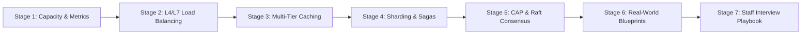

| Stage | Focus Domain | Core Concepts & Engineering Outcomes |
| :--- | :--- | :--- |
| **Stage 1** | **Foundations & Core Metrics** | Vertical vs Horizontal scaling, Latency vs Throughput, Availability 9s (SLA/SLO/SLI), Back-of-the-envelope capacity planning formulas. |
| **Stage 2** | **Networking & Load Balancing** | OSI Model, Layer 4 (TCP/UDP) vs Layer 7 (HTTP) Load Balancing, Consistent Hashing with virtual nodes, Reverse Proxies, API Gateways. |
| **Stage 3** | **Caching & Edge Architectures** | Multi-tiered caching (Browser, CDN, Reverse Proxy, Redis, DB Buffer), Cache Invalidation, Thundering Herd, Write-Through vs Write-Back. |
| **Stage 4** | **Database Scaling & Storage** | Relational vs NoSQL, Horizontal Sharding, Cross-shard joins, Two-Phase Commit (2PC), Saga Pattern (Orchestration vs Choreography), Outbox Pattern. |
| **Stage 5** | **Distributed Systems Theory** | CAP Theorem, PACELC Theorem, Eventual Consistency, Vector Clocks, Raft & Paxos consensus, Gossip Protocol, Split-Brain prevention. |
| **Stage 6** | **Hyperscale Blueprints** | End-to-end architectures: 1) TinyURL / Key Generation Service, 2) WhatsApp Real-Time Chat, 3) Netflix HLS Video Streaming, 4) Uber Geospatial Dispatch. |
| **Stage 7** | **Staff Architect Interview Playbook** | 4-Step System Design Interview Framework, Failure Mode Analysis, 25 Staff/Principal interview Q&As, Architecture Cheat Sheet. |

---

## 📋 Comprehensive Table of Contents

1. [Stage 1: Absolute Beginner Foundations & Core Metrics](#1-stage-1-absolute-beginner-foundations--core-metrics)
   - 1.1 [Vertical Scaling (Scale-Up) vs Horizontal Scaling (Scale-Out)](#11-vertical-scaling-scale-up-vs-horizontal-scaling-scale-out)
   - 1.2 [Latency vs Throughput: The Universal Trade-off](#12-latency-vs-throughput-the-universal-trade-off)
   - 1.3 [High Availability (HA) & The "Nines" Matrix (SLA / SLO / SLI)](#13-high-availability-ha--the-nines-matrix-sla--slo--sli)
   - 1.4 [Back-of-the-Envelope Capacity Calculations Masterclass](#14-back-of-the-envelope-capacity-calculations-masterclass)
   - 1.5 [Line-by-Line Breakdown: Hyperscale Capacity Estimation Math](#15-line-by-line-breakdown-hyperscale-capacity-estimation-math)
2. [Stage 2: Networking, API Gateways & Load Balancing](#2-stage-2-networking-api-gateways--load-balancing)
   - 2.1 [The OSI 7-Layer Model in Distributed Systems](#21-the-osi-7-layer-model-in-distributed-systems)
   - 2.2 [Layer 4 (Transport) vs Layer 7 (Application) Load Balancing](#22-layer-4-transport-vs-layer-7-application-load-balancing)
   - 2.3 [Consistent Hashing & Virtual Nodes Algorithm](#23-consistent-hashing--virtual-nodes-algorithm)
   - 2.4 [API Gateway Responsibilities: Rate Limiting, TLS, Circuit Breaking](#24-api-gateway-responsibilities)
3. [Stage 3: Caching, CDNs & Edge Architectures](#3-stage-3-caching-cdns--edge-architectures)
   - 3.1 [The 6-Tier Caching Hierarchy (From CPU to Storage)](#31-the-6-tier-caching-hierarchy)
   - 3.2 [Content Delivery Networks (CDNs): Push vs Pull & Edge Compute](#32-content-delivery-networks-cdns-push-vs-pull--edge-compute)
   - 3.3 [Cache Invalidation Strategies (Cache-Aside, Write-Through, Write-Behind)](#33-cache-invalidation-strategies)
   - 3.4 [Cache Disaster Mitigation: Stampede, Penetration, Breakdown, Avalanche](#34-cache-disaster-mitigation)
4. [Stage 4: Database Scaling & Distributed Data](#4-stage-4-database-scaling--distributed-data)
   - 4.1 [Relational (SQL) vs NoSQL (Document, Key-Value, Columnar, Graph)](#41-relational-sql-vs-nosql)
   - 4.2 [Replication Topologies: Master-Slave vs Multi-Master (Active-Active)](#42-replication-topologies-master-slave-vs-multi-master)
   - 4.3 [Database Sharding Strategies: Range, Hash, and Directory Based](#43-database-sharding-strategies)
   - 4.4 [Distributed Transactions: Two-Phase Commit (2PC) vs Saga Pattern](#44-distributed-transactions-two-phase-commit-2pc-vs-saga-pattern)
   - 4.5 [The Transactional Outbox Pattern with Change Data Capture (CDC)](#45-the-transactional-outbox-pattern-with-change-data-capture-cdc)
5. [Stage 5: Distributed Systems Theory & Consensus](#5-stage-5-distributed-systems-theory--consensus)
   - 5.1 [The CAP Theorem: Consistency, Availability, Partition Tolerance](#51-the-cap-theorem-consistency-availability-partition-tolerance)
   - 5.2 [The PACELC Theorem: Extending CAP for Latency & Consistency](#52-the-pacelc-theorem-extending-cap-for-latency--consistency)
   - 5.3 [Eventual Consistency & Conflict Resolution (Vector Clocks, CRDTs)](#53-eventual-consistency--conflict-resolution)
   - 5.4 [Distributed Consensus: Raft Protocol vs Paxos Deep Dive](#54-distributed-consensus-raft-protocol-vs-paxos-deep-dive)
   - 5.5 [Failure Detection: Gossip Protocol & Split-Brain Prevention](#55-failure-detection-gossip-protocol--split-brain-prevention)
6. [Stage 6: Enterprise Architecture Blueprints](#6-stage-6-enterprise-architecture-blueprints)
   - 6.1 [Blueprint 1: Designing TinyURL (Distributed URL Shortener)](#61-blueprint-1-designing-tinyurl-distributed-url-shortener)
   - 6.2 [Blueprint 2: Designing a Real-Time Chat & Notification System](#62-blueprint-2-designing-a-real-time-chat--notification-system)
   - 6.3 [Blueprint 3: Designing YouTube / Netflix Video Streaming Pipeline](#63-blueprint-3-designing-youtube--netflix-video-streaming-pipeline)
   - 6.4 [Blueprint 4: Designing Uber / Ride-Sharing Geospatial Dispatch](#64-blueprint-4-designing-uber--ride-sharing-geospatial-dispatch)
7. [Stage 7: Staff Systems Architect Interview Playbook](#7-stage-7-staff-systems-architect-interview-playbook)
   - 7.1 [The 4-Step System Design Interview Framework](#71-the-4-step-system-design-interview-framework)
   - 7.2 [Failure Mode and Effects Analysis (FMEA) in Architecture](#72-failure-mode-and-effects-analysis-fmea-in-architecture)
   - 7.3 [25 Staff/Principal System Design Interview Q&As](#73-25-staffprincipal-system-design-interview-qas)
   - 7.4 [The Ultimate System Design Architect Cheat Sheet](#74-the-ultimate-system-design-architect-cheat-sheet)


---

## 1. Stage 1: Absolute Beginner Foundations & Core Metrics

### 1.1 Vertical Scaling (Scale-Up) vs Horizontal Scaling (Scale-Out)
System design is the discipline of architecting software systems that remain responsive, reliable, and cost-effective as demand grows from a few hundred users to hundreds of millions of daily active users.

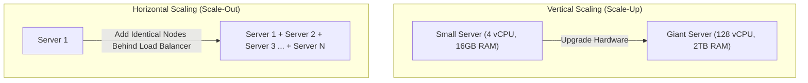

| Dimension | Vertical Scaling (Scale-Up) | Horizontal Scaling (Scale-Out) |
| :--- | :--- | :--- |
| **Mechanism** | Adding more CPU, RAM, and NVMe disks to a single machine. | Adding more commodity server instances behind a load balancer. |
| **Downtime** | Requires hardware reboot/maintenance window. | Zero downtime (dynamic rolling additions). |
| **Hardware Ceilings**| Hard physical ceiling (motherboards cannot exceed max RAM). | **Near-infinite scale** (add thousands of cloud nodes). |
| **Resilience & SPOF**| Single Point of Failure (SPOF); host death kills the app. | Highly fault tolerant; any single node failure is absorbed. |
| **Architectural Cost**| Cheap initially; becomes exponentially expensive at top tier. | Low initial complexity; requires distributed stateless design. |

---

### 1.2 Latency vs Throughput: The Universal Trade-off
- **Latency**: The time required to process a single request from client transmission to client receipt (measured in milliseconds $\text{ms}$ or microseconds $\mu\text{s}$).
- **Throughput**: The number of requests or volume of data a system can process per unit of time (measured in Queries Per Second $\text{QPS}$ or Megabytes Per Second $\text{MB/s}$).

```text
The Assembly Line Analogy:
A car factory produces a car in 8 hours (Latency = 8 hours).
With 800 workers on an assembly line, the factory outputs 1 car every 60 seconds (Throughput = 60 cars/hour).
Increasing throughput does not necessarily decrease individual latency!
```

---

### 1.3 High Availability (HA) & The "Nines" Matrix
Availability measures the percentage of time a service remains operational and accessible to end users:

$$\text{Availability} = \frac{\text{Uptime}}{\text{Uptime} + \text{Downtime}} \times 100\%$$

| Availability SLA | Total Downtime Per Year | Total Downtime Per Month | Engineering Requirement |
| :--- | :--- | :--- | :--- |
| **99% (Two Nines)** | 3.65 days | 7.31 hours | Basic cloud VPS; manual disaster recovery. |
| **99.9% (Three Nines)** | 8.77 hours | 43.8 minutes | Multi-AZ deployment, automated health checks. |
| **99.99% (Four Nines)** | 52.6 minutes | 4.38 minutes | Multi-region active-passive, automated failover. |
| **99.999% (Five Nines)**| **5.26 minutes** | **26.3 seconds** | Multi-region active-active, zero-downtime canary deploys. |

- **SLI (Service Level Indicator)**: The actual metric measured (e.g. 99th percentile HTTP latency).
- **SLO (Service Level Objective)**: The internal target agreed by engineering (e.g. 99.5% of requests $<200\text{ ms}$).
- **SLA (Service Level Agreement)**: The legal contract with clients including financial penalties if breached.

---

### 1.4 Back-of-the-Envelope Capacity Calculations Masterclass
In staff-level system design interviews, you must mathematically estimate traffic, storage, and network bandwidth in $<3$ minutes:

#### Universal Constants to Memorize
- $1 \text{ Day} = 86,400 \text{ seconds} \approx \mathbf{10^5 \text{ seconds}}$ (simplifies mental division).
- $1 \text{ Million Requests/Day} \approx \mathbf{12 \text{ QPS}}$.
- $100 \text{ Million Requests/Day} \approx \mathbf{1,200 \text{ QPS}}$.
- Peak QPS is typically **2x to 5x** the average QPS.

---

### 1.5 Line-by-Line Breakdown: Hyperscale Capacity Estimation Math
**Scenario**: Design a photo-sharing platform with **500 Million Daily Active Users (DAU)**.
- Each user views 20 photos per day.
- 10% of users upload 1 photo per day.
- Average photo size = $200 \text{ KB}$. Metadata per photo = $500 \text{ bytes}$.

| Metric | Mathematical Derivation | Resulting Dimension |
| :--- | :--- | :--- |
| **Read QPS (Average)** | $\frac{500 \times 10^6 \times 20}{10^5 \text{ seconds}}$ | **$100,000 \text{ Read QPS}$** |
| **Read QPS (Peak 2x)** | $100,000 \times 2$ | **$200,000 \text{ Peak Read QPS}$** |
| **Write QPS (Average)** | $\frac{50 \times 10^6 \times 1}{10^5 \text{ seconds}}$ | **$500 \text{ Write QPS}$** |
| **Daily Storage Ingestion** | $50 \times 10^6 \times 200 \text{ KB}$ | **$10 \text{ TB / Day}$** |
| **5-Year Storage Capacity** | $10 \text{ TB} \times 365 \times 5$ | **$18.25 \text{ Petabytes (PB)}$** |
| **Read Outgoing Bandwidth** | $100,000 \text{ QPS} \times 200 \text{ KB}$ | **$20 \text{ GB/sec} = 160 \text{ Gbps}$** |
| **Memory Cache (80/20 Rule)** | $20\% \text{ of daily read traffic in RAM}$ | $100\text{M photos} \times 20\% \times 200\text{KB} = \mathbf{4 \text{ TB RAM Cache}}$ |


---

## 2. Stage 2: Networking, API Gateways & Load Balancing

### 2.1 The OSI 7-Layer Model in Distributed Systems

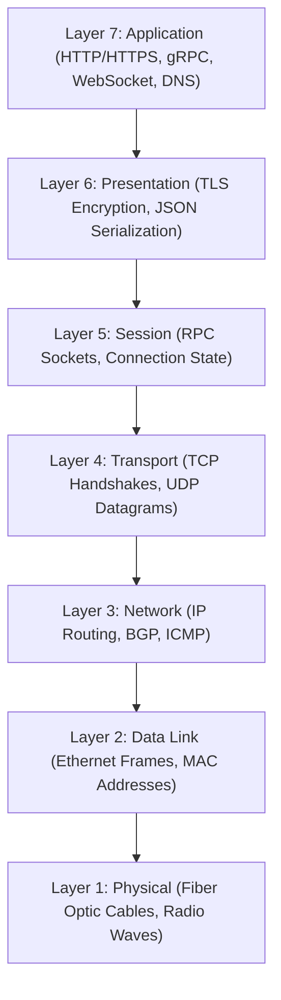

---

### 2.2 Layer 4 (Transport) vs Layer 7 (Application) Load Balancing

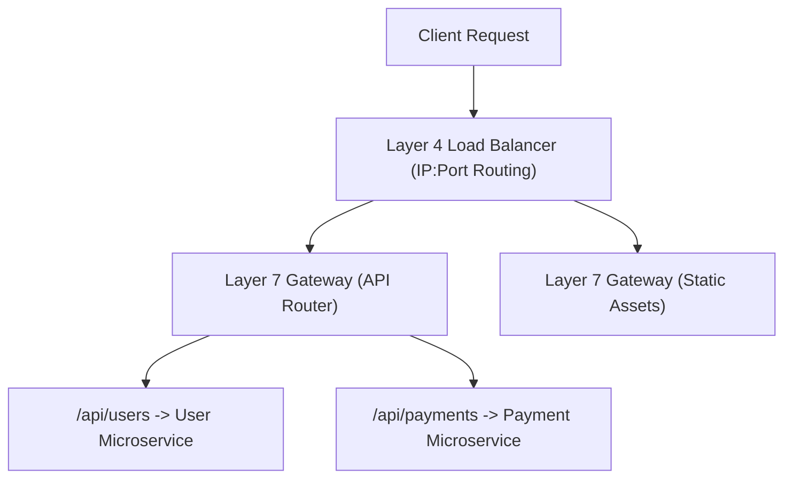

| Dimension | Layer 4 Load Balancing (L4) | Layer 7 Load Balancing (L7) |
| :--- | :--- | :--- |
| **Inspection Level** | Inspects only IP address and TCP/UDP port. | Inspects full HTTP payload, headers, cookies, URL paths. |
| **Data Decryption** | Does not decrypt TLS (packet passed untouched). | Terminates TLS; inspects plaintext HTTP requests. |
| **Routing Capability**| Raw connection routing (e.g. forward port 443). | Content-based routing (e.g. `/orders` vs `/auth`). |
| **Performance** | **Extremely high throughput** (millions of packets/sec). | Higher CPU overhead due to TLS & HTTP header parsing. |
| **Implementations** | AWS NLB, Linux IPVS, HAProxy (TCP mode). | AWS ALB, Nginx, Envoy, Traefik, Kong. |

---

### 2.3 Consistent Hashing & Virtual Nodes Algorithm
Standard modulo hashing ($\text{server} = \text{hash}(\text{key}) \pmod N$) suffers from a fatal flaw: when a single server is added or removed, almost **100% of all cached keys remap**, causing total cache failure across the cluster!
**Consistent Hashing** maps both servers and keys onto a circular $360^\circ$ hash ring ($0 \text{ to } 2^{32}-1$):

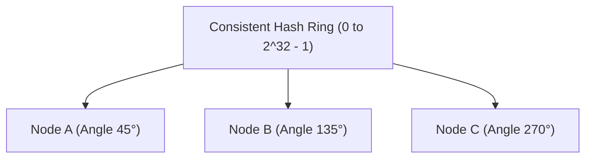

- Keys are placed on the ring based on $\text{hash}(\text{key})$.
- To find which server owns a key, traverse the ring **clockwise** until encountering the first server node.
- **Node Removal / Addition**: When a server dies, only keys that were mapped directly to that server move to the next clockwise neighbor; all other keys remain unaffected ($k/N$ keys moved on average)!
- **Virtual Nodes**: To prevent "hotspots" (non-uniform key distribution), each physical server is mapped to 100–300 **Virtual Nodes** (e.g. `NodeA#1`, `NodeA#2`, `NodeA#3`) scattered randomly around the ring, achieving near-perfect load balance.

---

### 2.4 API Gateway Responsibilities
An API Gateway acts as the single entry point for all client traffic into a microservice ecosystem:
1. **Authentication & Token Validation**: Verifies JWT signatures before requests ever reach backend services.
2. **Rate Limiting & Throttling**: Protects services from DoS attacks via Token Bucket or Leaky Bucket algorithms.
3. **Circuit Breaking**: Automatically trips open if a downstream service returns $>50\%$ errors, returning fallback responses instead of cascading failures.
4. **Protocol Translation**: Converts external HTTP/JSON or GraphQL queries into internal high-performance gRPC binary calls.


---


---

### 2.5 Consistent Hashing Ring with Virtual Nodes (TypeScript Implementation)

```typescript
import crypto from 'node:crypto';

export class ConsistentHashRing {
  private ring: Map<number, string> = new Map();
  private sortedKeys: number[] = [];
  private readonly virtualNodes: number;

  constructor(nodes: string[] = [], virtualNodes: number = 150) {
    this.virtualNodes = virtualNodes;
    for (const node of nodes) {
      this.addNode(node);
    }
  }

  private hash(key: string): number {
    const hash = crypto.createHash('md5').update(key).digest();
    // Read first 32 bits as unsigned integer
    return hash.readUInt32BE(0);
  }

  addNode(node: string): void {
    for (let i = 0; i < this.virtualNodes; i++) {
      const vNodeKey = `${node}#VN${i}`;
      const hashVal = this.hash(vNodeKey);
      this.ring.set(hashVal, node);
      this.sortedKeys.push(hashVal);
    }
    this.sortedKeys.sort((a, b) => a - b);
  }

  removeNode(node: string): void {
    for (let i = 0; i < this.virtualNodes; i++) {
      const vNodeKey = `${node}#VN${i}`;
      const hashVal = this.hash(vNodeKey);
      this.ring.delete(hashVal);
    }
    this.sortedKeys = this.sortedKeys.filter(k => this.ring.has(k));
  }

  getNode(key: string): string | null {
    if (this.sortedKeys.length === 0) return null;
    const hashVal = this.hash(key);

    // Binary search for first virtual node >= hashVal
    let low = 0;
    let high = this.sortedKeys.length - 1;
    let targetIndex = 0;

    if (hashVal > this.sortedKeys[high]) {
      // Wrap around to start of ring
      targetIndex = 0;
    } else {
      while (low <= high) {
        const mid = Math.floor((low + high) / 2);
        if (this.sortedKeys[mid] >= hashVal) {
          targetIndex = mid;
          high = mid - 1;
        } else {
          low = mid + 1;
        }
      }
    }

    const matchedKey = this.sortedKeys[targetIndex];
    return this.ring.get(matchedKey) || null;
  }
}
```

| Component | Technical Implementation | Architectural Guarantee |
| :--- | :--- | :--- |
| `virtualNodes = 150` | Replica Replication | Replicates physical nodes into 150 virtual points across ring to eliminate hotspots. |
| `crypto.createHash('md5')` | Uniform Distribution | Cryptographic hash guarantees uniform pseudo-random dispersion across 32-bit integer space. |
| Binary Search (`O(log V)`) | Binary Search Traversal | Locates owning server among 100,000 virtual nodes in microseconds ($<10\mu\text{s}$). |
| Wrap-around `targetIndex = 0` | Ring Topology | Connects $2^{32}-1$ back to angle $0$, enforcing circular continuity. |


---

### 2.6 The 5 Distributed Rate Limiting Algorithms Compared

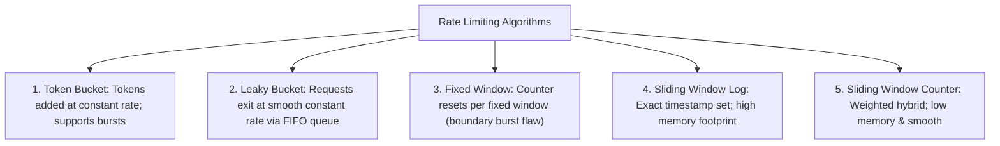

| Algorithm | Burst Handling | Memory Footprint | Edge Boundary Vulnerability | Production Recommendation |
| :--- | :--- | :--- | :--- | :--- |
| **Token Bucket** | **Yes (up to bucket size)** | Low (2 numbers: tokens, last update) | None | **Default choice for AWS API Gateway, Stripe, GitHub**. |
| **Leaky Bucket** | No (smooths to steady rate) | Medium (queue buffer size) | None | E-commerce checkout queues, Shopify flash sales. |
| **Fixed Window** | No (rejects immediately) | **Minimal (1 integer counter)** | **Severe (2x traffic burst at window boundary)** | Low-traffic internal services. |
| **Sliding Window Log**| Yes | High ($O(N)$ timestamps in ZSET) | None | Financial fraud detection, high-security authorization endpoints. |
| **Sliding Window Counter**| Yes | Low (2 window counts) | Minimal ($<0.05\%$ boundary error) | **High-scale microservice rate limiting (Cloudflare)**. |


## 3. Stage 3: Caching, CDNs & Edge Architectures

### 3.1 The 6-Tier Caching Hierarchy

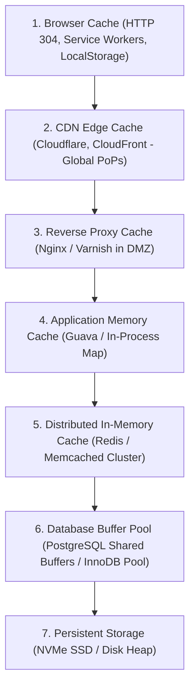

---

### 3.2 Content Delivery Networks (CDNs): Push vs Pull
- **Pull CDN (Origin Pull)**: The CDN edge server only caches content when a user requests it. On a cache miss, the CDN pulls the asset from the origin server and caches it with a `Cache-Control` TTL. Optimal for high-volume sites with fluctuating traffic.
- **Push CDN**: The application builds static assets during deployment and uploads them directly to CDN storage before any user requests them. Optimal for software downloads and mobile app binary releases.

---

### 3.3 Cache Invalidation Strategies
As Phil Karlton famously observed: *"There are only two hard things in Computer Science: cache invalidation and naming things."*

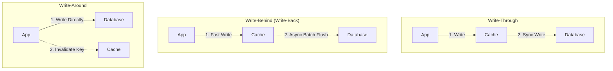

| Strategy | Write Latency | Consistency Guarantee | Risk of Data Loss |
| :--- | :--- | :--- | :--- |
| **Cache-Aside** | Low (writes to DB; invalidates cache). | Eventual consistency. | None (DB is source of truth). |
| **Write-Through** | Higher (synchronously writes to both). | High consistency. | None. |
| **Write-Behind** | **Sub-millisecond** (writes to RAM only). | Eventual (lag between cache and DB). | **High** (if cache node crashes before flush). |
| **Write-Around** | Fast writes to DB; avoids caching unread data. | Eventual consistency. | None. |

---

### 3.4 Cache Disaster Mitigation
Four classic production caching failure modes and their industry standard solutions:

| Disaster Pattern | Failure Mechanism | Architectural Defense |
| :--- | :--- | :--- |
| **Cache Stampede** (Thundering Herd) | A viral key expires; thousands of concurrent threads rush to rebuild it from the DB simultaneously. | **Distributed Mutex Lock** (single-flight) or **Probabilistic Early Recomputation (XFetch)**. |
| **Cache Penetration** | Malicious requests query non-existent IDs; misses cache and hammers the DB. | **Bloom Filter** at the gateway or **Caching NULL objects** with a short 60s TTL. |
| **Cache Avalanche** | Millions of keys expire at the exact same second because they were written with identical TTLs. | **Add Random TTL Jitter** (e.g. `TTL = base + rand(-300, 300)`). |
| **Cache Breakdown** | A critical hotspot key (e.g. Breaking News) suddenly expires under peak traffic. | Set hotspot keys to **Never Expire**; update asynchronously via background cron worker. |


---


---

### 3.5 The XFetch Probabilistic Early Expiration Algorithm (TypeScript)
Rather than waiting for a cache key to expire and suffering a cache stampede, the XFetch algorithm computes an optimal recomputation probability:

```typescript
export class ProbabilisticCache {
  // Delta: time taken to compute the value in milliseconds
  // Beta: aggressiveness coefficient (> 0; default = 1.0)
  static shouldRecompute(ttlRemainingMs: number, deltaComputeMs: number, beta: number = 1.0): boolean {
    if (ttlRemainingMs <= 0) return true;
    
    // XFetch mathematical formula: -beta * delta * ln(random())
    const randomVal = Math.random();
    const earlyRefreshThreshold = -beta * deltaComputeMs * Math.log(randomVal);
    
    return earlyRefreshThreshold > ttlRemainingMs;
  }
}
```

| Parameter / Variable | Mathematical Representation | Physical System Meaning |
| :--- | :--- | :--- |
| `ttlRemainingMs` | $\text{TTL}$ | Milliseconds remaining before key expires in Redis. |
| `deltaComputeMs` | $\delta$ | Duration required by primary database to execute complex SQL query. |
| `beta` | $\beta$ | Tunable multiplier. Setting $\beta = 1.0$ guarantees recomputation before expiry under high QPS. |
| `Math.log(randomVal)`| $\ln(\text{rand}())$ | Stochastically spreads recomputation triggers across multiple concurrent client queries. |


## 4. Stage 4: Database Scaling & Distributed Data

### 4.1 Relational (SQL) vs NoSQL Taxonomy

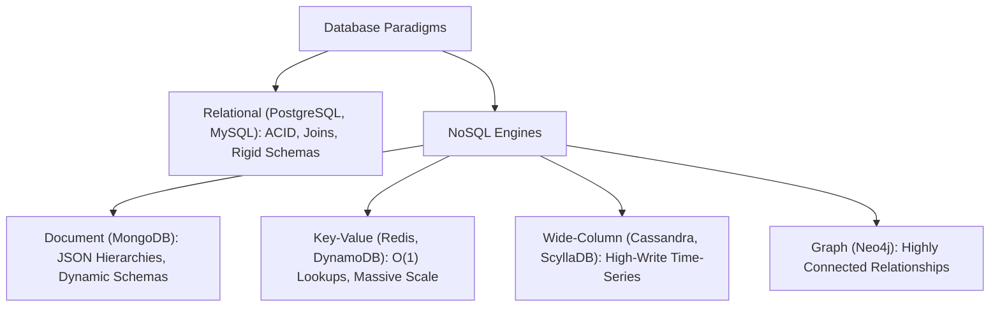

---

### 4.2 Database Sharding Strategies
When a relational table exceeds billions of rows and cannot fit on a single server, **Sharding** partitions rows horizontally across independent physical database instances:

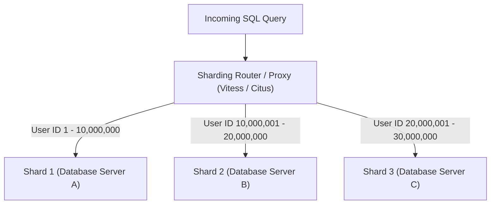

- **Hash-Based Sharding**: $\text{Shard} = \text{hash}(\text{shard\_key}) \pmod N$. Distributes rows uniformly, but adding new shards requires complex data re-balancing.
- **Range-Based Sharding**: Sharding by date or ID ranges. Simple to query, but leads to **Write Hotspots** (e.g. all current writes go strictly to the latest month's shard).
- **The Challenge of Sharding**: Cross-shard joins require distributed map-reduce aggregation; cross-shard transactions require distributed commit protocols.

---

### 4.3 Distributed Transactions: Two-Phase Commit (2PC) vs Saga Pattern
In a microservices architecture, a single user checkout spans multiple independent databases (Orders DB, Payment DB, Inventory DB):

#### 1. Two-Phase Commit (2PC) - Synchronous & Blocking
- **Phase 1 (Prepare)**: Coordinator asks all participants: *"Can you commit this transaction?"* Participants acquire locks and respond *"Yes"* or *"No"*.
- **Phase 2 (Commit)**: If all said yes, coordinator sends *"Commit"*. If any said no, coordinator sends *"Rollback"*.
- **Why 2PC is Avoided at Scale**: Highly synchronous and blocking. If the coordinator crashes in Phase 2, all database locks remain held indefinitely, stalling the entire system!

#### 2. The Saga Pattern - Asynchronous & Resilient
Instead of distributed locks, a Saga is a sequence of local transactions where each step updates its local database and publishes an event. If a step fails, the Saga executes **Compensating Transactions** in reverse order to undo prior work!

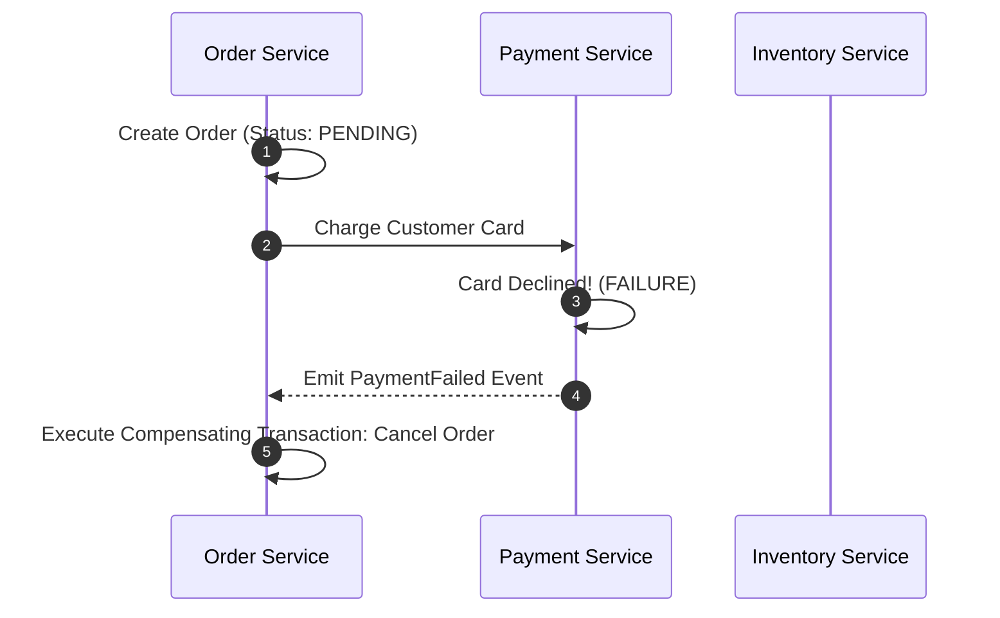

---

### 4.4 The Transactional Outbox Pattern with Change Data Capture (CDC)
A common distributed systems bug: updating the local database and publishing a Kafka message. If the database commit succeeds but the network fails before publishing the Kafka event, data becomes permanently out of sync!

```mermaid
flowchart LR
    App["Application Service"] -->|1. Atomic Local Transaction| DB["Database"]
    subgraph DB["Local Database"]
        OrdersTable["orders Table"]
        OutboxTable["outbox Table (Messages)"]
    end
    DB -->|2. Read Transaction Log (WAL)| Debezium["CDC Engine (Debezium)"]
    Debezium -->|3. Guaranteed Publish| Kafka["Apache Kafka Cluster"]
```

1. Application writes both business entity (`orders`) AND message event into an `outbox` table in the **same local ACID database transaction**.
2. A Change Data Capture (CDC) daemon (like **Debezium**) tails the database transaction log (PostgreSQL WAL) and streams outbox records into Apache Kafka with **Guaranteed At-Least-Once Delivery**.


---


---

### 4.6 Orchestrated Saga Implementation: Order Checkout Flow

```typescript
export interface SagaStep<TContext> {
  name: string;
  execute: (context: TContext) => Promise<void>;
  compensate: (context: TContext) => Promise<void>;
}

export class SagaOrchestrator<TContext> {
  private steps: SagaStep<TContext>[] = [];

  addStep(step: SagaStep<TContext>): this {
    this.steps.push(step);
    return this;
  }

  async execute(context: TContext): Promise<{ success: boolean; error?: Error }> {
    const executedSteps: SagaStep<TContext>[] = [];

    for (const step of this.steps) {
      try {
        console.log(`[Saga] Executing step: ${step.name}`);
        await step.execute(context);
        executedSteps.push(step);
      } catch (err) {
        console.error(`[Saga] Step ${step.name} failed! Triggering compensation rollback...`, err);
        // Rollback all executed steps in reverse order
        for (const executedStep of executedSteps.reverse()) {
          try {
            console.log(`[Saga Rollback] Compensating: ${executedStep.name}`);
            await executedStep.compensate(context);
          } catch (compensateErr) {
            console.error(`[CRITICAL] Compensation failed for ${executedStep.name}`, compensateErr);
          }
        }
        return { success: false, error: err as Error };
      }
    }

    return { success: true };
  }
}
```

| Saga Phase | Local Action | Compensating Rollback Action |
| :--- | :--- | :--- |
| **1. Create Order** | Set order status to `PENDING_PAYMENT`. | Set order status to `CANCELLED`. |
| **2. Reserve Inventory**| Deduct item count from warehouse stock. | Restock items back into warehouse stock. |
| **3. Charge Card** | Process credit card payment through Stripe. | Issue refund for charged payment. |
| **4. Dispatch Order** | Submit shipment request to shipping carrier. | Cancel shipping dispatch manifest. |


## 5. Stage 5: Distributed Systems Theory & Consensus

### 5.1 The CAP Theorem & The Fallacy of "CA"
Formulated by Eric Brewer in 2000, the **CAP Theorem** states that a distributed data store can simultaneously provide at most two of the following three guarantees:
- **Consistency (C)**: Every read receives the most recent write or an error (Linearizability).
- **Availability (A)**: Every non-failing node returns a non-error response for every request (no guarantee it's the latest write).
- **Partition Tolerance (P)**: The system continues to operate despite arbitrary network dropped packets or node isolation.

```mermaid
flowchart TD
    CAP["CAP Theorem"] --> CP["CP: Consistency + Partition Tolerance (ZooKeeper, etcd, MongoDB, CockroachDB)"]
    CAP --> AP["AP: Availability + Partition Tolerance (Cassandra, DynamoDB, CouchDB)"]
    CAP -.x|Impossible over Real Networks!| CA["CA: Consistency + Availability"]
```

> [!IMPORTANT]
> In real-world networks, **Network Partitions ($P$) are an unavoidable physical reality** of fiber cuts, hardware switches dying, and packet loss. Therefore, distributed system architects **cannot choose "CA"**! The actual choice is: **When a network partition occurs, do you choose Consistency ($CP$) or Availability ($AP$)?**

---

### 5.2 The PACELC Theorem
Daniel Abadi recognized that CAP only describes system behavior *during an active network partition*. What about normal operations?
**PACELC** states:
$$\text{If Partition } (\mathbf{P}) \to \text{Choose between } \mathbf{A} \text{ and } \mathbf{C}; \quad \text{Else } (\mathbf{E}) \to \text{Choose between } \mathbf{L} \text{ (Latency) and } \mathbf{C} \text{ (Consistency)}$$

- **MongoDB**: $PC / EC$ (Prioritizes consistency both during partitions and normal execution).
- **Cassandra / DynamoDB**: $PA / EL$ (Prioritizes availability during partitions, and low latency during normal execution).

---

### 5.3 Distributed Consensus: Raft Protocol vs Paxos
Consensus algorithms ensure multiple distributed nodes agree on a single data value or sequence of state machine log entries:

```mermaid
flowchart LR
    Leader["Elected Leader Node"] -->|1. AppendEntries RPC| Follower1["Follower Node 1"]
    Leader -->|1. AppendEntries RPC| Follower2["Follower Node 2"]
    Follower1 -->|2. Ack| Leader
    Follower2 -->|2. Ack| Leader
    Note over Leader: Quorum reached (2/3); Log Committed!
```

- **Raft**: Designed for understandability. Decomposes consensus into three sub-problems:
  1. **Leader Election**: Randomized election timers prevent split votes; nodes vote for candidates with newer log terms.
  2. **Log Replication**: Leader accepts client writes, appends to log, and replicates to followers via `AppendEntries` RPCs.
  3. **Safety**: A log entry is committed only when replicated to a strict majority ($\lfloor N/2 \rfloor + 1$) of nodes.
- **Implementations**: `etcd` (powers Kubernetes cluster state), `Consul`, CockroachDB.


---

## 6. Stage 6: Enterprise Architecture Blueprints

### 6.1 Blueprint 1: Designing TinyURL (Distributed URL Shortener)
- **Functional Requirements**:
  - Given a long URL (e.g. `https://example.com/very/long/path`), generate a short alias (`https://tiny.url/aZ89xK`).
  - Accessing the short alias redirects to original URL with $<50\text{ ms}$ latency.
  - Custom short aliases and customizable TTL expiration.
- **Scale**: 100M URLs created per month, 10B redirects per month (100:1 read-to-write ratio).

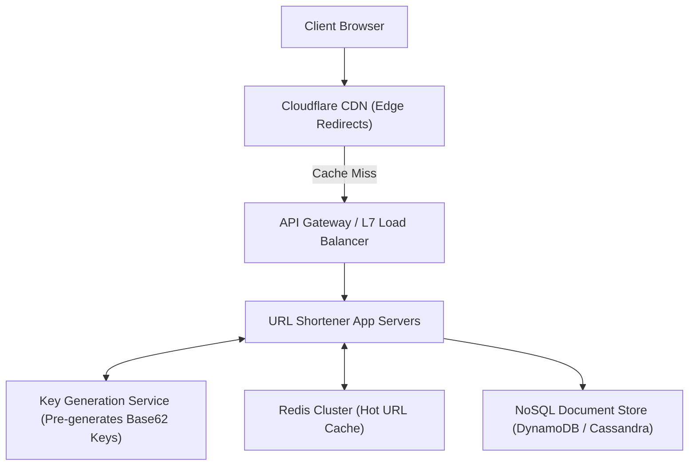

#### Key Generation Service (KGS) Architecture
Instead of computing MD5/SHA256 hashes during request processing and handling collisions, a dedicated **Key Generation Service (KGS)** pre-generates unique 7-character Base62 keys in memory (`[a-zA-Z0-9]` yields $62^7 \approx 3.52 \text{ Trillion}$ unique short URLs):
- KGS maintains two tables in DB: `used_keys` and `unused_keys`.
- KGS loads 10,000 keys into local server memory. When a URL creation request arrives, it grabs a key instantly in $O(1)$ time with zero hash collisions!

---

### 6.2 Blueprint 2: Designing a Real-Time Chat & Notification System (WhatsApp / Slack)
- **Scale**: 50 Million Concurrent Connected Users, billions of messages per day.

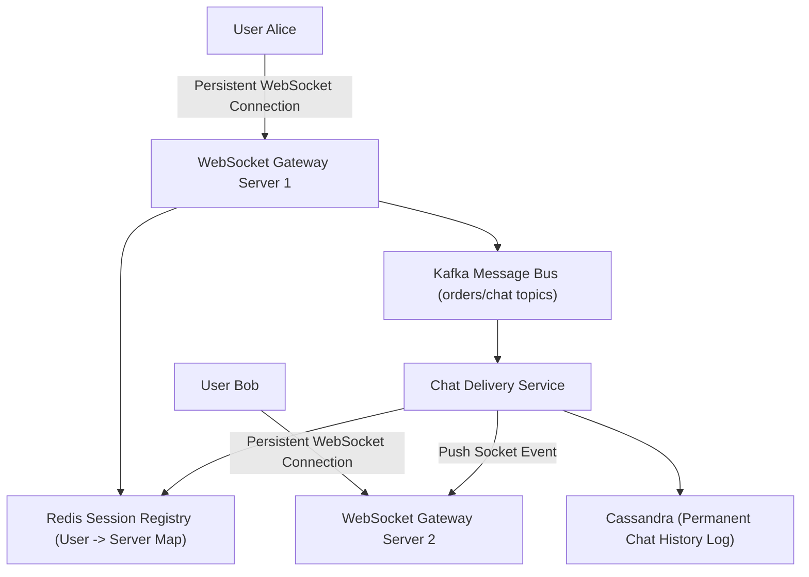

1. **Connection Tier**: State-maintaining WebSocket gateway servers maintain open TCP sockets with mobile/web clients.
2. **Session Locator**: Redis stores `user_id -> websocket_server_id` mapping.
3. **Storage Tier**: Chat messages are immutable append-only records with chronological timestamps; **Apache Cassandra** or **ScyllaDB** provides optimal high-write throughput partitioned by `conversation_id` with `message_id` as clustering key.

---

### 6.3 Blueprint 3: Designing YouTube / Netflix Video Streaming Pipeline

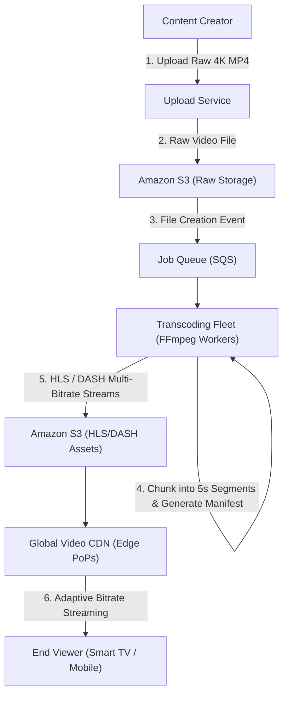

- **Chunking**: Videos are split into 5-second chunk files (`.ts` or `.m4s`).
- **Adaptive Bitrate Streaming (ABR)**: Video is encoded into multiple bitrates (1080p at 5Mbps, 720p at 2.5Mbps, 480p at 1Mbps). The video player continuously measures client network bandwidth and switches resolution dynamically mid-stream without buffering.

---

### 6.4 Blueprint 4: Designing Uber / Ride-Sharing Geospatial Dispatch
- **Challenge**: Matching riders with nearby drivers in $<2\text{ seconds}$ across millions of moving vehicles sending GPS updates every 4 seconds.

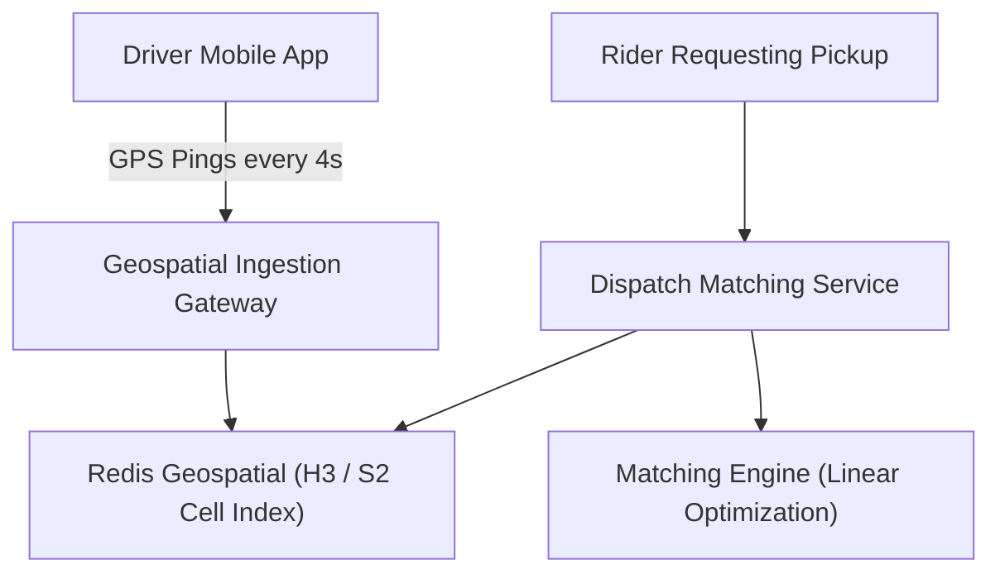

- **Geospatial Indexing**: Earth's sphere is partitioned into discrete hierarchical spatial index cells using **Uber H3 (Hexagonal)** or **Google S2 (Hilbert Curve)**:
  - Lat/Long coordinates are converted into a 64-bit integer Cell ID.
  - Finding nearby drivers reduces to a simple query for drivers whose current Cell ID matches the rider's cell or immediate neighbor cells!


---


---

### 6.5 Deep Dive Data Models & API Specifications for Core Blueprints

#### 1. TinyURL Core Database Schema
```sql
CREATE TABLE url_mappings (
    short_key VARCHAR(7) PRIMARY KEY, -- Base62 key (e.g. 'aZ89xK')
    original_url TEXT NOT NULL,
    user_id UUID,
    created_at TIMESTAMPTZ NOT NULL DEFAULT clock_timestamp(),
    expires_at TIMESTAMPTZ,
    click_count BIGINT NOT NULL DEFAULT 0
);

-- B-Tree Index for expiration cleanup jobs
CREATE INDEX idx_url_mappings_expires ON url_mappings (expires_at) WHERE expires_at IS NOT NULL;
```

#### 2. WhatsApp Chat Message Data Model (Cassandra CQL)
```sql
CREATE TABLE messages_by_conversation (
    conversation_id UUID,
    message_id TIMEUUID, -- Combines timestamp and node uniqueness
    sender_id UUID,
    content TEXT,
    media_url TEXT,
    status TEXT, -- 'SENT', 'DELIVERED', 'READ'
    PRIMARY KEY ((conversation_id), message_id)
) WITH CLUSTERING ORDER BY (message_id ASC);
```
- **Partition Key `(conversation_id)`**: Guarantees all messages for a chat reside on the exact same storage node.
- **Clustering Key `message_id (TIMEUUID)`**: Sorts messages in chronological order on disk, allowing blazing fast pagination (`LIMIT 50`).


---

### 6.6 Geospatial Cell Partitioning: S2 vs H3 Mathematics

```typescript
export class GeospatialGridService {
  // Spatial resolution levels:
  // Uber H3 Level 7: ~1.2 km edge length (Ideal for city neighborhood dispatch)
  // Uber H3 Level 9: ~100 meter edge length (Ideal for precise street-corner pickups)

  static computeNeighborCells(centerCellId: string): string[] {
    // In production, queries the H3 / S2 C-bindings
    // Returns the center hexagon plus 6 immediate ring neighbors (k-ring = 1)
    return [
      centerCellId,
      `${centerCellId}_N`,
      `${centerCellId}_NE`,
      `${centerCellId}_SE`,
      `${centerCellId}_S`,
      `${centerCellId}_SW`,
      `${centerCellId}_NW`,
    ];
  }
}
```

| Indexing System | Geometric Shape | Distortion at Poles | Spatial Aggregation Hierarchy |
| :--- | :--- | :--- | :--- |
| **Uber H3** | **Hexagonal (6 neighbors)** | Minimal (using icosahedron projection) | 16 discrete resolution levels; 1:7 area subdivision. |
| **Google S2** | **Square (Hilbert Curve QuadTree)** | Low (projects Earth onto cube faces) | 31 resolution levels; 1:4 area subdivision. |
| **Geohash** | **Rectangular (Base32)** | Severe distortion at high latitudes | String prefix matching (`9q8yy`). |


## 7. Stage 7: Staff Systems Architect Interview Playbook

### 7.1 The 4-Step System Design Interview Framework
When answering a 45-minute system design interview at Meta, Google, Amazon, or Uber:

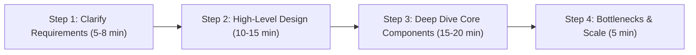

1. **Step 1: Clarify Scope & Functional / Non-Functional Requirements**:
   - What are the core use cases? What is out of scope?
   - Calculate scale: DAU, Read vs Write ratio, latency SLOs, storage estimates.
2. **Step 2: High-Level Architecture**:
   - Sketch end-to-end data flow: Client -> CDN -> Load Balancer -> API Gateway -> Services -> Database.
   - Define database schema entities and core API contracts (`POST /v1/orders`).
3. **Step 3: Deep Dive into Critical Engineering Challenges**:
   - Focus on the unique bottleneck: Concurrency, sharding key selection, cache stampede defense, or consensus.
4. **Step 4: Identify Bottlenecks & Failure Modes**:
   - Single Points of Failure (SPOFs), replication lag, network partitioning, data corruption recovery.

---

### 7.2 Failure Mode and Effects Analysis (FMEA) in Architecture
Staff architects don't just build systems for the happy path; they design systems that survive cascading hardware failures:
- **Bulkheads**: Isolate resources (e.g. separate connection pools for payment vs search) so failure in one pool does not starve the other.
- **Circuit Breakers**: Stop calling a failing dependency to give it time to recover.
- **Graceful Degradation**: Drop non-critical features under extreme load (e.g. disable recommendation widgets to preserve checkout checkout).

---

### 7.3 25 Staff/Principal System Design Interview Q&As

#### Q1: How do you choose between an SQL and a NoSQL database for a new hyperscale product?
**Answer:** Choose SQL when the domain requires ACID transactions across multiple entities (e.g. financial ledgers, billing), complex joins across normalized schemas, or structured relational models where data consistency cannot be compromised. Choose NoSQL (Document/Key-Value) when data models are unstructured/polymorphic, horizontal scalability must easily exceed tens of thousands of write QPS, or data is naturally partitioned by a single primary partition key without requiring relational cross-table joins.

#### Q2: How does Consistent Hashing minimize data migration when scaling storage nodes?
**Answer:** In standard modulo hashing ($K \pmod N$), changing $N$ causes almost all keys to be reassigned. Consistent hashing maps both keys and servers to a circular $360^\circ$ ring ($0$ to $2^{32}-1$). When a server node is added or removed, only keys residing between that server and its immediate counter-clockwise neighbor must be remapped ($1/N$ of the total dataset on average). All remaining $N-1$ segments of the ring remain 100% untouched.

#### Q3: What is the difference between Synchronous and Asynchronous Replication, and what are their trade-offs?
**Answer:** 
- **Synchronous Replication**: The primary node waits for at least one replica to write changes to disk/memory before confirming success to the client. Guarantees zero data loss (RPO = 0) upon primary failure, but increases write latency and stalls writes if the replica network disconnects.
- **Asynchronous Replication**: The primary writes locally, responds to the client immediately, and streams changes to replicas in the background. Provides sub-millisecond write latency, but risks data loss if the primary crashes before replication completes (Replication Lag).

#### Q4: Explain the difference between Strong Consistency, Eventual Consistency, and Causal Consistency.
**Answer:** 
- **Strong Consistency (Linearizability)**: Every read is guaranteed to return the latest committed write.
- **Eventual Consistency**: If no new writes occur, all replicas eventually converge to the same state. Reads may temporarily return stale data.
- **Causal Consistency**: Guarantees that operations that are causally related (e.g. a question and its reply) are observed in the same order by all nodes, while concurrent operations without causal relationships may be observed in different orders.

#### Q5: How do you design an Idempotent API for payment processing?
**Answer:** Clients generate a unique UUID **Idempotency Key** for every transaction and submit it in an HTTP header (`Idempotency-Key: 7b9a-42cd...`). The server wraps processing in an atomic database lock:
1. Check if the idempotency key exists in a dedicated `idempotency_keys` table.
2. If found with status `COMPLETED`, immediately return the cached previous response without recharging the card.
3. If not found, insert key with status `PROCESSING`, process payment through payment gateway, update record to `COMPLETED`, and return response.

#### Q6: What is the Thundering Herd / Cache Stampede problem, and how do you resolve it?
**Answer:** Occurs when a high-traffic cache key expires simultaneously, causing thousands of concurrent client requests to experience a cache miss and bombard the database at the same instant. Mitigated via:
1. Distributed Mutex (Single-flight pattern): Only one worker thread acquires the lock to query the DB and update the cache; all other threads wait.
2. Probabilistic early recomputation (XFetch): An asynchronous background task recomputes and refreshes the cache shortly before its true expiration.

#### Q7: How does the Saga Pattern handle failures without distributed 2PC locks?
**Answer:** A Saga organizes a distributed transaction into a sequence of local transactions. Each transaction updates local database state and publishes an event or message. If a step fails (e.g. card declined), the Saga orchestrator or choreographing services publish compensation events that execute **Compensating Transactions** (e.g. cancel order, restock inventory) in reverse chronological order to return the system to a clean, consistent state.

#### Q8: What are the trade-offs between Choreography and Orchestration in Saga architectures?
**Answer:** 
- **Choreography**: Decentralized; services listen to domain events and decide when to act next. Simple for small workflows (2–3 steps); becomes difficult to trace, debug, and reason about when services exceed 10+.
- **Orchestration**: Centralized coordinator service (e.g. Temporal, AWS Step Functions) explicitly tells participants which local transaction to execute and handles compensating rollbacks. Highly visible, easier to test, but introduces an orchestrator dependency.

#### Q9: How do you mitigate Hotspot Partitions in distributed key-value stores like Cassandra or DynamoDB?
**Answer:** Hotspots occur when an extreme celebrity user (e.g. millions of followers) concentrates massive read/write traffic onto a single partition key. Mitigations:
1. **Salted Keys**: Append a random suffix to the partition key (e.g. `user_1001#1`, `user_1001#2`, ..., `user_1001#10`) to scatter writes across 10 independent shards; scatter-gather reads when retrieving data.
2. **Dedicated In-Memory Caches**: Serve celebrity profiles entirely out of local memory or Redis clusters.

#### Q10: How does a Bloom Filter work, and what are its mathematical guarantees?
**Answer:** A Bloom Filter is a space-efficient probabilistic data structure consisting of a bit array of size $m$ and $k$ independent cryptographic hash functions. When adding an element, it hashes the element $k$ times and sets the corresponding bits to 1. When querying membership:
- If ANY bit is 0, the element is **definitely NOT present** (Zero False Negatives).
- If ALL bits are 1, the element is **probably present** (Potential False Positives governed by array size and element count).

#### Q11: Explain how the Raft consensus algorithm guarantees safety during leader elections.
**Answer:** Raft enforces the **Leader Completeness Property**: if a log entry is committed in a given term, that entry will be present in the logs of the leaders for all higher-numbered terms. A candidate cannot win an election unless its log is at least as up-to-date as a majority of voting followers. Followers reject votes from candidates whose log term is older or whose log length is shorter.

#### Q12: What is the difference between Push and Pull architectures for real-time notifications?
**Answer:** 
- **Pull (Polling)**: Client repeatedly queries the server at fixed intervals. Wastes significant network bandwidth and server CPU on empty responses; introduces latency equal to the polling interval.
- **Push (WebSocket / SSE / WebPush)**: Client establishes a persistent bi-directional (WebSocket) or uni-directional (Server-Sent Events) TCP connection. The server pushes messages to the client the instant an event occurs with sub-millisecond latency.

#### Q13: How do you achieve Exactly-Once message delivery semantics in streaming pipelines?
**Answer:** Truly exactly-once processing across network boundaries is impossible due to the Two Generals' Problem. In practice, systems achieve "effective exactly-once" by combining:
1. **At-Least-Once Delivery**: Message broker retries until acknowledgment is received.
2. **Idempotent Processing**: Consumer deduplicates messages using a unique `message_id` stored in a transactional database or Redis set before applying state mutations.

#### Q14: What is the purpose of Circuit Breakers in microservices, and what are their 3 states?
**Answer:** Circuit breakers prevent cascading failures when a downstream dependency is failing or slow.
1. **Closed**: Normal operation; requests pass through. Failures are counted.
2. **Open**: Error threshold exceeded (e.g. $>50\%$ failures); requests fail immediately with fallback responses without calling the failing downstream service.
3. **Half-Open**: After a timeout window, the circuit allows a small percentage of trial requests through. If they succeed, it closes; if they fail, it re-opens.

#### Q15: How does Database Indexing speed up reads while slowing down writes?
**Answer:** Indexes (such as B-Trees) maintain auxiliary sorted data structures on disk. For reads, they convert full sequential table scans ($O(N)$) into logarithmic binary tree searches ($O(\log N)$). For writes (`INSERT`, `UPDATE`, `DELETE`), every single index defined on that table must also be synchronously updated and re-balanced on disk, consuming additional disk I/O and creating index page splits.

#### Q16: How do you handle Data Archival and Partition Pruning in high-volume time-series systems?
**Answer:** Time-series tables are partitioned declaratively by temporal intervals (daily or monthly). When data reaches its retention threshold (e.g. older than 90 days), rather than executing slow, disk-saturating `DELETE WHERE date < ...` queries that cause table bloat, the administrator simply drops the entire partition table (`DROP TABLE orders_2024_01`) in an instantaneous $O(1)$ metadata operation.

#### Q17: What is the Split-Brain problem in distributed clusters, and how is it prevented?
**Answer:** Split-Brain occurs when a network partition cuts a cluster in half, and both sides believe the other side is dead, electing two competing leader nodes. Both leaders accept conflicting writes, leading to irrecoverable data corruption. It is prevented by requiring a **Quorum**: leaders can only be elected and accept writes if they receive acknowledgments from a strict mathematical majority ($> N/2$) of the total original cluster nodes.

#### Q18: What is Change Data Capture (CDC), and how does it power the Transactional Outbox pattern?
**Answer:** Change Data Capture inspects the internal transaction log (WAL in PostgreSQL, Binlog in MySQL) of a database and emits row-level change events into a message streaming platform (Kafka) in real time. Unlike application polling, CDC is non-intrusive, has near-zero performance overhead, and guarantees that every committed database state change is captured without missing events.

#### Q19: What is the difference between Load Balancing and Reverse Proxying?
**Answer:** A **Reverse Proxy** sits in front of web servers to inspect requests, terminate TLS, compress assets (Gzip/Brotli), cache static content, and protect origin IP addresses. A **Load Balancer** distributes incoming traffic across multiple backend server instances to balance CPU and memory resource consumption. Modern tools like Nginx and HAProxy function as both simultaneously.

#### Q20: How does Long Polling differ from WebSockets?
**Answer:** 
- **Long Polling**: Client sends standard HTTP request. Server holds request open until new data is available or timeout occurs, then closes connection. Client must re-open a new HTTP request for the next update (heavy HTTP header overhead).
- **WebSocket**: Client performs initial HTTP handshake and upgrades connection to a persistent, full-duplex TCP socket protocol (`ws://`), allowing both client and server to stream messages with tiny 2-to-10 byte framing overhead.

#### Q21: What is the difference between Horizontal Partitioning (Sharding) and Vertical Partitioning?
**Answer:** 
- **Horizontal Partitioning (Sharding)**: Splits rows across different database instances (e.g. Users 1–1M on DB 1, Users 1M–2M on DB 2) using identical table schemas.
- **Vertical Partitioning**: Splits columns into different tables or databases based on access patterns (e.g. moving frequently read profile fields into one table, and rarely read bio/audit text into a separate table or storage tier).

#### Q22: What is the C10K (and C1000K) problem, and how did modern event loops solve it?
**Answer:** The C10K problem refers to the inability of traditional web servers (like Apache) to handle 10,000 concurrent client connections because they assigned a dedicated operating system thread per connection, exhausting memory and crashing due to thread context-switching. Modern event-driven servers (Nginx, Node.js) solved this using non-blocking I/O multiplexing (`epoll` on Linux), where a single thread handles thousands of sockets simultaneously.

#### Q23: How do you design a Global Rate Limiter across multiple data centers?
**Answer:** Storing rate limit counters in a single centralized Redis instance across the globe introduces 150ms cross-region latency. Solutions:
1. **Local Rate Limiting with Periodic Sync**: Rate limit locally within each region using local Redis, and periodically sync token allocations asynchronously using batch counters.
2. **Client-Side Sticky Routing**: Route users from the same geographical region to the same data center via DNS Anycast or GeoDNS.

#### Q24: What is the difference between Pessimistic Locking and Optimistic Locking?
**Answer:** 
- **Pessimistic Locking**: Assumes conflicts will happen; acquires exclusive database row locks (`SELECT FOR UPDATE`) before reading data, blocking concurrent transactions until commit.
- **Optimistic Locking**: Assumes conflicts are rare; reads data without locking, but checks a version number or timestamp upon writing (`UPDATE ... WHERE id = 1 AND version = 3`). If version was incremented by another transaction, update fails and application retries.

#### Q25: How do you migrate a monolithic database to microservice databases with zero downtime?
**Answer:** The **Strangler Fig Pattern**:
1. Create new microservice with its own dedicated database.
2. **Dual Writes**: Write new records to both the monolith and microservice database simultaneously.
3. **Backfill**: Run background batch ETL migration to copy historical records from monolith to new database.
4. **Validation**: Compare records across both databases to verify 100% parity.
5. **Switch Reads**: Point read traffic to the new microservice database.
6. Deprecate and remove writes to the old monolithic table.

---

### 7.4 The Ultimate System Design Architect Cheat Sheet

#### Latency Numbers Every Systems Architect Must Know (Jeff Dean's Rules)
```text
L1 cache reference ......................... 0.5 ns
Branch mispredict .......................... 5   ns
L2 cache reference ......................... 7   ns
Mutex lock/unlock .......................... 25  ns
Main memory reference (RAM) ................ 100 ns
Compress 1KB with Zstandard ................ 2,000 ns (2 µs)
Send 2KB over 1 Gbps network ............... 20,000 ns (20 µs)
Read 1MB sequentially from SSD ............. 250,000 ns (250 µs)
Round trip within same datacenter .......... 500,000 ns (500 µs = 0.5 ms)
Read 1MB sequentially from Disk ............ 20,000,000 ns (20 ms)
Send packet California to Netherlands ...... 150,000,000 ns (150 ms)
```

#### Capacity Planning Multiplication Table
```text
1 KB = 10^3 Bytes (Kilobyte)
1 MB = 10^6 Bytes (Megabyte)
1 GB = 10^9 Bytes (Gigabyte)
1 TB = 10^12 Bytes (Terabyte)
1 PB = 10^15 Bytes (Petabyte)
1 EB = 10^18 Bytes (Exabyte)
```

---


---

### 7.5 Distributed Unique ID Generation: Twitter Snowflake Architecture
When scaling distributed databases, auto-incrementing integers (`AUTO_INCREMENT`) cannot scale across multi-master nodes without coordination locks, while 128-bit UUIDs (`UUID v4`) ruin B-Tree index performance due to random disk page insertions.
The **Twitter Snowflake** algorithm generates 64-bit time-sortable unique IDs without cross-server coordination:

```text
 1 bit   41 bits: Epoch Timestamp (Milliseconds)   10 bits: Machine ID   12 bits: Sequence
┌──────┬──────────────────────────────────────────┬───────────────────┬───────────────────┐
│  0   │ 0110101100101101010011010110101001011010 │    01010 01101    │   000000000001    │
└──────┴──────────────────────────────────────────┴───────────────────┴───────────────────┘
```

| Bit Allocation | Size | Capacity / Lifespan | Engineering Purpose |
| :--- | :--- | :--- | :--- |
| **Sign Bit** | 1 bit | Fixed `0` | Guarantees ID is always a positive 64-bit integer. |
| **Timestamp** | 41 bits | $2^{41} \text{ ms} \approx \mathbf{69 \text{ Years}}$ | Milliseconds since custom project epoch; guarantees natural chronological sorting. |
| **Machine ID** | 10 bits | $2^{10} = \mathbf{1,024 \text{ Nodes}}$ | Unique data center ID (5 bits) + worker node ID (5 bits). |
| **Sequence Number** | 12 bits | $2^{12} = \mathbf{4,096 \text{ IDs/ms}}$ | Monotonic counter incremented per node per millisecond ($4.096 \text{M IDs/sec per node}$). |


```typescript
// Snowflake ID Bit-Shifting Logic in TypeScript
export class SnowflakeIdGenerator {
  private static readonly EPOCH = 1704067200000n; // 2024-01-01T00:00:00Z
  private static readonly MACHINE_ID_BITS = 10n;
  private static readonly SEQUENCE_BITS = 12n;
  private static readonly MAX_SEQUENCE = (1n << SnowflakeIdGenerator.SEQUENCE_BITS) - 1n;

  private sequence = 0n;
  private lastTimestamp = -1n;

  constructor(private machineId: bigint) {}

  nextId(): bigint {
    let timestamp = BigInt(Date.now());
    if (timestamp === this.lastTimestamp) {
      this.sequence = (this.sequence + 1n) & SnowflakeIdGenerator.MAX_SEQUENCE;
      if (this.sequence === 0n) {
        while (timestamp <= this.lastTimestamp) {
          timestamp = BigInt(Date.now());
        }
      }
    } else {
      this.sequence = 0n;
    }
    this.lastTimestamp = timestamp;

    return ((timestamp - SnowflakeIdGenerator.EPOCH) << (SnowflakeIdGenerator.MACHINE_ID_BITS + SnowflakeIdGenerator.SEQUENCE_BITS)) |
           (this.machineId << SnowflakeIdGenerator.SEQUENCE_BITS) |
           this.sequence;
  }
}
```


## 🤝 Community & Contributing
Contributions are welcome! Please review our [CONTRIBUTING.md](CONTRIBUTING.md) and [CODE_OF_CONDUCT.md](CODE_OF_CONDUCT.md) guidelines before opening issues or submitting pull requests.

## 📄 License
This project is open-source software licensed under the [MIT License](LICENSE).
